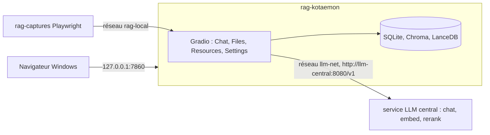

# Kotaemon — banc d'essai et manuels vérifiés

**Poser des questions à ses propres documents et vérifier chaque réponse à sa source (page, vignette, phrase surlignée), sur sa machine et sans service en ligne : Kotaemon 0.12.0 installé, branché sur un service de modèles local, mesuré sur 38 questions et documenté en un manuel utilisateur de 14 chapitres suivis de 6 annexes, avec 92 captures d'écran annotées et 24 captures de repérage.**

**Le manuel utilisateur commence ici : [docs/kotaemon/README.md](docs/kotaemon/README.md).**


Kotaemon 0.12.0 (image officielle « full ») branché sur le service LLM central (LLM-Service : `chat`, `embed`, `rerank`), le corpus d'entreprise fictive de la série avec ses pièges (scan, tableaux, audio, document en anglais), un banc de 38 questions dont les réponses sont connues, et un manuel écrit à partir de ce qui a réellement tourné : chaque action de la partie 1 a été faite à la souris par Playwright et photographiée, chaque chiffre renvoie à un résultat brut dans `outils/resultats/`.

Quatrième banc de la série après Open Notebook, RAGFlow et AnythingLLM : mêmes documents, mêmes questions, même machine. Le comparatif est dans [docs/README.md](docs/README.md).

## Sommaire

- [Le parcours](#le-parcours)
- [Architecture](#architecture)
- [Démarrage](#démarrage)
- [Configuration](#configuration)
- [API / Endpoints](#api--endpoints)
- [Tests](#tests)
- [Structure du projet](#structure-du-projet)
- [Licences & composants](#licences--composants)
- [Commandes utiles](#commandes-utiles)
- [Données du banc](#données-du-banc)
- [Les pièges que ce banc documente](#les-pièges-que-ce-banc-documente)
- [Résultats](#résultats)
- [Versions](#versions)
- [Ressources](#ressources)

## Le parcours

| Manuel | Ce qu'on saura faire |
|---|---|
| [01 Découvrir](docs/kotaemon/manuel/01-decouvrir-kotaemon.md) | dire à quoi sert l'outil et quelle machine prévoir (sans et avec carte graphique) |
| [02 Installer](docs/kotaemon/manuel/02-installer-kotaemon.md) | installer, ouvrir, arrêter, supprimer |
| [03 Premiers pas](docs/kotaemon/manuel/03-premiers-pas.md) | connexion, mot de passe, écran, déclaration des trois modèles, langue |
| [04 Première question](docs/kotaemon/manuel/04-premiere-question.md) | un PDF, une question, une réponse citée |
| [05 Documents](docs/kotaemon/manuel/05-ajouter-et-organiser-ses-documents.md) à [07 Réglages](docs/kotaemon/manuel/07-regler-la-recherche-et-le-raisonnement.md) | documents, groupes, lecteur Docling, conversations, citations, recherche et raisonnement |
| [08 Agents](docs/kotaemon/manuel/08-agents-react-et-rewoo.md) et [09 GraphRAG](docs/kotaemon/manuel/09-graphes-de-connaissances.md) | agents ReAct et ReWOO, graphes LightRAG, NanoGraphRAG, Microsoft GraphRAG |
| [10 Collections et modèles](docs/kotaemon/manuel/10-collections-et-modeles.md) et [11 Comptes](docs/kotaemon/manuel/11-comptes-et-partage.md) | collections partagées, modèles, comptes, partage |
| [12 Cas pratiques](docs/kotaemon/manuel/12-cas-pratiques.md), [13 En cas de problème](docs/kotaemon/manuel/13-en-cas-de-probleme.md), [14 Glossaire](docs/kotaemon/manuel/14-glossaire.md) | trois usages complets, erreurs réelles, vocabulaire |
| [Annexes A1 à A6](docs/kotaemon/README.md#partie-2--évaluation-et-compléments) | banc, matériel, bibliothèque Python, exploitation, fonctionnement interne, preuves |

Parcours conseillés : interroger ses documents seul (01 à 07, 12) ; équipe (01 à 04, 10, 11, A4) ; automatiser (01 à 04, A3) ; choisir (01, A1, A2).

## Architecture

| Service | Conteneur | Image | Rôle |
|---|---|---|---|
| Kotaemon | `rag-kotaemon` | `ghcr.io/cinnamon/kotaemon:main-full` (figée par empreinte, = v0.12.0) | interface Gradio, lecture des fichiers (lecteur intégré, unstructured, Docling), base SQLite, vecteurs Chroma, texte plein LanceDB, graphes LightRAG |
| Modèles | `llm-central`, `llm-swap`, `llm-speaches` | LiteLLM v1.109.0, llama-swap v272 (llama.cpp), speaches 0.8.3 | `chat`, `embed`, `rerank` servis par [LLM-Service](https://github.com/floSa/llm-service) (dépôt séparé, géré à part) |
| Captures | `rag-captures` (éphémère) | `mcr.microsoft.com/playwright/python:v1.65.1-noble` | scénarios Playwright du manuel |



Réseaux : `llm-net` (externe, créé par LLM-Service) et `rag-local` (captures). Un seul port publié, `127.0.0.1:7860`.

## Démarrage

Prérequis : Windows 11 + WSL2, Docker Desktop, LLM-Service installé et démarré, 20 Go de disque libre.

```bash
cp .env.example .env            # puis y mettre LLM_CENTRAL_KEY (clé du service LLM central)
outils/communs/llm_central_sante.sh --essai
outils/kotaemon/installer.sh
```

| Service | URL | Note |
|---|---|---|
| Kotaemon | http://127.0.0.1:7860 | compte `admin` ; mot de passe changé au chapitre 03, identifiants de démonstration dans `donnees/IDENTIFIANTS-LOCAUX.txt` |
| Service LLM central | http://127.0.0.1:8080/v1 | clé dans `.env` |

Ensuite : chapitre 03 (modèles déclarés dans l'interface), options `outils/kotaemon/completer_lightrag.sh` et `outils/kotaemon/installer_nanographrag.sh` (chapitre 09).

## Configuration

- **Variables** (`outils/kotaemon/compose.yml`) : `LOCAL_MODEL`, `LOCAL_MODEL_EMBEDDINGS`, `VOYAGE_API_KEY` vidés (pas d'entrées Ollama ni VoyageAI) ; télémétrie de Gradio, Chroma et unstructured coupée ; `NLTK_DATA` vers les données fournies par `installer.sh`. Options facultatives dans `donnees/kotaemon/options.env` (ex. `USE_NANO_GRAPHRAG=true`).
- **Écarts à la commande officielle** : image figée par empreinte, port sur `127.0.0.1`, données dans `donnees/kotaemon/`, réseaux `llm-net` et `rag-local`, données NLTK fournies (l'adresse intégrée à unstructured répond 403), aucun serveur de modèles (l'image « full » n'embarque pas Ollama).
- **Branchement au service LLM central** : dans « Resources », type `ChatOpenAI` (`chat`), `OpenAIEmbeddings` (`embed`, sans `context_length`) et `CohereReranking` (`rerank`, `base_url: http://llm-central:8080` sans `/v1`), clé `LLM_CENTRAL_KEY` de `.env` (modèle : `.env.example`). Réglages : langue French, « Max context length (LLM) » 8000, `max_tokens` 6144, `timeout` 600, « Use LLM relevant scoring » décoché.

## API / Endpoints

Kotaemon n'a pas d'API REST. Le pilotage se fait par sa bibliothèque Python dans le conteneur : `exemples/kotaemon/lancer.sh <exemple.py>` (lister les collections, poser une question, pipeline personnalisé) ; le banc utilise `outils/kotaemon/pilote_conteneur.py`. Détail : [annexe A3](docs/kotaemon/annexes/A3-automatiser-par-la-bibliotheque.md).

## Tests

```bash
python3 outils/communs/verifier_docs.py           # 0 point(s) sur 24 fichier(s)
outils/kotaemon/serie_banc.sh rerank --sans-index # banc de 38 questions, environ 45 minutes
exemples/kotaemon/lancer.sh exemples/kotaemon/03_poser_une_question.py
```

Sortie de l'exemple 03 : « Réponse : … le prix unitaire des batteries prévu par le contrat avec Batterix est de **212 euros HT** » et « Sources : ['[Page 1] contrat-batterix-scan.pdf', … ] » (`exemples/kotaemon/sorties_verifiees.txt`).

## Structure du projet

```text
docs/kotaemon/        manuel : README (sommaire), manuel/ (partie 1), annexes/ (partie 2), img/ (captures)
docs/README.md        index de la série et comparatif du banc
outils/kotaemon/      installer, démarrer, arrêter, état, sauvegarder, restaurer, banc, pilote, captures/
outils/communs/       outils partagés par la série (banc, captures, vérification, diagnostic)
outils/resultats/     résultats bruts (kotaemon/, bancs précédents, machine/)
exemples/kotaemon/    exemples exécutés et sorties_verifiees.txt
corpus/               documents fictifs et questions de référence
donnees/              données, identifiants locaux, sauvegardes (non versionné)
```

## Licences & composants

| Composant | Licence |
|---|---|
| Kotaemon | Apache 2.0 |
| LightRAG, nano-graphrag, Docling | MIT |
| Gradio, Chroma, LanceDB | Apache 2.0 |
| LiteLLM, llama.cpp, llama-swap | MIT |
| Playwright | Apache 2.0 |

Ce projet : MIT — Copyright (c) 2026 floSa (fichier [LICENSE](LICENSE)).

## Commandes utiles

```bash
outils/kotaemon/etat.sh          # état, ports, mémoire, santé du service central
outils/kotaemon/arreter.sh       # arrêt (données conservées)
outils/kotaemon/demarrer.sh      # démarrage
outils/kotaemon/sauvegarder.sh   # archive dans donnees/sauvegardes/
docker logs --tail 100 rag-kotaemon
outils/communs/nettoyer.sh kotaemon   # suppression complète, sur confirmation
```

## Données du banc

Corpus fictif (entreprise Vélanor) : 9 documents (`corpus/MANIFEST.json`) et 38 questions (`corpus/questions.json`), repris tels quels des bancs précédents.

## Les pièges que ce banc documente

1. Données NLTK d'unstructured sur un stockage fermé : DOCX et PPTX en échec « HTTP Error 403 » sans correction.
2. Notation par le modèle : dix demandes simultanées (429) et note non reconnue (« AssertionError ») ; alerte de pertinence jamais affichée.
3. Langue des réponses : la conversation repart en anglais à chaque visite.
4. Visionneuse PDF vide : composant indisponible sur `cdn.skypack.dev`.
5. Lecteur intégré sans lecture optique : PDF scanné illisible sans Docling.
6. « Delete » d'un fichier sans confirmation ; fichier relu qui disparaît de ses groupes ; fichier en échec inscrit sans passage.
7. Création d'une collection : réglages des comptes non relus, retour silencieux aux valeurs par défaut.
8. LightRAG sans `pipmaster` ; nano-graphrag qui casse Chroma et Gradio ; Microsoft GraphRAG qui ne démarre pas.
9. Spécification d'embedding avec `context_length` : textes envoyés en numéros de jetons, incompatibles avec bge-m3.

## Résultats

| Réglage | Exactes | Refus pièges | p50 |
|---|---|---|---|
| lecteur intégré, 10 passages, sans tri | 25/34 (26 au comptage automatique) | 4/4 | 25,8 s |
| idem avec tri `rerank` | 25/34 (26 au comptage automatique) | 4/4 | 24,0 s |
| scan lu par Docling, tri `rerank` | 30/34 | 4/4 | 23,4 s |
| idem, 3 passages | 31/34 | 4/4 | 22,0 s |

Détail : [annexe A1](docs/kotaemon/annexes/A1-evaluation-qualite-et-performances.md).

## Versions

| Composant | Version |
|---|---|
| Kotaemon | 0.12.0 (31 mai 2026), image `main-full@sha256:cb4b71561e529398bacdf12f1289c32290f6c70f286b8efb7a1ed7e66d089b66` |
| Playwright | 1.65.1 |
| Service central | LiteLLM v1.109.0, llama-swap v272, llama.cpp b12282, speaches 0.8.3 |

Relevé : `outils/resultats/kotaemon/versions-2026-11-12.json`.

## Ressources

- Kotaemon : https://github.com/Cinnamon/kotaemon, documentation https://cinnamon.github.io/kotaemon/
- LLM-Service : https://github.com/floSa/llm-service
- Bancs précédents : https://github.com/floSa/Open-Notebook-Test-Bench, https://github.com/floSa/RAGFlow-Test-Bench, https://github.com/floSa/AnythingLLM-Test-Bench
