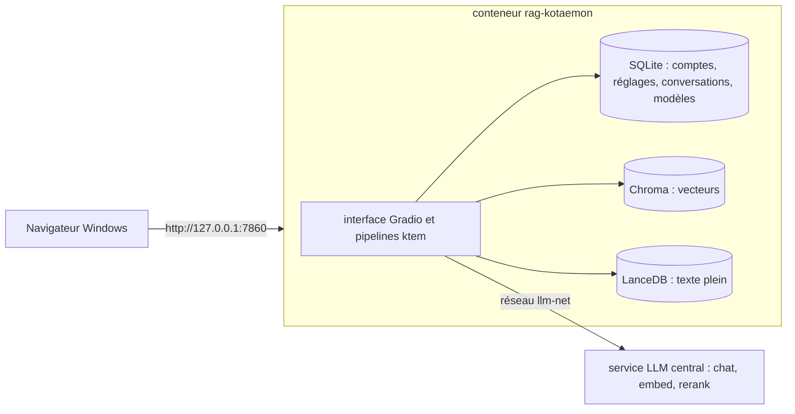

# A5. Fonctionnement interne

> **Objet** : décrire l'architecture de Kotaemon 0.12.0 (image Docker « full ») telle qu'installée ici, ses dossiers, ses ports, et les notions techniques qui expliquent son comportement (lecteurs, découpage, recherche hybride, tri, budget de contexte, réflexion du modèle).
> **Prérequis** : avoir lu le [chapitre 01](../manuel/01-decouvrir-kotaemon.md) et le [glossaire](../../glossaire.md).
> **Version décrite** : Kotaemon 0.12.0 (image `ghcr.io/cinnamon/kotaemon:main-full@sha256:cb4b7156…`, révision `9ad3e4e`), essais du 12 novembre 2026.
> **Statut des informations** : [Vérifié] observé sur la machine d'essai ; [Source] lu dans le code source au tag `v0.12.0` (relevés `outils/resultats/kotaemon/cadrage-serveur.md` et `cadrage-interface.md`, avec fichier et ligne) ; [Estimation] calcul expliqué ; [À tester] ni lu ni essayé.
> **Précautions** : la base de données de Kotaemon contient en clair la clé du service de modèles (spécifications des modèles) et les empreintes des mots de passe ; ne pas partager le dossier de données.

## Sommaire

1. [Vue d'ensemble](#1-vue-densemble)
2. [Un conteneur, un processus Python](#2-un-conteneur-un-processus-python)
3. [Dossier de données](#3-dossier-de-données)
4. [Ports, réseaux et appels sortants](#4-ports-réseaux-et-appels-sortants)
5. [Du document au passage](#5-du-document-au-passage)
6. [De la question à la réponse](#6-de-la-question-à-la-réponse)
7. [Budget de contexte](#7-budget-de-contexte)
8. [Réflexion du modèle `chat`](#8-réflexion-du-modèle-chat)
9. [Réglages : base, `.env` et interface](#9-réglages--base-env-et-interface)
10. [Dépannage](#dépannage)
11. [Sources](#sources)

## 1. Vue d'ensemble

[Vérifié] Un seul conteneur, `rag-kotaemon`, sert l'interface et fait tout le travail : lecture des fichiers, découpage, appels au service de modèles, recherche, rédaction des réponses. Les modèles d'IA sont tous fournis par le service LLM central, joint par le réseau Docker `llm-net` à l'adresse `http://llm-central:8080/v1` (`outils/resultats/kotaemon/captures/03-premiers-pas/notes.log` : test de connexion réussi pour les trois modèles).

## 2. Un conteneur, un processus Python

- [Source] Point d'entrée `launch.sh` : lance `ollama serve` (absent de l'image « full », d'où le message `ollama: not found`), puis `.venv/bin/python app.py` (Gradio 4.39, port 7860) (`launch.sh:20-21`).
- [Vérifié] Python 3.10 dans `/app/.venv` (chemin des bibliothèques relevé dans les journaux) ; le conteneur tourne en `root` (aucune directive `USER` dans le `Dockerfile`).
- [Vérifié] Mémoire : 0,6 à 0,9 Gio au repos après démarrage (`installation-2026-11-12.log`), davantage pendant l'indexation et les questions (annexe A2).
- [Source] L'image « full » ajoute à l'image « lite » : Tesseract (lecture optique, avec le japonais), LibreOffice (conversion des documents Office), ffmpeg, PyTorch pour processeur, `unstructured[all-docs]`, Docling 2.5 au plus, LightRAG 1.3 au plus (`Dockerfile:59-99`). PaddleOCR n'est présent que dans une image « paddle » non publiée.

## 3. Dossier de données

[Vérifié] Tout est rangé dans `donnees/kotaemon/ktem_app_data/` du dépôt, monté sur `/app/ktem_app_data` :

| Chemin | Contenu |
|---|---|
| `user_data/sql.db` | base SQLite : comptes (mots de passe hachés en SHA-256 sans sel [Source] `user.py:106`), réglages de chaque compte, conversations, modèles déclarés et leurs spécifications (clé du service en clair), collections |
| `user_data/files/` | copies des fichiers ajoutés, et dossiers des graphes (`lightrag/`, `nano_graphrag/`, `graphrag/`) |
| `user_data/vectorstore/` | vecteurs des passages (Chroma) |
| `user_data/docstore/` | texte des passages et index plein texte (LanceDB) |
| `markdown_cache_dir/`, `chunks_cache_dir/` | textes convertis et passages, gardés pour l'aperçu |
| `huggingface/` | modèles téléchargés par les lecteurs (Docling) |
| `nltk_data/` | données de découpage en phrases, ajoutées par `installer.sh` (section 5) |
| `gradio_tmp/` | fichiers temporaires de l'interface (copies servies à la visionneuse) |
| `banc/` | corpus et pilote copiés par le banc (`outils/kotaemon/banc.py`) |

## 4. Ports, réseaux et appels sortants

| Élément | Valeur |
|---|---|
| Port publié | `127.0.0.1:7860->7860/tcp` [Vérifié] (`outils/resultats/kotaemon/ports-publies-2026-11-12.txt`) |
| Réseaux | `llm-net` (service de modèles), `rag-local` (captures Playwright) |
| Appels sortants du conteneur | page des nouveautés sur `api.github.com` à chaque démarrage [Source] `help.py:94-114` ; données NLTK sur `utic-public-cf.s3.amazonaws.com` (403) [Vérifié] ; service en ligne `r.jina.ai` pour « Use Web Links » [Source] `web_loader.py:12-23` ; télémétrie de Chroma et d'unstructured coupée par variables (`compose.yml`) |
| Appels sortants du navigateur | scripts sur `cdn.skypack.dev`, `cdnjs`, `jsdelivr`, polices Google [Source] `app.py:186-197` ; la visionneuse PDF dépend de `cdn.skypack.dev/pdfjs-viewer-element`, qui renvoie une erreur de construction [Vérifié] (`incident-2026-11-12-visionneuse-pdf.txt`) |

## 5. Du document au passage

1. [Source] Lecteur selon l'extension (`indices/ingests/files.py:48-64`) : PDF par `PDFThumbnailReader` (texte page par page et vignette de chaque page), XLSX par Pandas, DOCX, PPTX, images par unstructured, HTML et Markdown par des lecteurs simples. Le réglage « File loader » remplace le lecteur des PDF par Docling (ou un service payant).
2. [Vérifié] unstructured a besoin de deux paquets NLTK (`punkt_tab`, `averaged_perceptron_tagger_eng`) ; l'adresse de téléchargement intégrée répond 403, ce qui fait échouer DOCX et PPTX avec « HTTP Error 403: Forbidden » (`installation-2026-11-12-essai-nltk-403.log`). `installer.sh` les récupère depuis le dépôt officiel NLTK et `NLTK_DATA` les désigne.
3. [Vérifié] Un fichier en échec reste inscrit dans la collection, sans passage : il faut le réindexer avec « Force reindex file » (chapitre 05).
4. [Source] Découpage en passages de 1 024 jetons, chevauchement 256 (`pipelines.py:787-791`), réglable par collection (`chunk_size`, `chunk_overlap`).
5. [Vérifié] Chaque passage est représenté par `embed` (1 024 dimensions) dans Chroma, et son texte indexé en plein texte dans LanceDB.

## 6. De la question à la réponse

1. [Source] Recherche « hybrid » par défaut : passages proches par le sens (Chroma) et par les mots (LanceDB), dix fois plus que le nombre demandé, réunis (`vectorindex.py:151-238`).
2. [Source] Tri par le modèle de tri par défaut si « Use reranking » est coché, puis coupe au nombre demandé (10) ; notation par le modèle de réponse si « Use LLM relevant scoring » est coché, une demande par passage, en parallèle (`llm_trulens.py:100-150`).
3. [Source] Les passages, coupés à « Max context length (LLM) » (compté avec le découpage d'OpenAI), sont donnés au modèle `chat` avec la consigne « QA Prompt » et la langue choisie (`simple.py:348-393`).
4. [Source] Citations « highlight » : un second appel au modèle, en parallèle, extrait les phrases qui justifient la réponse ; s'il n'a pas fini 5 secondes après la réponse, il est abandonné (`citation_qa.py:35,218-280`).
5. [Vérifié] La réponse arrive mot à mot ; le panneau « Information panel » montre les passages, leur page et leurs notes.

## 7. Budget de contexte

[Estimation] Le modèle `chat` accepte 16 384 jetons par requête. Réglages retenus (chapitre 03) : passages limités à 8 000 jetons (« Max context length (LLM) », comptés avec le découpage d'OpenAI, qui donne des nombres proches de ceux de Qwen pour le français, à 20 % près), consignes et question environ 500 jetons, réponse plafonnée à 6 144 jetons (réflexion comprise). Total au plus 14 644 jetons environ, sous la limite. La valeur par défaut, 32 000, peut dépasser la limite si la collection contient de longs documents et que dix passages longs sont retenus. L'essai de dépassement est décrit dans l'annexe A1.

## 8. Réflexion du modèle `chat`

- [Source] Kotaemon n'envoie pas `chat_template_kwargs` : la réflexion de `chat` reste active, sans moyen de la couper depuis l'interface (`openai.py:307-329`).
- [Source] La réflexion revient à part (`reasoning_content`) et n'est pas affichée ; seul le texte de la réponse l'est (`openai.py:163-268`).
- [Vérifié] Les réponses arrivent en 16 à 45 secondes environ sur carte graphique, réflexion comprise (annexe A1). Le plafond `max_tokens: 6144` et le délai `timeout: 600` évitent les réponses coupées.

## 9. Réglages : base, `.env` et interface

- [Source] Le fichier `.env` intégré à l'image (copie de `.env.example`) est lu à chaque démarrage, mais les modèles ne sont ajoutés à la base que s'ils sont absents (LLM) ou si la table est vide (embeddings, tri) (`llms/manager.py:22-34`, `embeddings/manager.py:22-32`, `rerankings/manager.py:23-31`). Ensuite, tout se change dans l'onglet « Resources ».
- [Vérifié] Les réglages de « Settings » sont enregistrés par compte. Les réglages de « Chat settings » (langue, méthode, modèle, citation, carte mentale) valent pour la session du navigateur et l'emportent (`pages/chat/__init__.py:1218-1245`).
- [Source] Variables utiles, passées par `donnees/kotaemon/options.env` : `USE_NANO_GRAPHRAG`, `USE_LIGHTRAG`, `USE_MS_GRAPHRAG`, `KH_FEATURE_CHAT_SUGGESTION`, `KH_FEATURE_USER_MANAGEMENT`, `CONTEXT_RELEVANT_WARNING_SCORE` (seuil de l'alerte, 0,3) (`flowsettings.py`).

## Dépannage

| Symptôme | Cause probable | Action |
|---|---|---|
| DOCX ou PPTX : « HTTP Error 403: Forbidden » | données NLTK absentes, adresse intégrée fermée | relancer `outils/kotaemon/installer.sh`, puis « Force reindex file » |
| réponse bloquée sur « Thinking ... » | notation par le modèle : plus de quatre demandes simultanées, refusées (429) | décocher « Use LLM relevant scoring » ou ramener le nombre de passages à 4 |
| visionneuse PDF vide | composant `pdfjs-viewer-element` indisponible sur le site public | utiliser la vignette et le texte surligné du panneau d'information |
| changement du `.env` sans effet | modèles déjà présents dans la base | modifier dans « Resources » |

## Sources

- Code source de Kotaemon au tag `v0.12.0` : https://github.com/Cinnamon/kotaemon/tree/v0.12.0
- Relevés de lecture : `outils/resultats/kotaemon/cadrage-serveur.md`, `outils/resultats/kotaemon/cadrage-interface.md`, `outils/resultats/kotaemon/relecture.md`
- Journaux d'essai : `outils/resultats/kotaemon/installation-2026-11-12.log`, `outils/resultats/kotaemon/incident-2026-11-12-429-score-llm.log`, `outils/resultats/kotaemon/incident-2026-11-12-visionneuse-pdf.txt`
