# Carte de l'interface

> **Objet** : liste de contrôle de la couverture de l'interface de Kotaemon 0.12.0 : chaque onglet, sous-onglet, bouton et réglage visible, et le chapitre du manuel qui le couvre.
> **Prérequis** : session administrateur ; interface en anglais (seule langue disponible) ; navigateur en français (textes des zones de dépôt traduits par Gradio).
> **Version décrite** : Kotaemon 0.12.0 (image `main-full`, révision `9ad3e4e`), relevé du 13 novembre 2026.
> **Statut des informations** : [Vérifié] parcouru avec Playwright, capture de repérage dans `../img/carte/` et texte de la page dans `outils/resultats/kotaemon/captures/carte/` ; [Source] lu dans le code (`outils/resultats/kotaemon/cadrage-interface.md`) ; [Estimation] sans objet ; [À tester] non parcouru.
> **Précautions** : les onglets « Resources » et les sous-onglets « Users » n'apparaissent que pour un compte administrateur.

## Sommaire

1. [Connexion](#1-connexion)
2. [Chat](#2-chat)
3. [Files](#3-files)
4. [Resources](#4-resources)
5. [Settings](#5-settings)
6. [Help](#6-help)
7. [Ce qui n'est pas couvert](#7-ce-qui-nest-pas-couvert)

## 1. Connexion

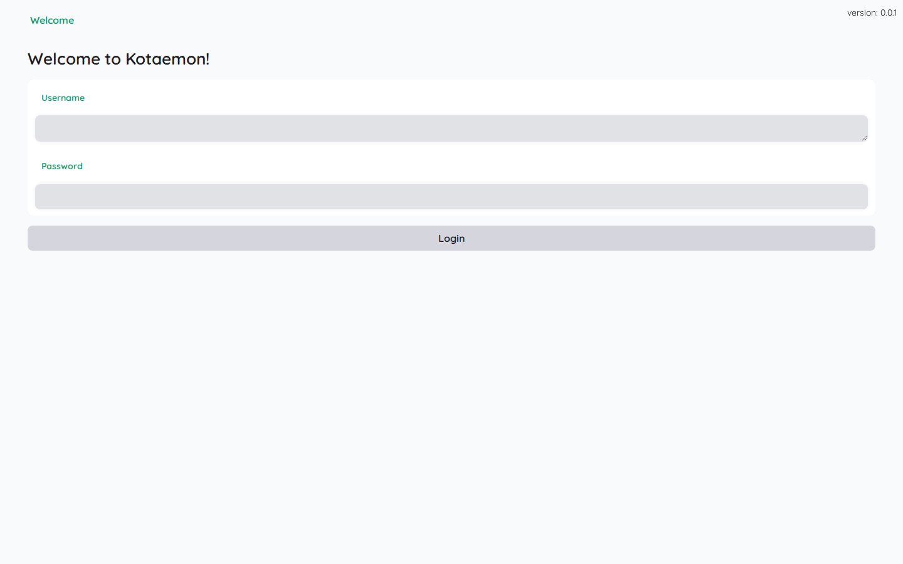

| Page ou menu | Chemin d'accès | Éléments | Manuel qui le couvre |
|---|---|---|---|
| Welcome | `http://127.0.0.1:7860`, avant connexion | « Username », « Password », « Login », numéro de version | [03](../manuel/03-premiers-pas.md) ; erreur : [13](../manuel/13-en-cas-de-probleme.md) |

## 2. Chat

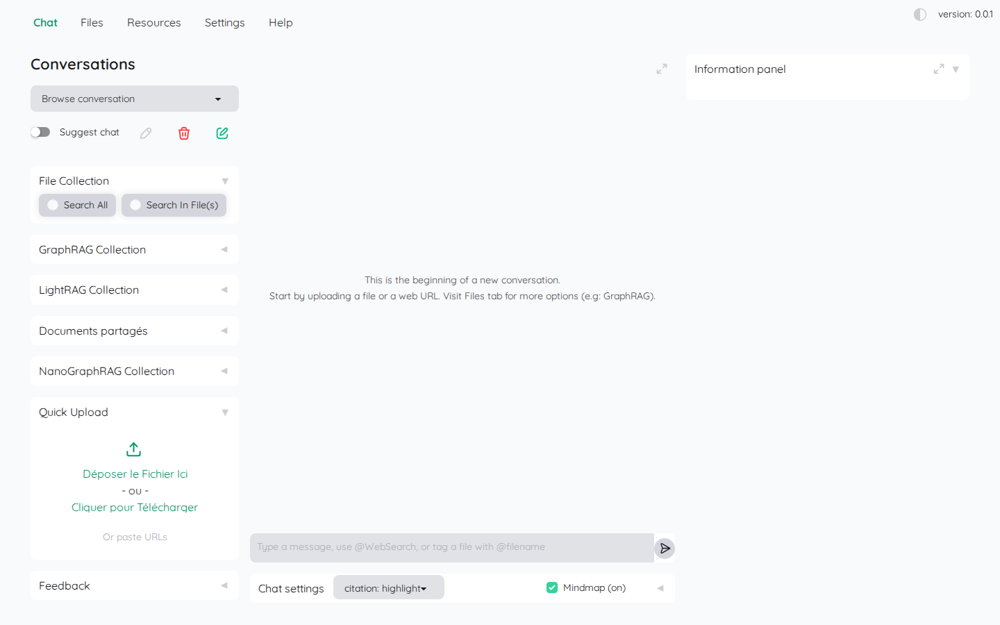

| Page ou menu | Chemin d'accès | Éléments | Manuel qui le couvre |
|---|---|---|---|
| Conversations | Chat › colonne de gauche | liste des conversations (« Browse conversation »), renommer, supprimer (« Delete », « Cancel »), nouvelle conversation | [06](../manuel/06-poser-des-questions-et-lire-les-sources.md) |
| Suggest chat | Chat › sous la liste | interrupteur des suggestions | [06](../manuel/06-poser-des-questions-et-lire-les-sources.md) |
| Sections des collections | Chat › « File Collection », « GraphRAG Collection », « LightRAG Collection », « Documents partagés », « NanoGraphRAG Collection » | « Search All », « Search In File(s) », liste des fichiers et groupes | [04](../manuel/04-premiere-question.md), [06](../manuel/06-poser-des-questions-et-lire-les-sources.md), [09](../manuel/09-graphes-de-connaissances.md), [11](../manuel/11-comptes-et-partage.md) |
| Quick Upload | Chat › « Quick Upload » | zone de dépôt, « Or paste URLs » | [05](../manuel/05-ajouter-et-organiser-ses-documents.md) |
| Feedback | Chat › « Feedback » | « Correctness: », « Other issue: », « More detail », « Report », « Share this conversation » | [06](../manuel/06-poser-des-questions-et-lire-les-sources.md), [11](../manuel/11-comptes-et-partage.md) |
| Zone de discussion | Chat › centre | réponses, copier, pouce haut, pouce bas, agrandir | [04](../manuel/04-premiere-question.md), [06](../manuel/06-poser-des-questions-et-lire-les-sources.md) |
| Zone de saisie | Chat › bas | question, `@fichier`, `@WebSearch`, envoi | [04](../manuel/04-premiere-question.md), [06](../manuel/06-poser-des-questions-et-lire-les-sources.md) |
| Chat settings | Chat › sous la saisie | style de citation, « Mindmap », « Reasoning method », « Model », « Language » | [04](../manuel/04-premiere-question.md), [06](../manuel/06-poser-des-questions-et-lire-les-sources.md), [07](../manuel/07-regler-la-recherche-et-le-raisonnement.md), [08](../manuel/08-agents-react-et-rewoo.md) |
| Information panel | Chat › droite | passages, « [Preview] », « Relevance score » et détail, carte mentale (« [Expand] », « [Export] »), visionneuse PDF, agrandir | [04](../manuel/04-premiere-question.md), [06](../manuel/06-poser-des-questions-et-lire-les-sources.md) |
| Mode sombre | barre des onglets, à droite | bascule clair, sombre | [06](../manuel/06-poser-des-questions-et-lire-les-sources.md) |

## 3. Files

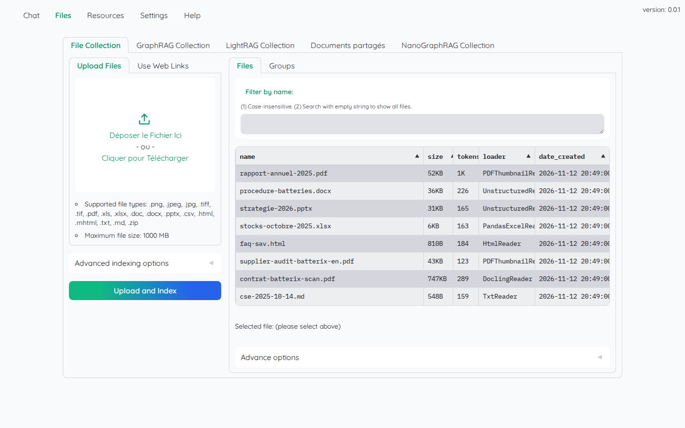

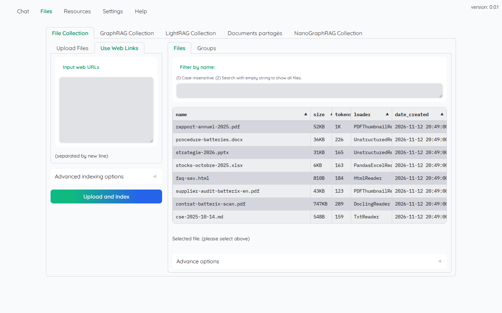

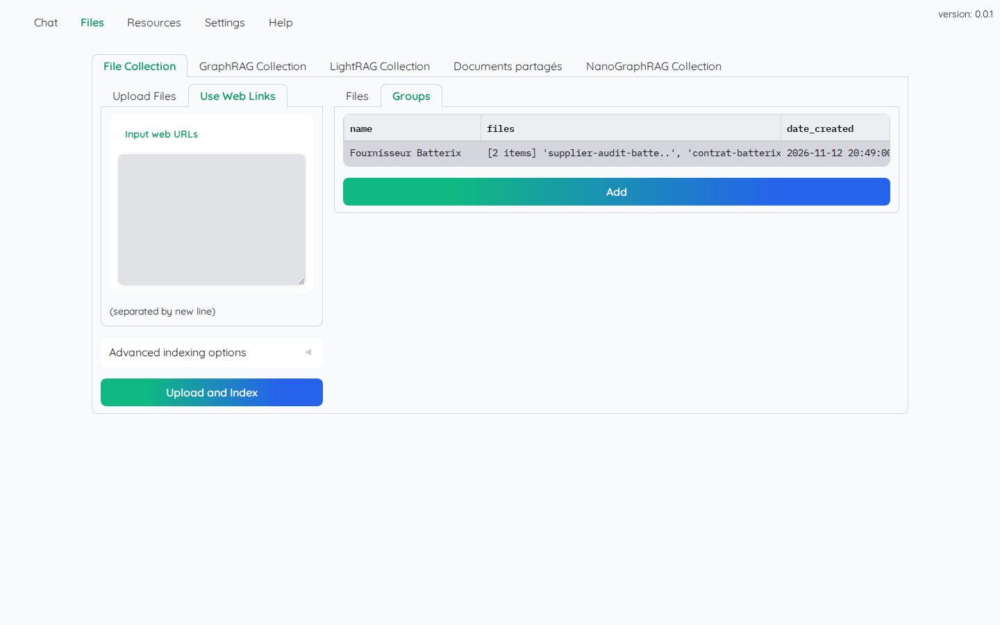

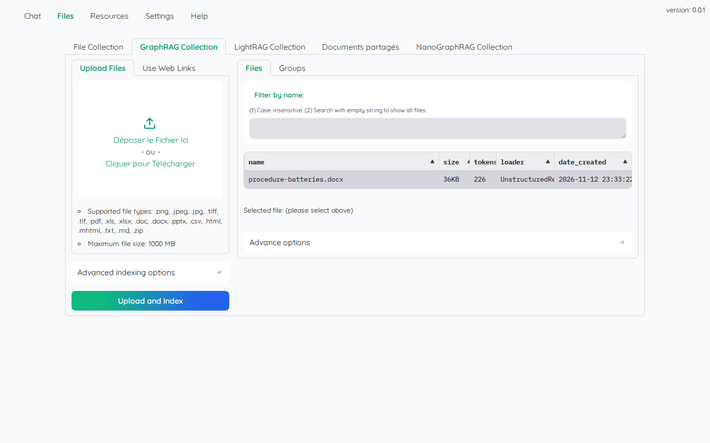

| Page ou menu | Chemin d'accès | Éléments | Manuel qui le couvre |
|---|---|---|---|
| Upload Files | Files › collection › « Upload Files » | zone de dépôt, formats acceptés, « Advanced indexing options » (« Force reindex file »), « Upload and Index », « Upload Progress » (« Upload result », « Upload info », « Clear Upload Info and Close ») | [04](../manuel/04-premiere-question.md), [05](../manuel/05-ajouter-et-organiser-ses-documents.md) |
| Use Web Links | Files › collection › « Use Web Links » | « Input web URLs », « Upload and Index » | [05](../manuel/05-ajouter-et-organiser-ses-documents.md) (écran seulement) |
| Files | Files › collection › « Files » | « Filter by name: », liste (name, size, tokens, loader, date_created), fiche : « Go to Chat », « Download », « Delete », « Close », type de passages, aperçu des passages ; « Advance options » : « Download all files », « Delete all files », « Confirm delete », « Cancel » | [04](../manuel/04-premiere-question.md), [05](../manuel/05-ajouter-et-organiser-ses-documents.md) |
| Groups | Files › collection › « Groups » | liste, « Add », « Group name », « Attached files », « Save », fiche (« Go to Chat », « Delete », « Close ») | [05](../manuel/05-ajouter-et-organiser-ses-documents.md) |
| GraphRAG Collection | Files › « GraphRAG Collection » | mêmes éléments | [09](../manuel/09-graphes-de-connaissances.md) |
| LightRAG Collection | Files › « LightRAG Collection » | mêmes éléments | [09](../manuel/09-graphes-de-connaissances.md) |
| NanoGraphRAG Collection | Files › « NanoGraphRAG Collection » (après l'option du chapitre 09) | mêmes éléments | [09](../manuel/09-graphes-de-connaissances.md) |
| Documents partagés | Files › « Documents partagés » (collection créée au chapitre 10) | mêmes éléments | [11](../manuel/11-comptes-et-partage.md) |

## 4. Resources

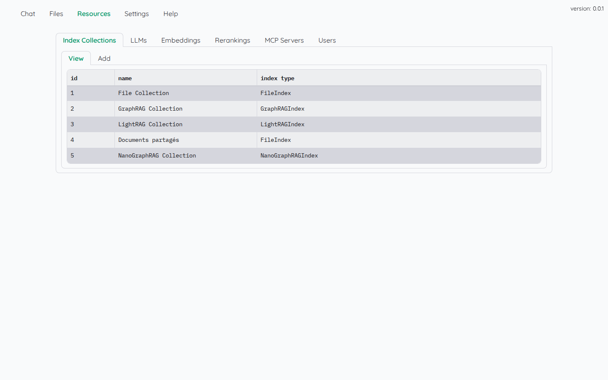

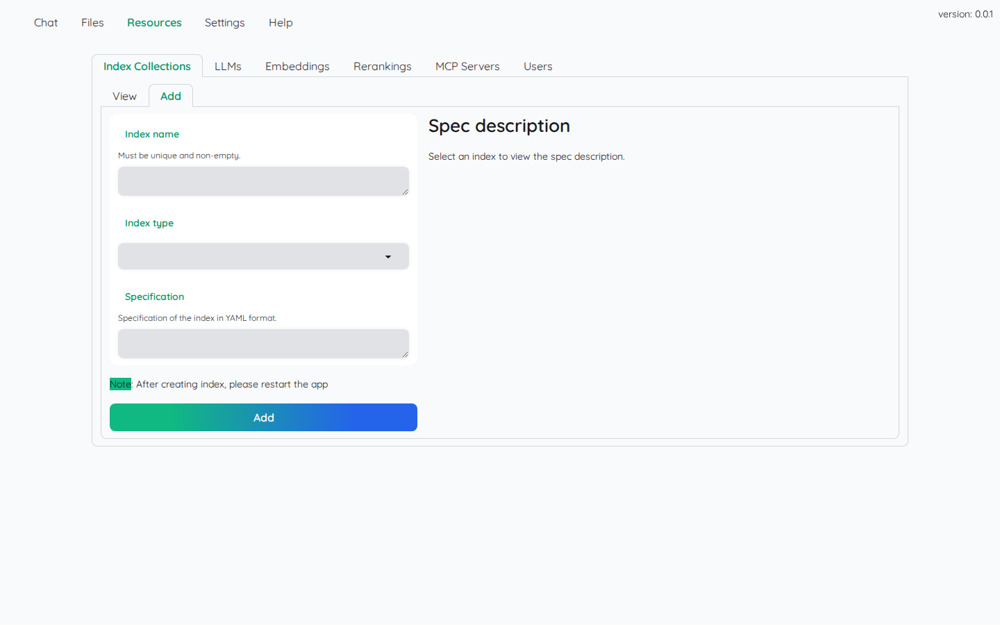

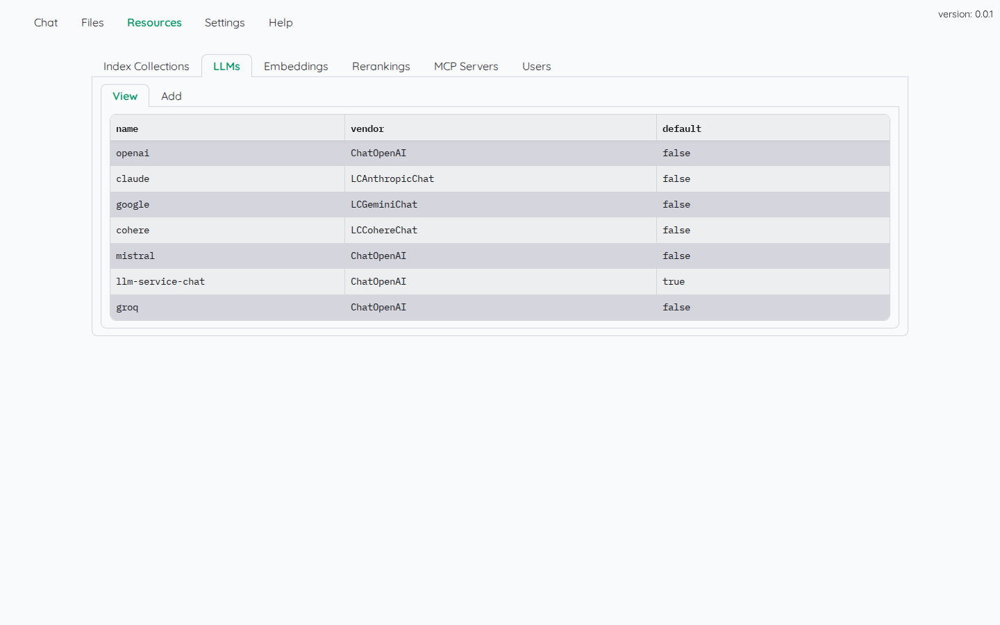

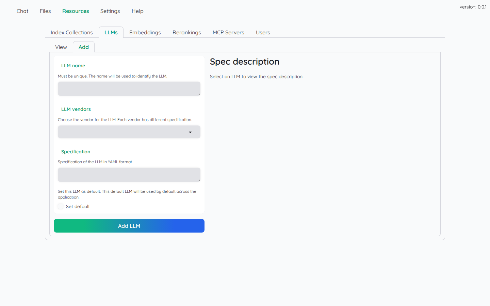

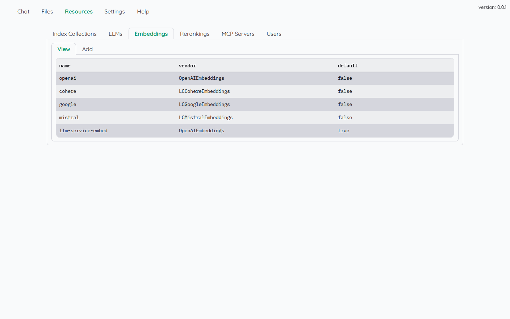

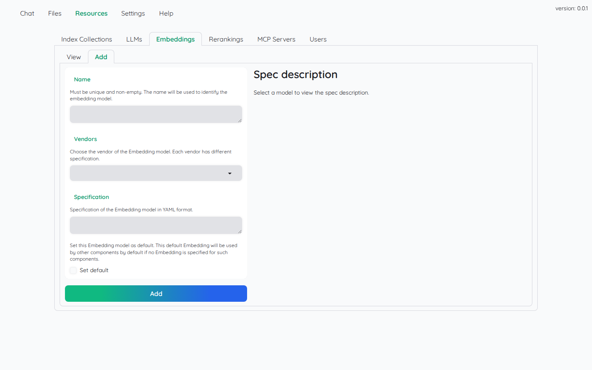

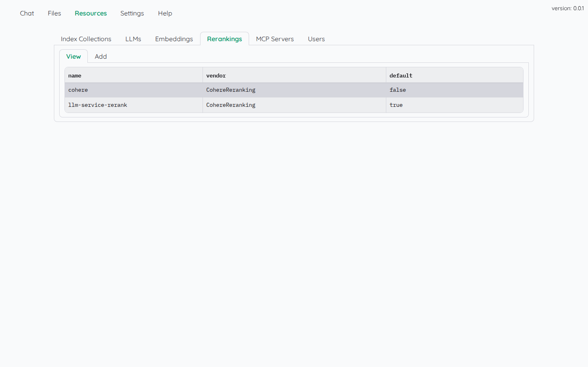

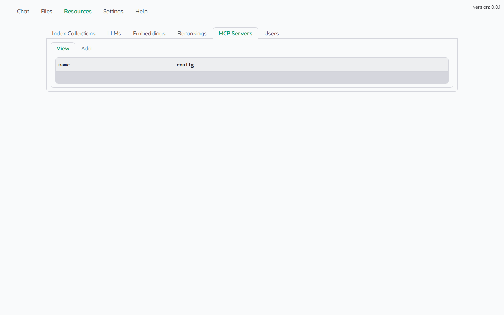

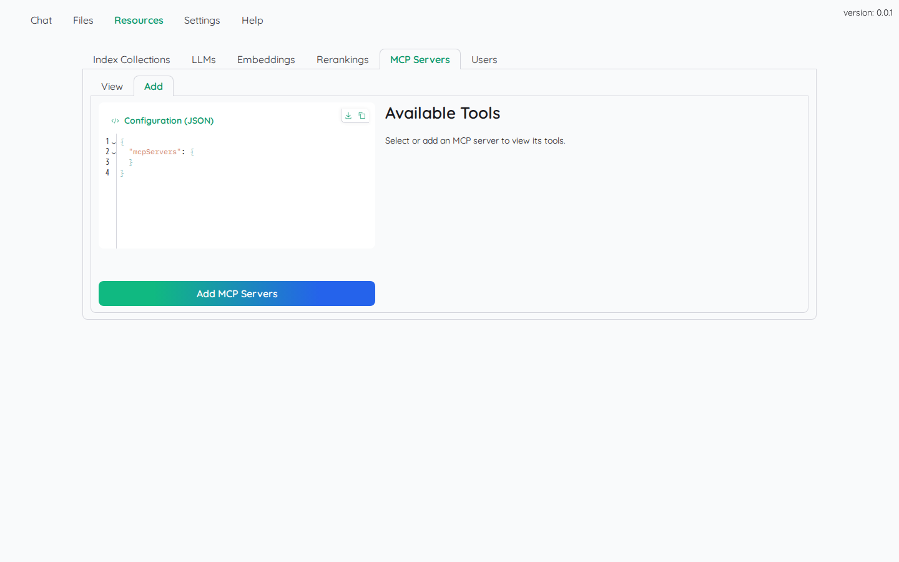

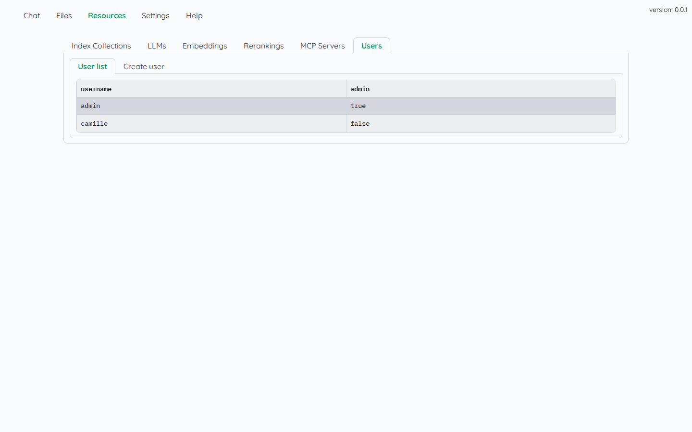

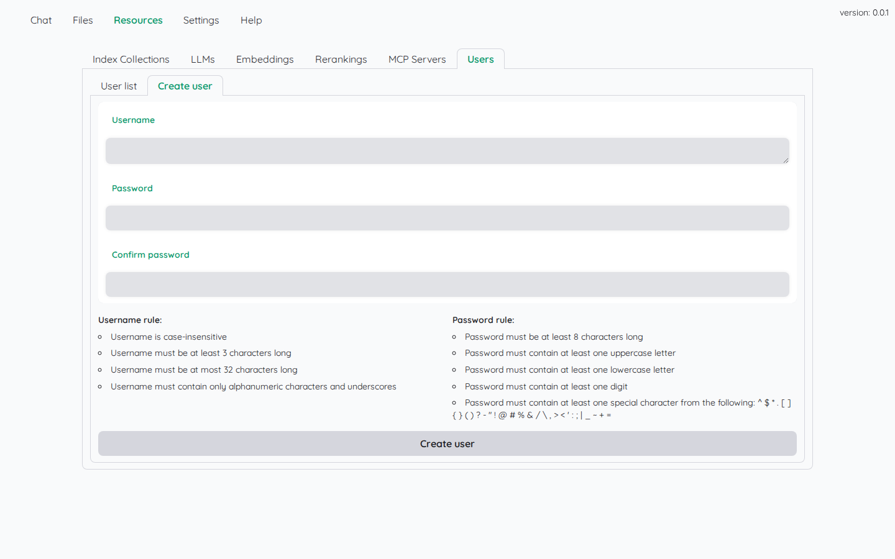

| Page ou menu | Chemin d'accès | Éléments | Manuel qui le couvre |
|---|---|---|---|
| Index Collections › View | Resources › « Index Collections » › « View » | liste (id, name, index type), « Index name », « Index config », « Save », « Delete », « Close » | [10](../manuel/10-collections-et-modeles.md) |
| Index Collections › Add | Resources › « Index Collections » › « Add » | « Index name », « Index type », « Specification », « Add » | [10](../manuel/10-collections-et-modeles.md) |
| LLMs › View | Resources › « LLMs » › « View » | liste (name, vendor, default), « Set default », « Name », « Specification », « Test connection », « Test », « Save », « Delete », « Confirm Delete », « Cancel », « Close » | [03](../manuel/03-premiers-pas.md), [10](../manuel/10-collections-et-modeles.md) |
| LLMs › Add | Resources › « LLMs » › « Add » | « LLM name », « LLM vendors », « Specification », « Set default », « Add LLM », tableau de description | [03](../manuel/03-premiers-pas.md) |
| Embeddings › View, Add | Resources › « Embeddings » | mêmes éléments (« Name », « Vendors », « Add ») | [03](../manuel/03-premiers-pas.md), [10](../manuel/10-collections-et-modeles.md) |
| Rerankings › View, Add | Resources › « Rerankings » | mêmes éléments | [03](../manuel/03-premiers-pas.md), [10](../manuel/10-collections-et-modeles.md) |
| MCP Servers › View, Add | Resources › « MCP Servers » | liste, « Configuration (JSON) », « Add MCP Servers » | [08](../manuel/08-agents-react-et-rewoo.md) (formulaire seulement) |
| Users › User list | Resources › « Users » › « User list » | liste (id, username, admin), « Username », « Change password », « Confirm change password », « Admin », « Save », « Delete », « Close » | [11](../manuel/11-comptes-et-partage.md) |
| Users › Create user | Resources › « Users » › « Create user » | « Username », « Password », « Confirm password », « Create user » | [11](../manuel/11-comptes-et-partage.md) |

## 5. Settings

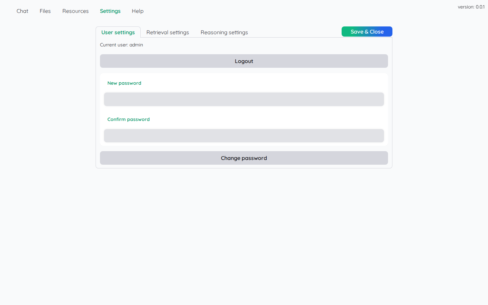

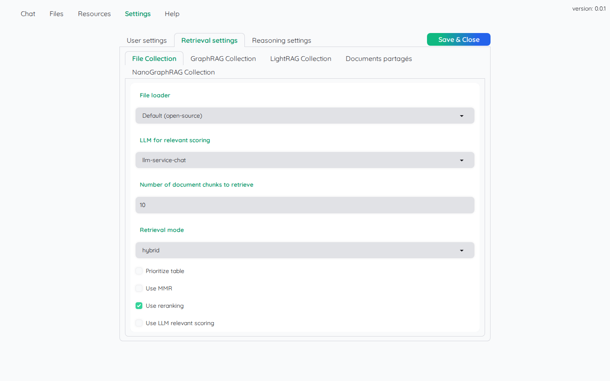

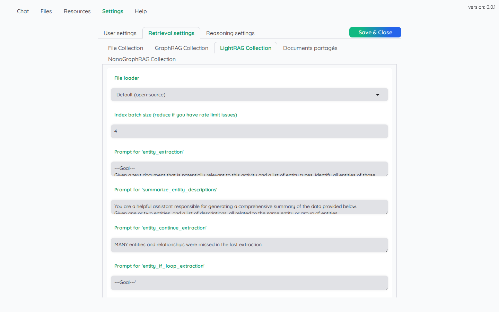

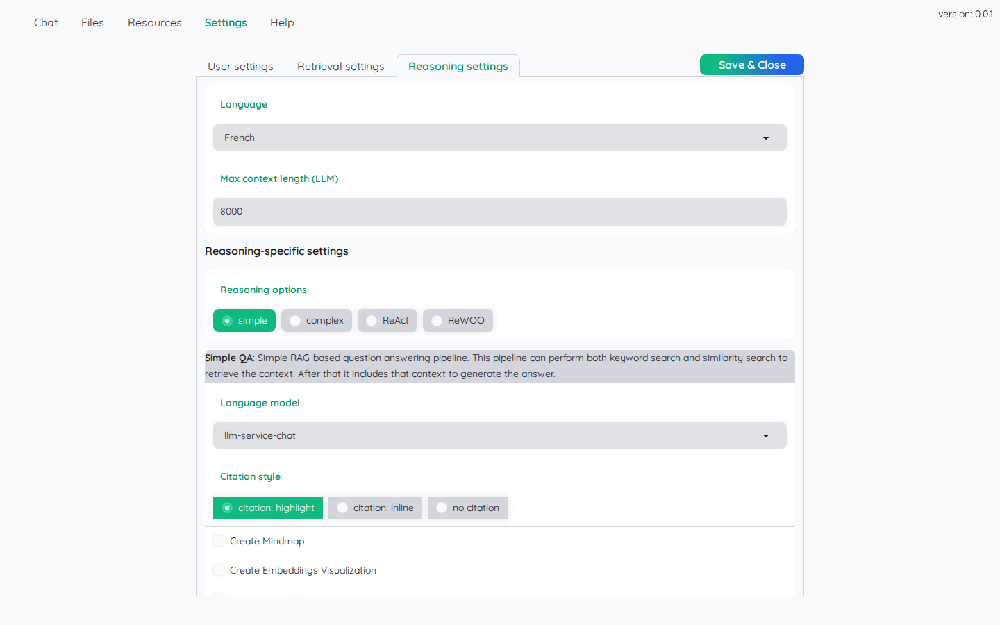

| Page ou menu | Chemin d'accès | Éléments | Manuel qui le couvre |
|---|---|---|---|
| User settings | Settings › « User settings » | « Current user », « Logout », « New password », « Confirm password », « Change password » | [03](../manuel/03-premiers-pas.md), [11](../manuel/11-comptes-et-partage.md) |
| Retrieval settings | Settings › « Retrieval settings » › collection | « File loader », « LLM for relevant scoring », « Number of document chunks to retrieve », « Retrieval mode », « Prioritize table », « Use MMR », « Use reranking », « Use LLM relevant scoring » ; collections en graphe : « Search type », taille de lot et consignes d'extraction | [03](../manuel/03-premiers-pas.md), [05](../manuel/05-ajouter-et-organiser-ses-documents.md), [07](../manuel/07-regler-la-recherche-et-le-raisonnement.md) |
| Reasoning settings | Settings › « Reasoning settings » | « Language », « Max context length (LLM) », « Reasoning options » (`simple`, `complex`, `ReAct`, `ReWOO`) et leurs options : modèle, style de citation, carte mentale, visualisation, entrée multimodale, consignes, historique, outils, itérations | [03](../manuel/03-premiers-pas.md), [07](../manuel/07-regler-la-recherche-et-le-raisonnement.md), [08](../manuel/08-agents-react-et-rewoo.md) |
| Save & Close | Settings, en haut à droite | enregistre tous les réglages | [03](../manuel/03-premiers-pas.md) |

## 6. Help

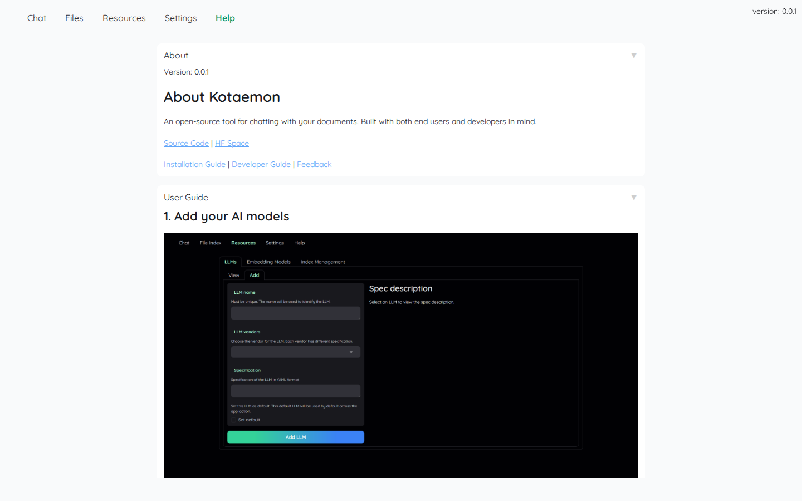

| Page ou menu | Chemin d'accès | Éléments | Manuel qui le couvre |
|---|---|---|---|
| Help | barre des onglets › « Help » | « About » (version, liens), « User Guide » (guide en anglais), « Changelogs » | Non couvert : pages d'aide en anglais, sans action ; leur contenu double ce manuel |

## 7. Ce qui n'est pas couvert

| Élément | Raison |
|---|---|
| « Use Web Links » (envoi) | envoie l'adresse au service en ligne Jina Reader : hors du périmètre local |
| `@WebSearch` et outils `Google`, `Wikipedia` des agents | services en ligne (clé Tavily payante pour `@WebSearch`) |
| lecteurs « Adobe API », « Azure AI Document Intelligence » | services en ligne payants |
| lecteurs PaddleOCR | absents de l'image « full » |
| ajout effectif d'un serveur MCP | aucun serveur MCP dans le périmètre de l'essai ; formulaire seulement |
| assistant de premier lancement | n'apparaît pas quand le dossier de données existe déjà (installation de ce manuel) ; ne permet pas de saisir l'adresse du service de modèles |
| « Help » | pages d'information en anglais, sans action |
