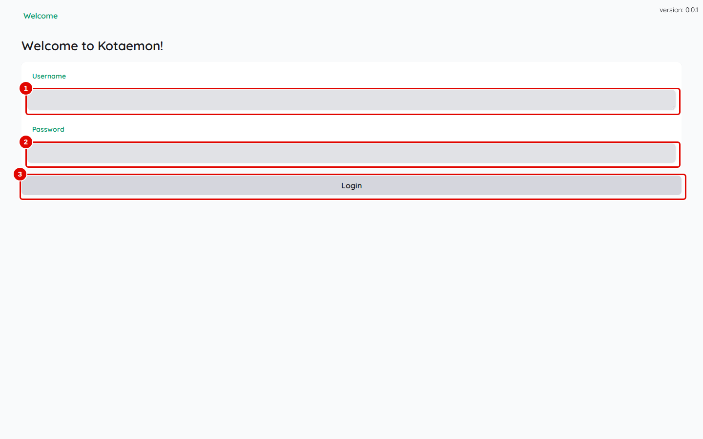

# 02. Installer Kotaemon

> Ce chapitre apprend à installer Kotaemon sous Windows 11 avec WSL2, à l'ouvrir dans le navigateur, puis à l'arrêter, le redémarrer et le supprimer.
> **Point de départ** : un terminal Ubuntu (WSL2) ouvert sur le poste, Docker Desktop démarré, et le service de modèles LLM-Service installé et démarré sur le même poste (voir « Ce qu'il faut savoir »).
> **Durée** : environ 20 minutes, dont 10 à 15 de téléchargement. **Avant** : chapitre 01.

**Attention, deux risques** : Kotaemon crée au premier démarrage un compte administrateur `admin` avec le mot de passe `admin`, connu de tous ; il se change dès la première connexion (chapitre 03, tâche « Changer le mot de passe de l'administrateur »). Par ailleurs, l'application n'est ouverte qu'au poste lui-même (adresse `127.0.0.1`) : ne pas modifier les ports dans les fichiers fournis, car une adresse ouverte sur le réseau exposerait les documents et ce compte.

## Ce qu'il faut savoir

Kotaemon tient dans **un seul conteneur Docker** (un « conteneur » est une petite machine isolée qui contient l'application et tout ce dont elle a besoin). Ce conteneur ne contient aucun modèle d'IA : les réponses, la représentation des textes et le tri des passages sont demandés à un **service de modèles** installé à part sur le même poste : le service LLM central, projet LLM-Service (https://github.com/floSa/llm-service). Il s'installe en suivant son propre README, avant ce chapitre, et se démarre par son script `scripts/demarrer.sh` (dans le dossier où il a été installé ; ajouter `cpu` sans carte graphique NVIDIA). Il est protégé par une clé : la valeur de `LITELLM_MASTER_KEY` dans le fichier `.env` de LLM-Service (ou celle que fournit la personne qui gère ce service).

Ce service a deux adresses : depuis le terminal du poste, `http://127.0.0.1:8080/v1` ; depuis Kotaemon, qui tourne dans un conteneur Docker relié au service par un réseau Docker nommé `llm-net`, `http://llm-central:8080/v1`. Le chapitre 03 fait saisir cette seconde adresse dans Kotaemon.

L'installation se fait avec un script fourni dans ce dépôt. Il télécharge l'image officielle de Kotaemon dans sa version « full » (celle qui lit aussi Word, PowerPoint et les PDF scannés), crée un dossier de données, coupe l'envoi de statistiques d'usage des composants et démarre l'application. Le mot de passe, la langue des réponses et le choix des modèles se font ensuite dans le navigateur (chapitre 03).

Les données (documents, conversations, réglages, comptes) sont rangées dans le dossier `donnees/kotaemon/` du dépôt. Les supprimer efface tout.

## Vérifier les prérequis

**Étape 1. Vérifier Docker**
*Où* : terminal Ubuntu.

```bash
docker version --format '{{.Server.Version}}'
docker compose version
```

*Résultat* : deux numéros de version s'affichent (par exemple `29.9.3` et `Docker Compose version v5.7.0`). Une erreur signifie que Docker Desktop n'est pas démarré, ou que l'intégration WSL n'est pas activée dans ses réglages (Docker Desktop › Settings › Resources › WSL integration).

**Étape 2. Vérifier la place disponible**
*Où* : terminal Ubuntu.

```bash
df -h ~
```

*Résultat* : la colonne « Avail » doit montrer au moins 25 Go libres : l'image de Kotaemon pèse 12,7 Go, car elle embarque LibreOffice, la lecture optique de caractères et plusieurs bibliothèques d'IA.

**Étape 3. Récupérer le dépôt**
*Où* : terminal Ubuntu, dans le dossier où ranger le projet.

```bash
git clone https://github.com/floSa/Kotaemon-Test-Bench.git
cd Kotaemon-Test-Bench
```

*Résultat* : le dossier `Kotaemon-Test-Bench` existe ; toutes les commandes suivantes se lancent depuis ce dossier.

**Étape 4. Déclarer la clé du service de modèles**
*Où* : terminal Ubuntu, dossier du dépôt.

```bash
cp .env.example .env
nano .env
```

Dans le fichier ouvert, remplacer la valeur de `LLM_CENTRAL_KEY` par la clé du service LLM central (valeur de `LITELLM_MASTER_KEY` dans le `.env` de LLM-Service), enregistrer avec Ctrl+O puis quitter avec Ctrl+X. Ce fichier `.env` n'est jamais envoyé sur GitHub. La clé sera aussi recopiée dans Kotaemon au chapitre 03.

*Résultat* : le fichier `.env` contient la clé ; il n'est lisible que sur le poste.

**Étape 5. Vérifier que le service de modèles répond**
*Où* : terminal Ubuntu, dossier du dépôt.

```bash
outils/communs/llm_central_sante.sh --essai
```

*Résultat* : la liste des modèles s'affiche (`chat`, `embed`, `rerank`, `transcribe` et quelques autres), puis une ligne par essai : un mot de réponse, `dimensions : 1024`, deux scores de tri, le début de la transcription d'un message vocal. Si la commande répond « service injoignable », démarrer le service avec le script `scripts/demarrer.sh` du dossier de LLM-Service (sur le poste d'essai : `~/mes_projets/Projet-IA/LLM-Service/scripts/demarrer.sh` ; ajouter `cpu` sans carte graphique NVIDIA), puis relancer la vérification.

## Installer et ouvrir l'application

**Étape 6. Lancer l'installation**
*Où* : terminal Ubuntu, dossier du dépôt.

```bash
outils/kotaemon/installer.sh
```

Le script télécharge l'image (12,7 Go, une seule fois), crée le dossier `donnees/kotaemon/ktem_app_data`, démarre le conteneur `rag-kotaemon` et attend que la page d'accueil réponde.

*Résultat* : les dernières lignes affichent `Kotaemon prêt : http://127.0.0.1:7860`, la ligne `rag-kotaemon 127.0.0.1:7860->7860/tcp` (l'application n'écoute que sur le poste), `ports publiés : tous liés à 127.0.0.1`, la durée et la mémoire prise au repos (environ 0,9 Go). Une fois l'image téléchargée, le démarrage prend une trentaine de secondes.

**Étape 7. Ouvrir Kotaemon dans le navigateur**
*Où* : navigateur de Windows (Edge, Firefox, Chrome), barre d'adresse.

Taper `http://127.0.0.1:7860` puis Entrée.


*Écran : onglet « Welcome », connexion.*

| N° | Élément | Rôle |
|---|---|---|
| 1 | « Username » | nom du compte |
| 2 | « Password » | mot de passe du compte |
| 3 | « Login » | ouvre la session |

*Résultat* : la page « Welcome to Kotaemon! » s'affiche. L'interface de Kotaemon est en anglais seulement ; quelques textes communs (zones de dépôt de fichiers) apparaissent en français si le navigateur est en français. L'installation est terminée ; la suite se passe au chapitre 03.

## Arrêter, redémarrer, supprimer

**Étape 8. Voir l'état de l'application**
*Où* : terminal Ubuntu, dossier du dépôt.

```bash
outils/kotaemon/etat.sh
```

*Résultat* : l'état du conteneur (`Up …` et le port `127.0.0.1:7860->7860/tcp`), `HTTP 200`, la mémoire utilisée, la place occupée par les données et la liste des modèles du service central.

**Étape 9. Arrêter Kotaemon**
*Où* : terminal Ubuntu, dossier du dépôt.

```bash
outils/kotaemon/arreter.sh
```

*Résultat* : `Kotaemon arrêté.` Les documents, conversations et réglages sont conservés. Le service de modèles, partagé avec d'autres applications, continue de tourner.

**Étape 10. Redémarrer Kotaemon**
*Où* : terminal Ubuntu, dossier du dépôt.

```bash
outils/kotaemon/demarrer.sh
```

*Résultat* : `Kotaemon prêt : http://127.0.0.1:7860` après une trentaine de secondes. Dans le navigateur, recharger la page : si la session avait été fermée (« Logout », chapitre 11) ou si le navigateur a été changé, l'écran de connexion demande le mot de passe choisi au chapitre 03 ; sinon, le navigateur reconnecte automatiquement le compte.

**Étape 11. Tout supprimer**
*Où* : terminal Ubuntu, dossier du dépôt.

```bash
outils/communs/nettoyer.sh kotaemon
```

Le script annonce ce qu'il va supprimer et demande de taper `oui`. Il supprime le conteneur et le dossier `donnees/kotaemon/` (documents, conversations, réglages, comptes). Il ne touche pas au service de modèles. L'image téléchargée reste dans Docker ; pour la retirer aussi : `docker image rm ghcr.io/cinnamon/kotaemon:main-full`.

*Résultat* : `Terminé.` ; l'adresse `http://127.0.0.1:7860` ne répond plus.

## Bon à savoir

- Le script d'installation peut être relancé sans risque : il garde les réglages et les données existants.
- La version installée est Kotaemon 0.12.0 (31 mai 2026). Le projet ne publie pas d'image numérotée pour cette version : le script prend l'image `main-full`, figée par son empreinte, qui correspond exactement à la version 0.12.0. L'interface affiche pourtant « version: 0.0.1 » en haut à droite : ce numéro est faux (il est calculé à partir d'un historique absent de l'image) et peut être ignoré.
- Kotaemon propose aussi un assistant de premier lancement (choix d'un fournisseur de modèles en ligne ou d'Ollama). Il n'apparaît pas avec ce script, car le dossier de données existe avant le premier démarrage, et il ne permet de toute façon pas de saisir l'adresse du service de modèles : les modèles se déclarent dans l'onglet « Resources » (chapitre 03).
- Au démarrage, le journal du conteneur affiche `ollama: not found` et `Nano-GraphRAG dependencies not installed` : ces deux messages sont sans conséquence (Ollama n'est pas utilisé ; NanoGraphRAG est traité au chapitre 09).
- L'application télécharge, à chaque démarrage, la page des nouveautés de la version sur GitHub (onglet « Help ») et, dans le navigateur, quelques scripts et polices depuis des sites publics. Aucun document ni aucune question ne part vers ces sites.

## En cas de problème

| Symptôme | Cause | Que faire |
|---|---|---|
| `réseau llm-net absent` | le service de modèles n'est pas démarré (`llm-net` est le réseau Docker qu'il crée) | démarrer LLM-Service (`scripts/demarrer.sh` de son dossier), puis relancer l'installation |
| `Kotaemon ne répond pas après 300 s` | démarrage en échec | `docker logs rag-kotaemon` ; voir le [chapitre 13](13-en-cas-de-probleme.md) |
| Téléchargement interrompu ou disque plein | l'image fait 12,7 Go | libérer de la place (étape 2), puis relancer `outils/kotaemon/installer.sh` |

---
*Version décrite : Kotaemon 0.12.0, essais du 12 novembre 2026. Détails et preuves : [rapport d'essais](../annexes/A6-rapport-d-essais.md).*
