# 03. Premiers pas

> Ce chapitre apprend à se connecter, à changer le mot de passe de l'administrateur, à se repérer dans l'écran principal, à déclarer les trois modèles du service de modèles (réponse, embedding, tri) et à régler la langue des réponses.
> **Point de départ** : page `http://127.0.0.1:7860` ouverte dans le navigateur, après l'installation (chapitre 02).
> **Durée** : environ 20 minutes. **Avant** : chapitre 02.

**Attention** : tant que le mot de passe `admin` n'est pas changé, n'importe quelle personne qui accède au poste peut ouvrir Kotaemon avec le compte administrateur. Le changer est la première tâche de ce chapitre.

## Ce qu'il faut savoir

Kotaemon s'utilise dans le navigateur, par **onglets** affichés en haut de la page : « Chat » (poser des questions), « Files » (ajouter des documents), « Resources » (déclarer les modèles, les collections et les comptes ; visible pour un administrateur seulement), « Settings » (réglages) et « Help » (aide). L'interface est en anglais ; les réponses, elles, peuvent être rédigées en français.

Kotaemon a besoin de trois **modèles** :

- un **modèle de réponse** (appelé « LLM » dans Kotaemon) : il lit les passages trouvés et rédige la réponse ; ici, `chat` ;
- un **modèle d'embedding** : il transforme chaque passage de document en une suite de nombres qui représente son sens, ce qui permet de retrouver les passages proches d'une question ; ici, `embed` ;
- un **modèle de tri** (appelé « reranker », « Rerankings » dans Kotaemon) : il relit les passages trouvés et les classe du plus utile au moins utile ; ici, `rerank`.

Ces trois modèles sont fournis par le service de modèles du poste (chapitre 02). À l'installation, Kotaemon contient déjà des modèles nommés « openai », « claude », « google », « groq », « cohere » et « mistral » : ce sont des services en ligne payants, sans clé, inutilisables ici. Il faut ajouter ceux du service de modèles et les marquer comme modèles **par défaut**.

Chaque modèle se décrit par une **spécification** : quelques lignes au format YAML (une ligne par réglage, sous la forme `nom: valeur`). La clé du service de modèles s'y écrit en clair ; elle est remplacée par des astérisques sur les captures de ce manuel.

## Se connecter

**Étape 1. Ouvrir une session**
*Où* : onglet « Welcome » (seul onglet visible avant connexion).

Saisir `admin` dans « Username » (pastille 1) et `admin` dans « Password » (pastille 2), puis cliquer sur « Login » (pastille 3).

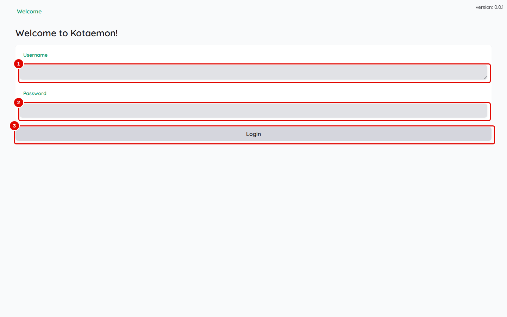
*Écran : onglet « Welcome », connexion.*

| N° | Élément | Rôle |
|---|---|---|
| 1 | « Username » | nom du compte (`admin` au premier démarrage) |
| 2 | « Password » | mot de passe (`admin` au premier démarrage) |
| 3 | « Login » | ouvre la session ; la touche Entrée dans « Password » a le même effet |

*Résultat* : l'onglet « Chat » s'ouvre (étape suivante). Le navigateur garde la session : à la visite suivante, la connexion est automatique.

## Se repérer dans l'écran principal

**Étape 2. Lire l'écran « Chat »**
*Où* : barre des onglets › « Chat ».

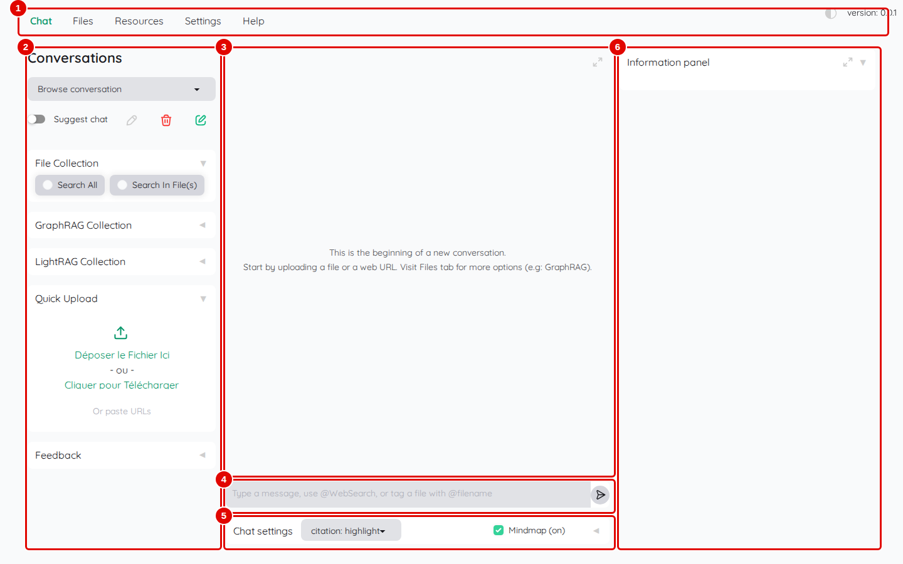
*Écran : onglet « Chat », juste après la connexion.*

| N° | Élément | Rôle |
|---|---|---|
| 1 | barre des onglets | « Chat », « Files », « Resources », « Settings », « Help » ; à droite, le bouton du mode sombre et le numéro de version |
| 2 | colonne « Conversations » | liste des conversations, boutons pour en créer, renommer ou supprimer une ; en dessous, une section par collection de documents (« File Collection »…) pour choisir où chercher, puis « Quick Upload » (ajout rapide de fichiers) et « Feedback » (signaler une réponse) |
| 3 | zone de discussion | questions posées et réponses ; vide au départ |
| 4 | zone de saisie | écrire la question, puis Entrée ou la flèche d'envoi |
| 5 | « Chat settings » | réglages de la conversation : style de citation, carte mentale (« Mindmap »), méthode de raisonnement, modèle, langue |
| 6 | « Information panel » | panneau des sources : les passages utilisés pour la réponse, avec leur score |

*Résultat* : les zones de l'écran sont identifiées ; les chapitres 04 et 06 les utilisent en détail.

## Changer le mot de passe de l'administrateur

**Étape 3. Saisir un nouveau mot de passe**
*Où* : barre des onglets › « Settings » › « User settings ».

Saisir le nouveau mot de passe dans « New password » (pastille 2) et une seconde fois dans « Confirm password » (pastille 3), puis cliquer sur « Change password » (pastille 4). Le mot de passe doit compter au moins 8 caractères, dont une majuscule, une minuscule, un chiffre et un caractère spécial.

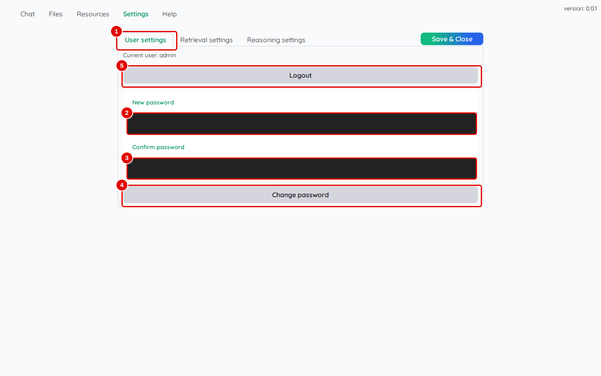
*Écran : « Settings », sous-onglet « User settings » (mots de passe masqués).*

| N° | Élément | Rôle |
|---|---|---|
| 1 | « User settings » | réglages du compte connecté (« Current user: admin ») |
| 2 | « New password » | nouveau mot de passe |
| 3 | « Confirm password » | même mot de passe, pour éviter une faute de frappe |
| 4 | « Change password » | enregistre le nouveau mot de passe |
| 5 | « Logout » | ferme la session et revient à l'onglet « Welcome » |

*Résultat* : le message « Password changed » apparaît en haut à droite. La prochaine connexion demandera le nouveau mot de passe. Le noter dans un endroit sûr : il n'existe pas de procédure « mot de passe oublié » (seul un autre administrateur peut le remplacer, chapitre 11).

## Déclarer le modèle de réponse

**Étape 4. Ouvrir le formulaire d'ajout d'un modèle de réponse**
*Où* : barre des onglets › « Resources » › « LLMs » › « Add ».

Saisir un nom dans « LLM name » (pastille 3), par exemple `llm-service-chat`, puis choisir `ChatOpenAI` dans la liste « LLM vendors » (pastille 4). `ChatOpenAI` désigne tout service qui parle comme l'API d'OpenAI, ce qui est le cas du service de modèles.

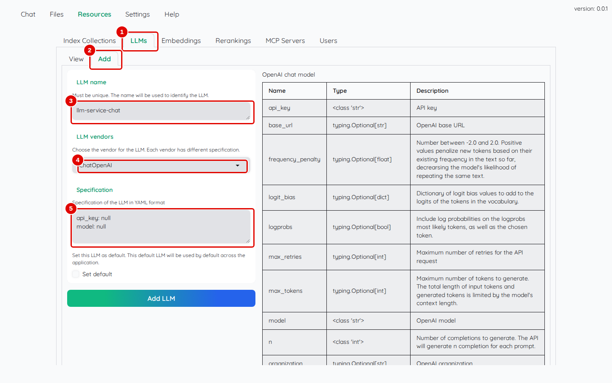
*Écran : « Resources » › « LLMs » › « Add », fournisseur `ChatOpenAI` choisi.*

| N° | Élément | Rôle |
|---|---|---|
| 1 | « LLMs » | liste et ajout des modèles de réponse |
| 2 | « Add » | formulaire d'ajout |
| 3 | « LLM name » | nom affiché dans Kotaemon ; doit être unique |
| 4 | « LLM vendors » | type de service ; `ChatOpenAI` pour le service de modèles |
| 5 | « Specification » | réglages du modèle, préremplis avec les champs obligatoires du type choisi |

*Résultat* : la zone « Specification » se remplit d'un modèle de réglages et, à droite, un tableau décrit chaque réglage possible (nom, type, explication).

**Étape 5. Écrire la spécification et ajouter le modèle**
*Où* : même écran.

Remplacer le contenu de « Specification » (pastille 1) par les lignes suivantes, en mettant la clé du service de modèles à la place de `CLE_DU_SERVICE` :

```yaml
api_key: CLE_DU_SERVICE
base_url: http://llm-central:8080/v1
model: chat
temperature: 0
max_tokens: 6144
timeout: 600
```

Cocher « Set default » (pastille 2), puis cliquer sur « Add LLM » (pastille 3).

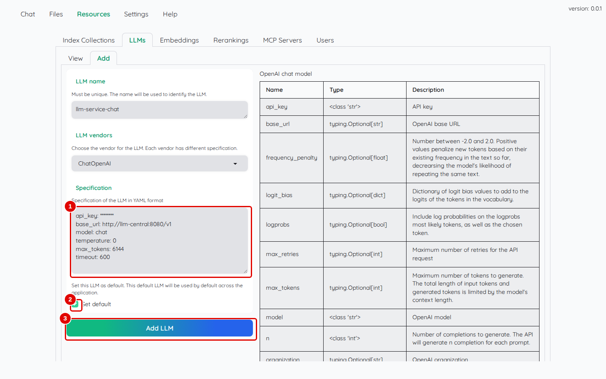
*Écran : « Resources » › « LLMs » › « Add », spécification saisie (clé masquée).*

| N° | Élément | Rôle |
|---|---|---|
| 1 | « Specification » | adresse du service (`base_url`), clé (`api_key`), nom du modèle (`model`) et réglages de réponse |
| 2 | « Set default » | fait de ce modèle celui que Kotaemon utilise partout par défaut |
| 3 | « Add LLM » | enregistre le modèle |

Signification des lignes : `temperature: 0` rend les réponses stables (même question, même réponse) ; `max_tokens: 6144` plafonne la longueur de la réponse, réflexion du modèle comprise ; `timeout: 600` laisse au modèle jusqu'à dix minutes pour répondre. Sans ces deux dernières lignes, Kotaemon abandonne au bout de 20 secondes, ce qui coupe souvent les réponses du modèle `chat`, qui réfléchit avant de répondre.

*Résultat* : le message « LLM 'llm-service-chat' created successfully » apparaît.

**Étape 6. Ouvrir la fiche du modèle**
*Où* : « Resources » › « LLMs » › « View ».

Cliquer sur la ligne `llm-service-chat` du tableau (pastille 2).

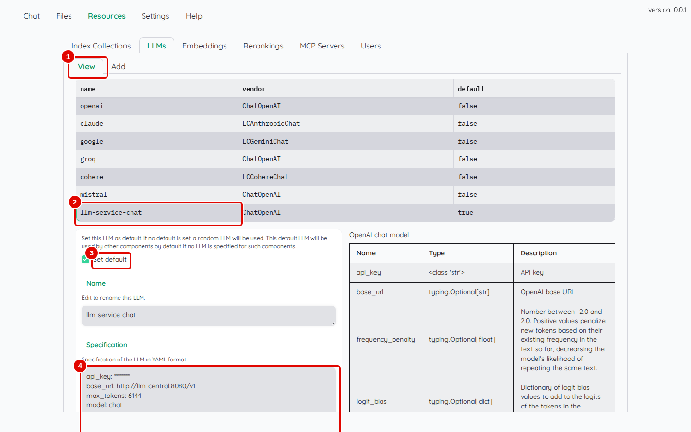
*Écran : « Resources » › « LLMs » › « View », modèle `llm-service-chat` sélectionné.*

| N° | Élément | Rôle |
|---|---|---|
| 1 | « View » | liste des modèles déclarés (nom, type, modèle par défaut) |
| 2 | `llm-service-chat` | ligne du modèle ; un clic ouvre sa fiche en dessous |
| 3 | « Set default » | coché : c'est le modèle par défaut |
| 4 | « Specification » | réglages enregistrés, modifiables |

*Résultat* : la fiche s'ouvre sous le tableau, avec un bloc « Test connection » plus bas.

**Étape 7. Tester la connexion**
*Où* : même écran, en faisant défiler la fiche vers le bas.

Ouvrir « Test connection » (pastille 1), puis cliquer sur « Test » (pastille 2).

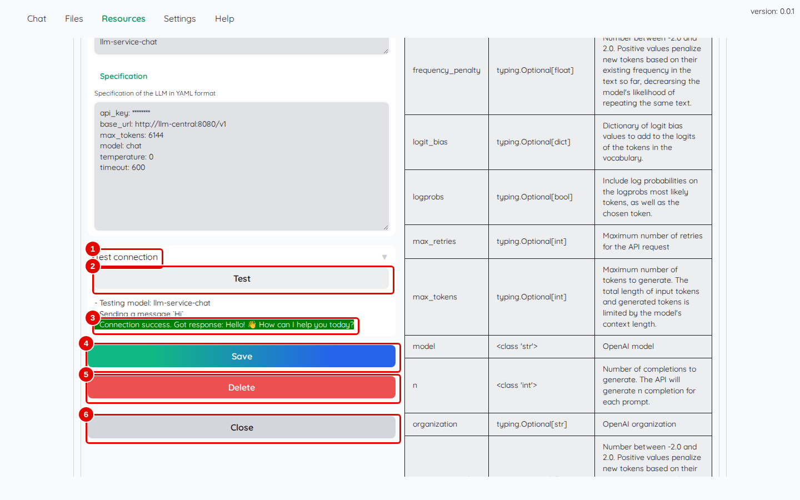
*Écran : fiche du modèle, bloc « Test connection » après le test.*

| N° | Élément | Rôle |
|---|---|---|
| 1 | « Test connection » | ouvre le bloc de test |
| 2 | « Test » | envoie le message « Hi » au modèle |
| 3 | résultat du test | « Connection success. Got response: … » si le modèle répond, « Connection failed » sinon |
| 4 | « Save » | enregistre une modification de la fiche |
| 5 | « Delete » | supprime le modèle (une confirmation est demandée) |
| 6 | « Close » | referme la fiche |

*Résultat* : « Connection success. Got response: Hello! … How can I help you today? » s'affiche en vert. En cas d'échec (« Error code: 401 »), la clé est fausse : la corriger dans « Specification », cliquer sur « Save », puis refaire le test.

## Déclarer le modèle d'embedding

**Étape 8. Ajouter le modèle d'embedding**
*Où* : « Resources » › « Embeddings » › « Add ».

Le formulaire est le même qu'à l'étape 4, avec des libellés plus courts : saisir `llm-service-embed` dans « Name », choisir `OpenAIEmbeddings` dans « Vendors », puis remplacer « Specification » par :

```yaml
api_key: CLE_DU_SERVICE
base_url: http://llm-central:8080/v1
model: embed
timeout: 120
```

Cocher « Set default », puis cliquer sur « Add ».

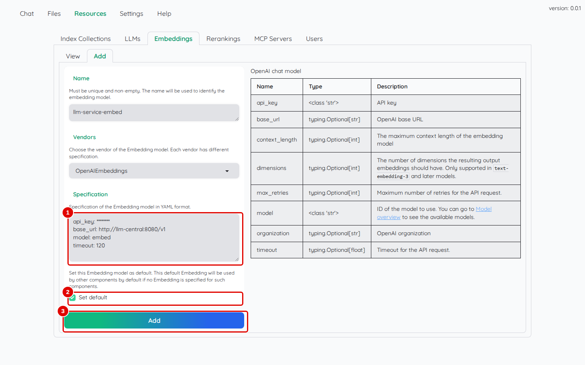
*Écran : « Resources » › « Embeddings » › « Add », spécification saisie (clé masquée).*

| N° | Élément | Rôle |
|---|---|---|
| 1 | « Specification » | adresse, clé et nom du modèle `embed` |
| 2 | « Set default » | modèle d'embedding utilisé par toutes les collections |
| 3 | « Add » | enregistre le modèle |

Ne pas ajouter de ligne `context_length` : avec ce réglage, Kotaemon découpe les textes à la manière des modèles d'OpenAI et envoie des numéros de mots au lieu du texte, ce que le modèle `embed` ne comprend pas.

*Résultat* : le message « Embedding model "llm-service-embed" created successfully » apparaît. Le test de connexion se fait comme à l'étape 7 (« View », clic sur la ligne, « Test connection », « Test ») et affiche « Connection success. ».

Ce modèle doit être choisi **avant d'ajouter le premier document** : les documents déjà analysés avec un autre modèle d'embedding ne seraient plus retrouvés.

## Déclarer le modèle de tri

**Étape 9. Ajouter le modèle de tri**
*Où* : « Resources » › « Rerankings » › « Add ».

Saisir `llm-service-rerank` dans « Name », choisir `CohereReranking` dans « Vendors », puis remplacer « Specification » par :

```yaml
cohere_api_key: CLE_DU_SERVICE
base_url: http://llm-central:8080
model_name: rerank
```

L'adresse s'écrit ici **sans** `/v1` à la fin : Kotaemon l'ajoute lui-même pour ce type de modèle. Cocher « Set default », puis cliquer sur « Add ».

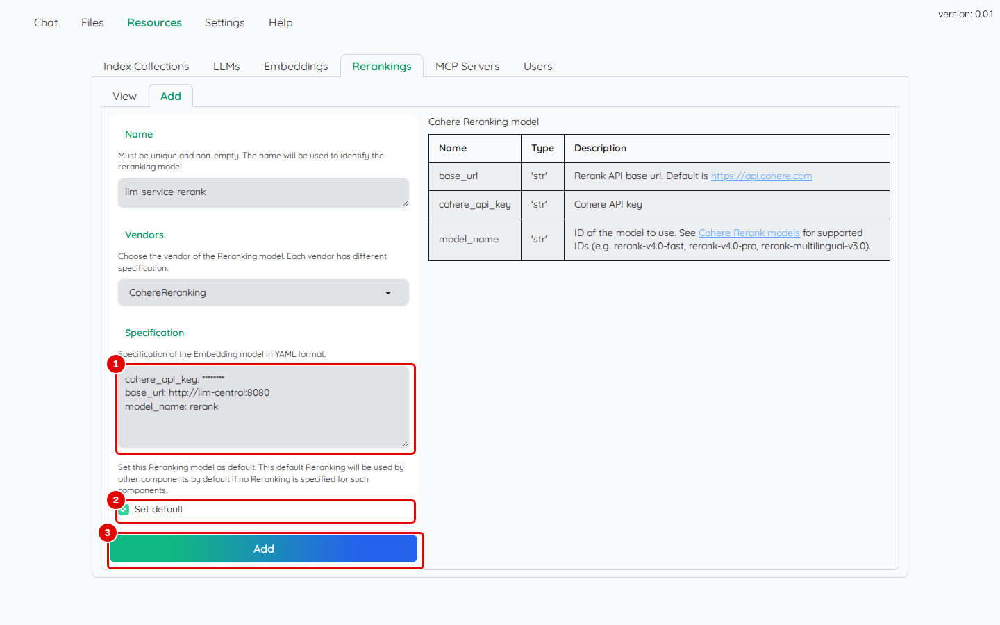
*Écran : « Resources » › « Rerankings » › « Add », spécification saisie (clé masquée).*

| N° | Élément | Rôle |
|---|---|---|
| 1 | « Specification » | clé (`cohere_api_key`), adresse sans `/v1` (`base_url`) et nom du modèle `rerank` (`model_name`) |
| 2 | « Set default » | remplace le modèle de tri « cohere » (service en ligne, sans clé) par celui du service de modèles |
| 3 | « Add » | enregistre le modèle |

*Résultat* : le message « Reranking model "llm-service-rerank" created successfully » apparaît ; le test de connexion (comme à l'étape 7) affiche « Connection success. ». Sans cette étape, le tri prévu par défaut (« cohere ») est ignoré sans aucun message, faute de clé.

## Régler la langue et la taille des textes envoyés au modèle

**Étape 10. Régler le raisonnement**
*Où* : barre des onglets › « Settings » › « Reasoning settings ».

Choisir `French` dans « Language » (pastille 2), saisir `8000` dans « Max context length (LLM) » (pastille 3), choisir `llm-service-chat` dans « Language model » (pastille 4), puis cliquer sur « Save & Close » (pastille 5).

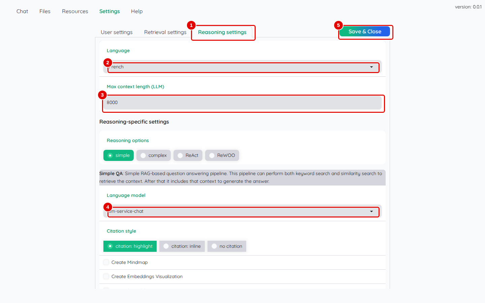
*Écran : « Settings » › « Reasoning settings ».*

| N° | Élément | Rôle |
|---|---|---|
| 1 | « Reasoning settings » | réglages de la rédaction des réponses |
| 2 | « Language » | langue des réponses |
| 3 | « Max context length (LLM) » | quantité maximale de texte des documents envoyée au modèle avec la question |
| 4 | « Language model » | modèle de réponse de la méthode « simple » |
| 5 | « Save & Close » | enregistre tous les réglages de « Settings » |

Pourquoi `8000` : le modèle `chat` accepte 16 384 jetons par question (un jeton vaut environ trois quarts de mot), en comptant à la fois la question, les passages des documents, sa réflexion et sa réponse. La valeur par défaut, 32 000, dépasse cette limite. Avec 8 000 pour les passages, il reste la place pour la réponse (6 144 au plus, étape 5).

*Résultat* : le message « Setting saved » apparaît.

**Étape 11. Régler la recherche des passages**
*Où* : « Settings » › « Retrieval settings » (sous-onglet « File Collection »).

Laisser « File loader » sur « Default (open-source) » et « Number of document chunks to retrieve » sur `10`. Laisser « Use reranking » coché et **décocher** « Use LLM relevant scoring » (pastille 5), puis cliquer sur « Save & Close ».

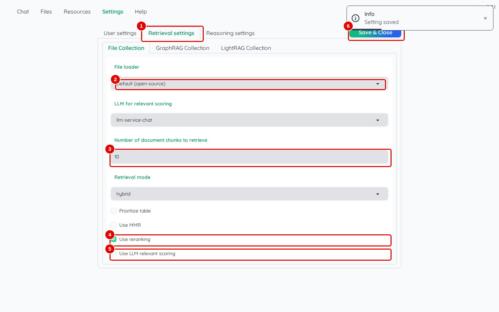
*Écran : « Settings » › « Retrieval settings », collection « File Collection ».*

| N° | Élément | Rôle |
|---|---|---|
| 1 | « Retrieval settings » | réglages de la recherche, un sous-onglet par collection |
| 2 | « File loader » | façon de lire les fichiers (détail au chapitre 05) |
| 3 | « Number of document chunks to retrieve » | nombre de passages transmis au modèle pour chaque question |
| 4 | « Use reranking » | trie les passages avec le modèle de tri par défaut (`llm-service-rerank`) |
| 5 | « Use LLM relevant scoring » | fait noter chaque passage par le modèle de réponse ; à décocher ici |
| 6 | « Save & Close » | enregistre les réglages |

Pourquoi décocher « Use LLM relevant scoring » : cette option envoie au modèle une demande par passage, toutes en même temps (dix par question). Le service de modèles en traite quatre à la fois et refuse les autres ; la réponse reste alors bloquée sur « Thinking ... » (chapitre 13). Le tri par `llm-service-rerank` joue le même rôle, plus vite.

*Résultat* : le message « Setting saved » apparaît. Kotaemon est prêt à recevoir des documents (chapitre 04).

## Bon à savoir

- Les réglages de « Settings » sont propres à chaque compte : un autre utilisateur repart des valeurs par défaut.
- La langue, le style de citation et la carte mentale choisis dans « Chat settings » (zone 5 de l'écran principal) l'emportent sur ceux de « Settings » : au début de chaque visite, la conversation repart en anglais, avec la carte mentale activée. Le chapitre 04 montre où choisir « French ».
- Les modèles en ligne préinstallés (« openai », « claude »…) peuvent rester : ils ne servent pas tant qu'ils ne sont pas choisis. Le chapitre 10 montre comment les supprimer.

## En cas de problème

| Symptôme | Cause | Que faire |
|---|---|---|
| « Invalid username or password » | mot de passe déjà changé | utiliser le mot de passe choisi à l'étape 3 |
| « Connection failed … Error code: 401 » | clé du service fausse dans la spécification | corriger `api_key` (ou `cohere_api_key`), « Save », refaire le test |
| « Connection failed … RetryError » pour l'embedding | adresse fausse ou service arrêté | vérifier `base_url: http://llm-central:8080/v1` et que le service répond (chapitre 02, étape 5) |
| la réponse reste sur « Thinking ... » | « Use LLM relevant scoring » coché | le décocher (étape 11) ; voir le [chapitre 13](13-en-cas-de-probleme.md) |

---
*Version décrite : Kotaemon 0.12.0, essais du 12 novembre 2026. Détails et preuves : [rapport d'essais](../annexes/A6-rapport-d-essais.md).*
