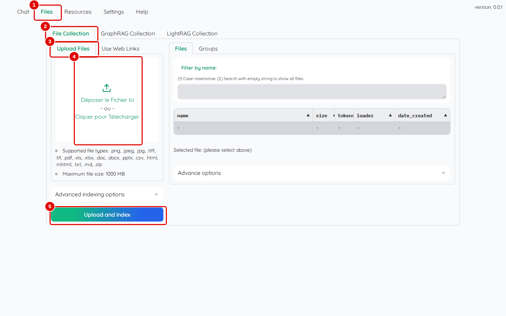
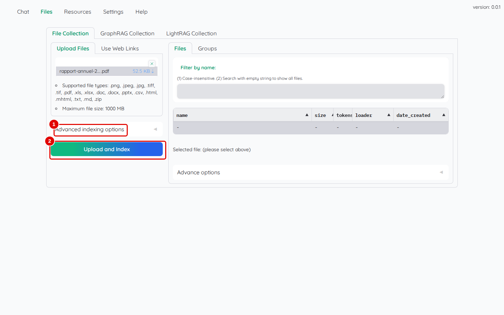
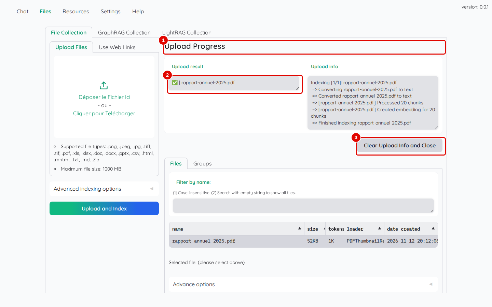
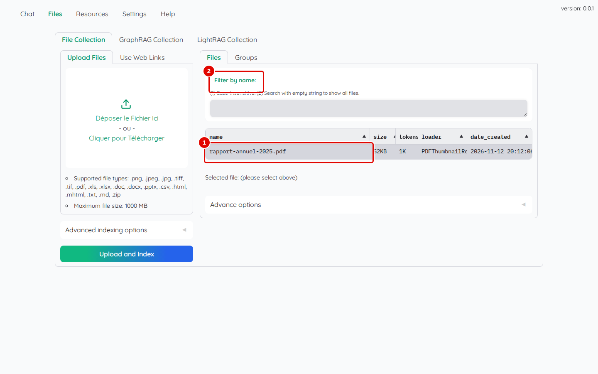
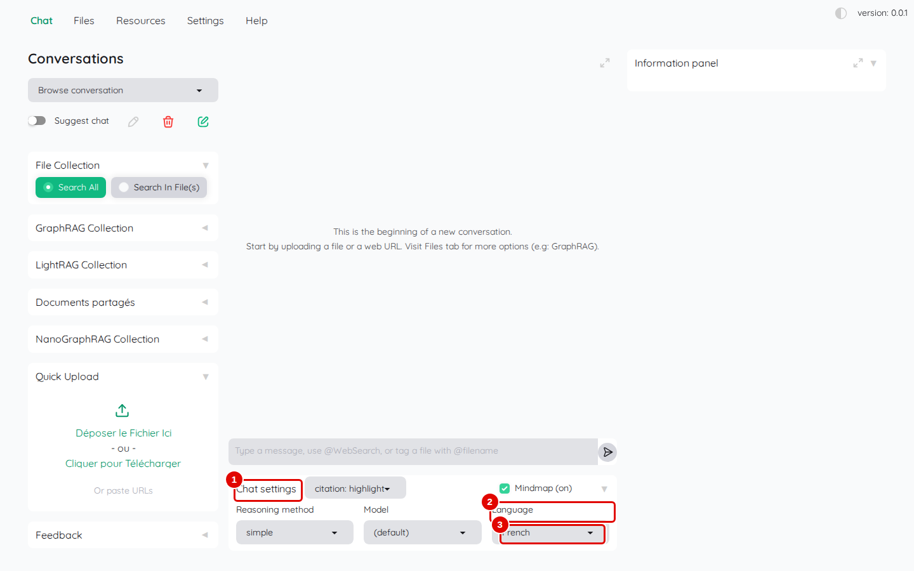
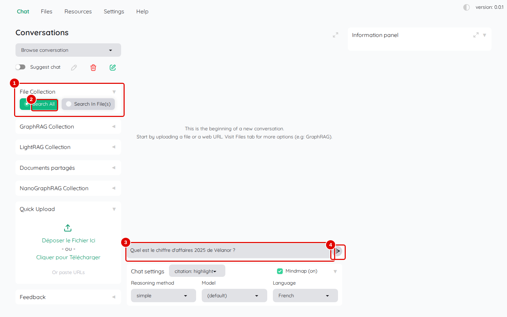
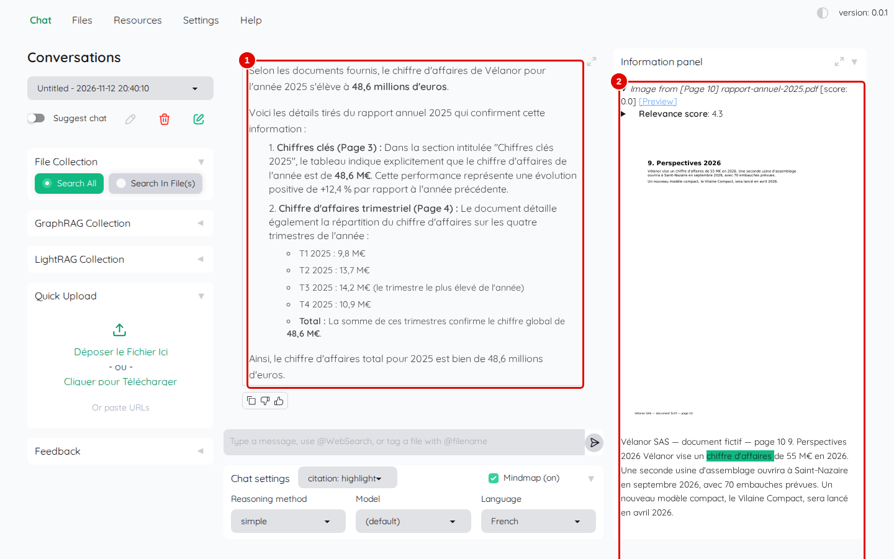
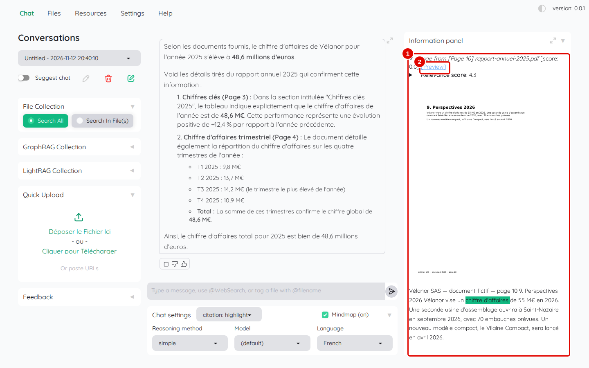
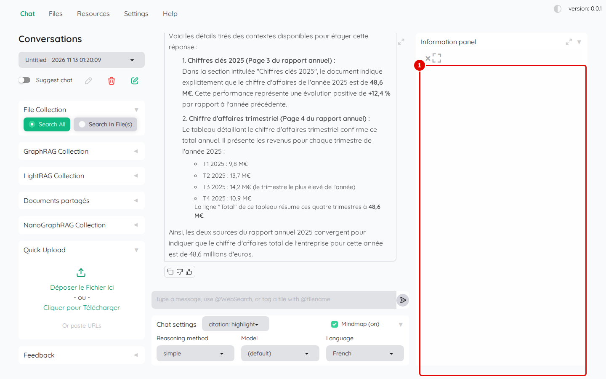

# 04. Première question en dix minutes

> Ce chapitre fait le parcours le plus court : ajouter un document PDF, poser une question en français et retrouver dans le document le passage qui justifie la réponse.
> **Point de départ** : Kotaemon ouvert sur l'onglet « Chat », session ouverte et modèles déclarés (chapitre 03).
> **Durée** : environ 10 minutes. **Avant** : chapitre 03.

## Ce qu'il faut savoir

Kotaemon range les documents dans des **collections**. À l'installation, il en existe trois : « File Collection » (la collection ordinaire, utilisée ici), « GraphRAG Collection » et « LightRAG Collection » (deux collections qui construisent en plus un graphe des notions du document, chapitre 09).

Quand un document est ajouté, Kotaemon le lit, le découpe en **passages** (des morceaux de texte d'environ une demi-page, 1 024 jetons au plus) et calcule pour chacun sa représentation par le modèle d'embedding : c'est l'**indexation**. À chaque question, Kotaemon cherche les passages les plus proches de la question, les trie, puis les donne au modèle de réponse, qui rédige une réponse en s'appuyant dessus. Les passages utilisés s'affichent à droite de la réponse, avec le nom du document et le numéro de page : ce sont les **citations**.

Les captures de ce chapitre montrent dans la colonne de gauche deux collections de plus (« Documents partagés », « NanoGraphRAG Collection »), créées plus loin dans le manuel : ne pas en tenir compte.

L'exemple utilise `rapport-annuel-2025.pdf`, le rapport annuel d'une entreprise fictive, Vélanor, fourni dans le dossier `corpus/documents/` du dépôt. Depuis Windows, ce dossier s'ouvre dans l'Explorateur à l'adresse `\\wsl$\Ubuntu\home\<nom d'utilisateur>\Kotaemon-Test-Bench\corpus\documents` (adapter le chemin au dossier où le dépôt a été cloné).

## Ajouter un document

**Étape 1. Ouvrir l'ajout de fichiers**
*Où* : barre des onglets › « Files » › « File Collection » › « Upload Files ».

*Écran : « Files », collection « File Collection », sous-onglet « Upload Files ».*

| N° | Élément | Rôle |
|---|---|---|
| 1 | « Files » | gestion des documents |
| 2 | « File Collection » | collection où ranger le document |
| 3 | « Upload Files » | ajout de fichiers depuis le poste |
| 4 | zone de dépôt | « Déposer le Fichier Ici - ou - Cliquer pour Télécharger » : glisser un fichier ici, ou cliquer pour le choisir |
| 5 | « Upload and Index » | lance l'envoi et l'indexation |

*Résultat* : la zone de dépôt est prête. Sous elle, la liste des formats acceptés (PDF, Word, Excel, PowerPoint, HTML, Markdown, texte, CSV, images, archives ZIP) et la taille maximale (1000 Mo).

**Étape 2. Choisir le fichier**
*Où* : même écran.

Cliquer dans la zone de dépôt, choisir `rapport-annuel-2025.pdf` dans la fenêtre de Windows, puis cliquer sur « Ouvrir ».

*Écran : « Upload Files », un fichier choisi.*

| N° | Élément | Rôle |
|---|---|---|
| 1 | « Advanced indexing options » | option « Force reindex file » : relire un fichier déjà présent (chapitre 05) |
| 2 | « Upload and Index » | lance l'envoi et l'indexation |

*Résultat* : le nom du fichier (raccourci en `rapport-annuel-2….pdf`) et sa taille (52,5 KB) apparaissent dans la zone de dépôt ; la croix à droite retire le fichier choisi.

**Étape 3. Lancer l'indexation**
*Où* : même écran.

Cliquer sur « Upload and Index ».

*Écran : « Files », panneau « Upload Progress » après l'indexation.*

| N° | Élément | Rôle |
|---|---|---|
| 1 | « Upload Progress » | suivi de l'indexation en cours |
| 2 | « Upload result » | une ligne par fichier, avec une coche verte s'il a été indexé |
| 3 | « Clear Upload Info and Close » | referme le panneau de suivi |

Le cadre « Upload info », à droite, détaille les étapes : conversion en texte (`Converting … to text`), découpage (`Processed 20 chunks`), calcul des représentations (`Created embedding for 20 chunks`), fin (`Finished indexing`).

*Résultat* : les messages « Start indexing 1 files... » puis « Successfully index 1 files » apparaissent en haut à droite. Pour ce rapport de dix pages, l'indexation prend environ 6 secondes.

**Étape 4. Vérifier la liste des fichiers**
*Où* : même écran ; cliquer d'abord sur « Clear Upload Info and Close ».

*Écran : « Files », sous-onglet « Files » (liste des fichiers de la collection).*

| N° | Élément | Rôle |
|---|---|---|
| 1 | `rapport-annuel-2025.pdf` | le fichier ajouté, avec sa taille, son nombre de jetons, son lecteur (`PDFThumbnailReader`) et sa date d'ajout (heure de Greenwich) |
| 2 | « Filter by name: » | filtre la liste par nom |

*Résultat* : le document fait partie de la collection « File Collection ».

## Poser la question

**Étape 5. Choisir le français pour la réponse**
*Où* : barre des onglets › « Chat », sous la zone de saisie › « Chat settings ».

Cliquer sur « Chat settings » (pastille 1) pour déplier les réglages de la conversation, puis choisir `French` dans la liste « Language » (pastilles 2 et 3).

*Écran : « Chat », réglages de la conversation dépliés.*

| N° | Élément | Rôle |
|---|---|---|
| 1 | « Chat settings » | déplie ou replie les réglages de la conversation |
| 2 | « Language » | langue de la réponse |
| 3 | `French` | valeur choisie |

Ce choix est nécessaire même si « French » a été réglé dans « Settings » au chapitre 03 : à chaque ouverture ou rechargement de la page, la langue de la conversation repart sur « English » ; elle reste ensuite celle choisie pour toutes les conversations, jusqu'au prochain rechargement. Le choix de la conversation l'emporte sur « Settings ».

*Résultat* : la liste affiche « French ».

**Étape 6. Choisir où chercher et écrire la question**
*Où* : colonne de gauche › « File Collection », puis zone de saisie.

Cliquer sur « Search All » (pastille 2) : la recherche porte sur tous les fichiers de la collection. Écrire dans la zone de saisie (pastille 3) : `Quel est le chiffre d'affaires 2025 de Vélanor ?`, puis appuyer sur Entrée ou cliquer sur la flèche d'envoi (pastille 4).

*Écran : « Chat », question saisie, recherche sur toute la collection.*

| N° | Élément | Rôle |
|---|---|---|
| 1 | « File Collection » | section de la collection dans la colonne de gauche |
| 2 | « Search All » | chercher dans tous les fichiers de la collection ; « Search In File(s) » limite la recherche à certains fichiers (chapitre 06) |
| 3 | zone de saisie | la question |
| 4 | flèche d'envoi | envoie la question |

Sans choix entre « Search All » et « Search In File(s) », Kotaemon ne consulte aucun document et répond « (Sorry, I don't know) » (chapitre 13, étape 5).

*Résultat* : la question apparaît dans la zone de discussion, suivie de « Thinking ... » pendant que le modèle réfléchit.

## Lire la réponse et sa source

**Étape 7. Lire la réponse**
*Où* : zone de discussion et « Information panel ».

*Écran : « Chat », réponse affichée, panneau des sources rempli.*

| N° | Élément | Rôle |
|---|---|---|
| 1 | réponse | réponse rédigée en français, avec les pages d'où viennent les chiffres |
| 2 | « Information panel » | les passages utilisés, un bloc par passage |

*Résultat* : en une trentaine de secondes, la réponse indique un chiffre d'affaires de 48,6 millions d'euros, en citant le tableau « Chiffres clés 2025 » (page 3) et le tableau trimestriel (page 4). Sous la réponse, trois boutons permettent de la copier et de la noter (pouce bas, pouce haut).

**Étape 8. Lire un passage cité**
*Où* : « Information panel », premier bloc.

*Écran : « Information panel », premier passage déplié.*

| N° | Élément | Rôle |
|---|---|---|
| 1 | passage cité | titre du bloc : type de passage (« Image from » pour une vignette de page), numéro de page, nom du fichier et score ; en dessous, la vignette de la page et le texte, avec les mots de la réponse surlignés en vert |
| 2 | « [Preview] » | ouvre le document à la page du passage |

Le « [score: 0.0] » du titre vient d'un calcul que Kotaemon n'utilise plus ici et peut être ignoré. La ligne « Relevance score » donne la vraie note de pertinence du passage ; un clic sur son triangle affiche le détail (note de la recherche, note du tri). Plus la note est haute, plus le passage est jugé utile.

*Résultat* : le premier bloc montre la page 4 (« Chiffre d'affaires trimestriel »), avec « Chiffre d'affaires » et « Total 48,6 » surlignés. Les autres blocs, plus bas dans le panneau, montrent notamment la page 3.

**Étape 9. Ouvrir le document à la bonne page**
*Où* : « Information panel » › « [Preview] ».

Cliquer sur « [Preview] ».

*Écran : « Information panel », visionneuse PDF ouverte.*

| N° | Élément | Rôle |
|---|---|---|
| 1 | visionneuse (grand cadre) | doit afficher le PDF à la page du passage, avec le passage surligné ; la croix en haut à gauche la referme, l'icône voisine l'agrandit |

*Résultat* : avec la version 0.12.0, la visionneuse s'ouvre mais **reste vide** : le composant d'affichage des PDF, téléchargé à l'ouverture de la page depuis un site public, n'y est plus disponible. La vignette de la page et le texte surligné de l'étape 8 restent la seule façon de vérifier la source dans l'interface (détail au chapitre 13).

## Bon à savoir

- La première question d'une session prend un peu plus de temps : Kotaemon prépare ses composants.
- Le titre de la conversation (« Untitled - date ») est donné automatiquement ; il se renomme au chapitre 06.
- La carte mentale (« Mindmap (on) ») est activée par défaut dans chaque conversation : Kotaemon demande alors au modèle un schéma de la réponse, ce qui allonge l'attente. Elle se décoche à côté de « Chat settings » (chapitre 06).

## En cas de problème

| Symptôme | Cause | Que faire |
|---|---|---|
| la réponse est en anglais | langue de la conversation restée sur « English » | choisir `French` dans « Chat settings » › « Language » (étape 5) |
| « Have errors for 1 files » | lecture du fichier impossible | voir le cadre « Upload info » et le [chapitre 13](13-en-cas-de-probleme.md) |
| « (Sorry, I don't know) » et « No evidence found. » | ni « Search All » ni « Search In File(s) » choisi | cliquer sur « Search All » (étape 6) |
| la réponse reste sur « Thinking ... » | « Use LLM relevant scoring » coché | le décocher (chapitre 03, étape 11) |

---
*Version décrite : Kotaemon 0.12.0, essais du 12 novembre 2026. Détails et preuves : [rapport d'essais](../annexes/A6-rapport-d-essais.md).*
