# 05. Ajouter et organiser ses documents

> Ce chapitre apprend à ajouter plusieurs documents d'un coup, à consulter les passages d'un fichier, à regrouper des fichiers, à supprimer, à ajouter un fichier depuis le chat, à choisir le lecteur de fichiers (lecteur intégré ou Docling) selon le type de document, et à réparer un groupe après une relecture.
> **Point de départ** : Kotaemon ouvert, session administrateur, modèles déclarés (chapitre 03).
> **Durée** : environ 20 minutes. **Avant** : chapitre 04.

**Attention** : le bouton « Delete » de la fiche d'un fichier supprime **immédiatement**, sans demander de confirmation. Le bouton « Delete all files » demande, lui, une confirmation.

## Ce qu'il faut savoir

Ajouter un document se fait en deux temps : Kotaemon le **lit** (le transforme en texte), puis l'**indexe** (le découpe en passages et calcule leur représentation). La lecture est confiée à un **lecteur de fichiers** :

- **le lecteur intégré** (« Default (open-source) ») : il fait partie de Kotaemon et sert par défaut. Il lit le texte des PDF page par page (avec une vignette de chaque page), les fichiers Word et PowerPoint, les classeurs Excel, les pages HTML, les fichiers Markdown et texte. Il **ne lit pas** le texte contenu dans une image : un PDF scanné reste presque vide ;
- **Docling** : un second lecteur, réservé aux PDF (les images restent lues par le lecteur intégré), choisi dans les réglages. Il reconnaît la mise en page et les tableaux, et lit le texte des pages scannées (lecture optique, ou OCR). Il est plus lent et télécharge environ 1 Go de modèles à sa première utilisation.

Docling n'est donc pas indispensable : il est utile pour les PDF scannés ou les tableaux complexes. Dans l'installation de ce manuel, il est fourni **à l'intérieur** de l'image de Kotaemon (version « full ») et tourne dans le même conteneur. Kotaemon sait aussi confier la lecture à un programme extérieur (un serveur Docling ou PaddleOCR installé à part) ; ce branchement demande d'écrire un petit module de réglage et n'est pas fait dans ce manuel (voir « Bon à savoir »).

Les fichiers audio et vidéo ne sont pas lus. Les pages web s'ajoutent par leur adresse, mais passent alors par un service en ligne (section « Ajouter des pages web »).

## Ajouter plusieurs documents

**Étape 1. Choisir les fichiers**
*Où* : barre des onglets › « Files » › « File Collection » › « Upload Files ».

Cliquer dans la zone de dépôt et choisir plusieurs fichiers à la fois dans la fenêtre de Windows (touche Ctrl enfoncée), ou les glisser ensemble dans la zone. L'exemple prend les huit documents lisibles du dossier `corpus/documents/` (tous sauf `message-vocal-production.mp3`).

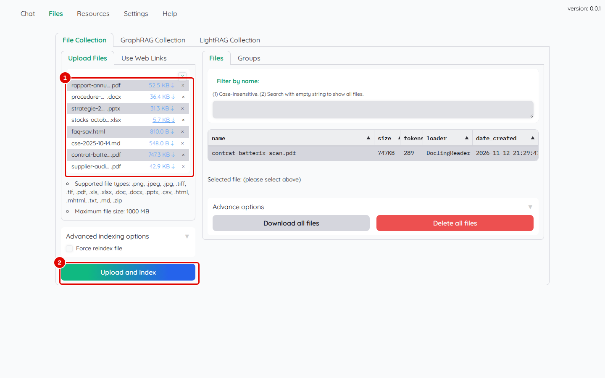
*Écran : « Upload Files », huit fichiers choisis.*

| N° | Élément | Rôle |
|---|---|---|
| 1 | fichiers choisis | un fichier par ligne, avec sa taille ; la croix en haut à droite vide la liste |
| 2 | « Upload and Index » | lance l'envoi et l'indexation de tous les fichiers |

*Résultat* : les huit fichiers sont listés dans la zone de dépôt.

**Étape 2. Indexer et lire le compte rendu**
*Où* : même écran.

Cliquer sur « Upload and Index », puis attendre la fin.

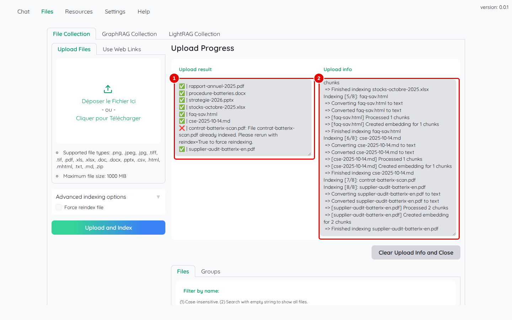
*Écran : panneau « Upload Progress » après l'ajout.*

| N° | Élément | Rôle |
|---|---|---|
| 1 | « Upload result » | une ligne par fichier, avec une coche verte s'il a été indexé |
| 2 | « Upload info » | détail de chaque fichier : conversion, découpage, calcul des représentations |

*Résultat* : en une quinzaine de secondes, le message « Successfully index 7 files » apparaît. Un fichier déjà présent dans la collection n'est pas relu : il est marqué d'une croix rouge, avec « already indexed » (sur la capture, le contrat scanné, présent d'un essai antérieur ; pour le lecteur qui suit ce manuel, ce sera le rapport annuel, ajouté au chapitre 04). Pour le relire, cocher « Force reindex file » (étape 9). Les captures de ce chapitre ont été prises à des moments où d'autres collections (« Documents partagés », « NanoGraphRAG Collection », chapitres 09 et 10) et d'autres fichiers existaient déjà : ne pas en tenir compte.

## Ajouter des pages web

**Étape 3. Saisir des adresses**
*Où* : « Files » › « File Collection » › « Use Web Links ».

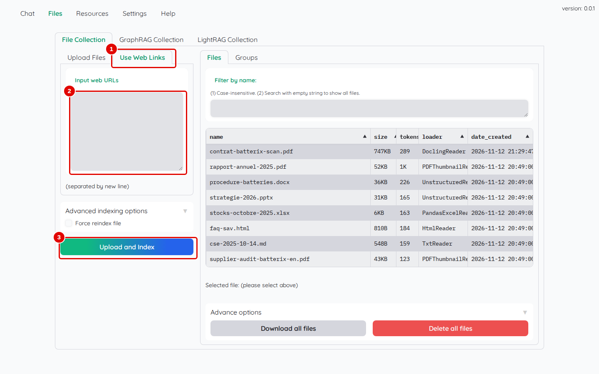
*Écran : sous-onglet « Use Web Links ».*

| N° | Élément | Rôle |
|---|---|---|
| 1 | « Use Web Links » | ajout de pages web par leur adresse |
| 2 | « Input web URLs » | une adresse par ligne (« separated by new line ») |
| 3 | « Upload and Index » | télécharge et indexe les pages |

*Résultat* : ce manuel s'arrête à cet écran. Kotaemon ne télécharge pas la page lui-même : il envoie l'adresse au service en ligne Jina Reader (`r.jina.ai`), qui lui renvoie le texte. À n'utiliser que pour des pages publiques, et seulement si cet envoi est acceptable.

## Consulter la liste et la fiche d'un fichier

**Étape 4. Lire la liste des fichiers**
*Où* : « Files » › « File Collection » › sous-onglet « Files » (à droite).

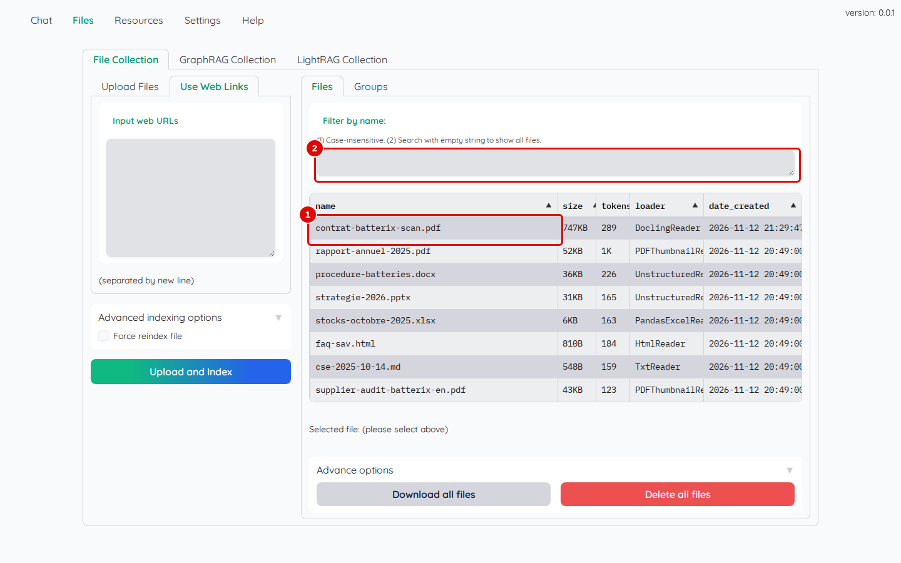
*Écran : liste des fichiers de « File Collection ».*

| N° | Élément | Rôle |
|---|---|---|
| 1 | `contrat-batterix-scan.pdf` | une ligne par fichier : nom, taille, nombre de jetons, lecteur utilisé (« loader »), date d'ajout ; sur la capture, le contrat a déjà été relu par Docling (étape 13) : à ce stade, sa ligne affiche `PDFThumbnailReader` |
| 2 | « Filter by name: » | n'affiche que les fichiers dont le nom contient le texte saisi (majuscules indifférentes) |

*Résultat* : la colonne « loader » indique le lecteur qui a lu chaque fichier : `PDFThumbnailReader` (PDF, lecteur intégré), `UnstructuredReader` (Word, PowerPoint), `PandasExcelReader` (Excel), `HtmlReader`, `TxtReader` (Markdown), `DoclingReader` (PDF lu par Docling).

**Étape 5. Ouvrir la fiche d'un fichier**
*Où* : même écran ; cliquer sur une ligne, par exemple `strategie-2026.pptx`.

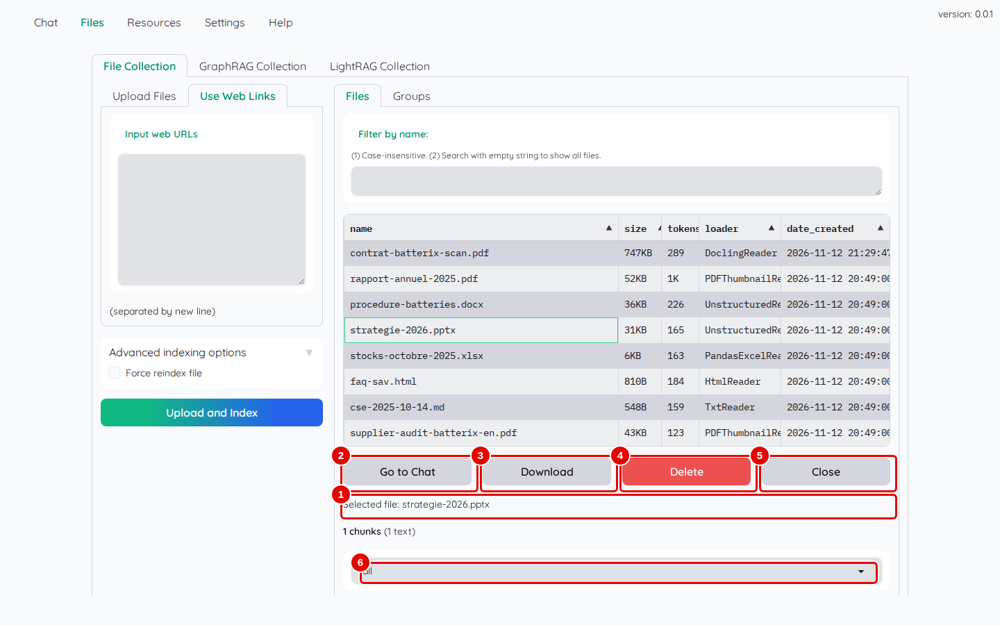
*Écran : fichier `strategie-2026.pptx` sélectionné.*

| N° | Élément | Rôle |
|---|---|---|
| 1 | « Selected file: » | nom du fichier sélectionné |
| 2 | « Go to Chat » | ouvre le chat avec la recherche limitée à ce fichier |
| 3 | « Download » | télécharge une copie du fichier |
| 4 | « Delete » | supprime le fichier, **sans confirmation** |
| 5 | « Close » | referme la fiche |
| 6 | type de passages | choix des passages affichés : `all`, `text`, `table`, `image`, `thumbnail` |

*Résultat* : en faisant défiler la page sous la liste « all », chaque passage du fichier s'affiche sur une ligne (« [1/1] … ») ; un clic sur une ligne déplie son texte. C'est le moyen de vérifier ce que Kotaemon a réellement lu dans un document.

## Regrouper des fichiers

Un **groupe** est une liste nommée de fichiers d'une collection. Il sert à limiter une recherche à ces fichiers d'un seul clic (chapitre 06).

**Étape 6. Créer un groupe**
*Où* : « Files » › « File Collection » › « Groups » (le formulaire « Add new group » s'affiche directement tant qu'aucun groupe n'existe ; sinon, cliquer sur « Add »).

Saisir `Fournisseur Batterix` dans « Group name », choisir `contrat-batterix-scan.pdf` puis `supplier-audit-batterix-en.pdf` dans « Attached files » (un clic par fichier dans la liste qui s'ouvre), puis cliquer sur « Save ».

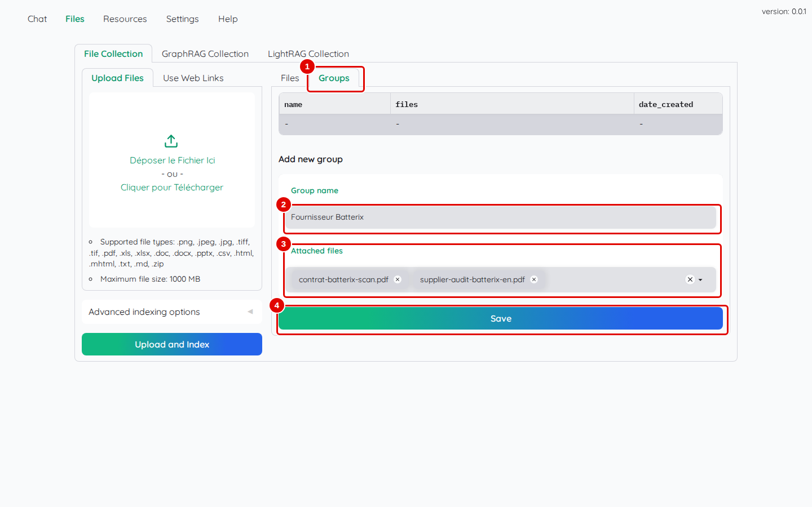
*Écran : « Groups », formulaire « Add new group ».*

| N° | Élément | Rôle |
|---|---|---|
| 1 | « Groups » | liste des groupes de la collection |
| 2 | « Group name » | nom du groupe, par exemple `Fournisseur Batterix` |
| 3 | « Attached files » | fichiers du groupe ; la croix de chaque fichier le retire |
| 4 | « Save » | enregistre le groupe |

*Résultat* : le message « Group Fournisseur Batterix has been saved » apparaît.

**Étape 7. Retrouver le groupe**
*Où* : même sous-onglet.

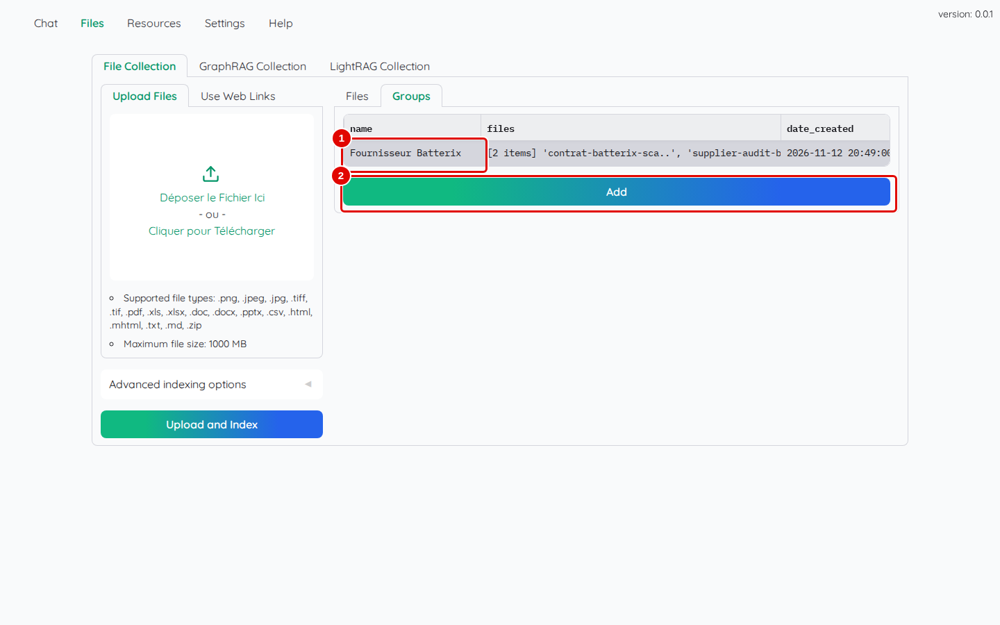
*Écran : « Groups », liste des groupes.*

| N° | Élément | Rôle |
|---|---|---|
| 1 | `Fournisseur Batterix` | le groupe, avec ses fichiers et sa date ; un clic ouvre sa fiche (« Go to Chat », « Delete », « Close ») |
| 2 | « Add » | crée un autre groupe |

*Résultat* : le groupe apparaît aussi dans le chat, dans la liste des fichiers de « Search In File(s) », sous la forme `group: 'Fournisseur Batterix'`.

## Tout supprimer, forcer la relecture

**Étape 8. Repérer la suppression de tous les fichiers**
*Où* : « Files » › « File Collection » › sous-onglet « Files » › « Advance options » (en bas).

Cliquer sur « Advance options », puis sur « Delete all files » : Kotaemon demande une confirmation. **Pour suivre la suite du manuel, cliquer sur « Cancel »** : les chapitres suivants utilisent les fichiers de la collection.

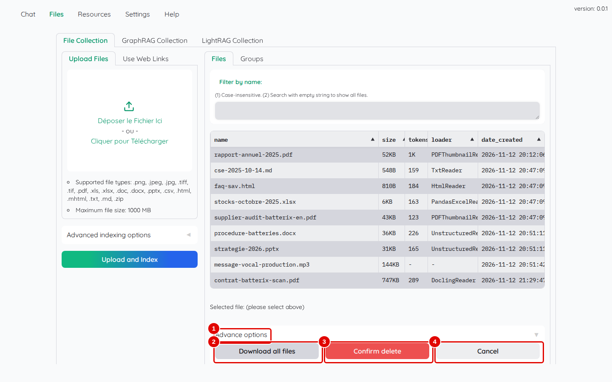
*Écran : « Advance options » ouvert, confirmation demandée (la liste contient ici un fichier MP3 d'un essai antérieur).*

| N° | Élément | Rôle |
|---|---|---|
| 1 | « Advance options » | options qui portent sur toute la collection |
| 2 | « Download all files » | télécharge tous les fichiers de la collection |
| 3 | « Confirm delete » | confirme la suppression de tous les fichiers |
| 4 | « Cancel » | annule |

*Résultat* : avec « Cancel », rien ne change. Avec « Confirm delete », un message « File … has been deleted » apparaît pour chaque fichier et les groupes de la collection restent, vides ; il faut alors tout réajouter (étape 1). C'est utile pour repartir de zéro.

**Étape 9. Forcer la relecture d'un fichier déjà présent**
*Où* : « Files » › « File Collection » › « Upload Files » › « Advanced indexing options ».

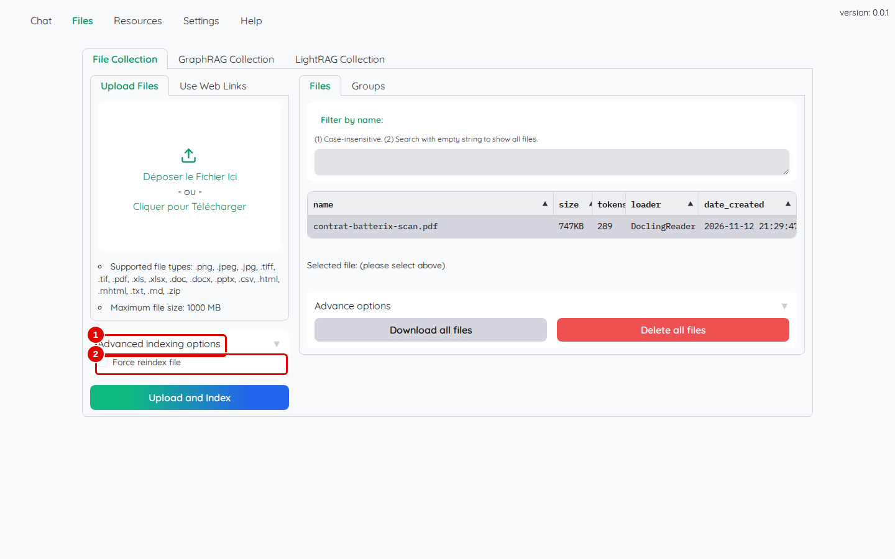
*Écran : « Advanced indexing options » ouvert.*

| N° | Élément | Rôle |
|---|---|---|
| 1 | « Advanced indexing options » | options de l'ajout |
| 2 | « Force reindex file » | relit et réindexe un fichier même s'il est déjà dans la collection |

*Résultat* : avec cette case cochée, « Upload and Index » remplace l'ancienne version du fichier. C'est nécessaire après un changement de lecteur (section suivante), ou quand un fichier a échoué : un fichier en échec reste inscrit dans la liste, sans aucun passage.

## Ajouter un fichier depuis le chat

**Étape 10. Utiliser « Quick Upload »**
*Où* : barre des onglets › « Chat » › colonne de gauche › « Quick Upload ».

Préparer d'abord une copie de la note du comité social et économique (CSE) sous un autre nom, dans le terminal Ubuntu, dossier du dépôt :

```bash
cp corpus/documents/cse-2025-10-14.md /mnt/c/Users/Public/note-rapide-cse.md
```

Cliquer ensuite dans la zone « Quick Upload » et choisir ce fichier (`C:\Users\Public\note-rapide-cse.md` dans la fenêtre de Windows).

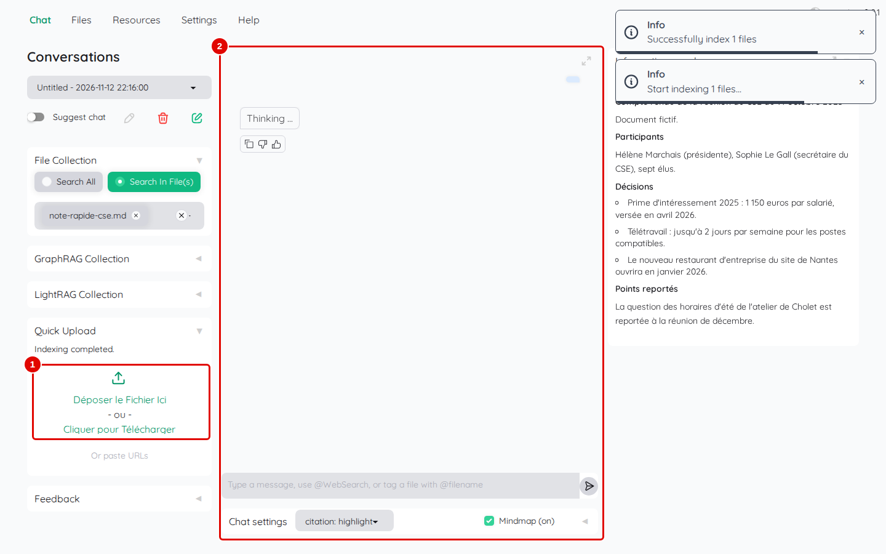
*Écran : « Chat », ajout rapide en cours.*

| N° | Élément | Rôle |
|---|---|---|
| 1 | « Quick Upload » | ajoute le fichier à « File Collection » sans quitter le chat ; « Or paste URLs » accepte une adresse web |
| 2 | zone de discussion | « Thinking ... » : Kotaemon indexe le fichier puis prépare un résumé ; les messages « Successfully index 1 files » apparaissent en haut à droite |

*Résultat* : le message « Indexing completed. » apparaît sous la zone (étape suivante).

**Étape 11. Lire le résumé automatique**
*Où* : même écran.

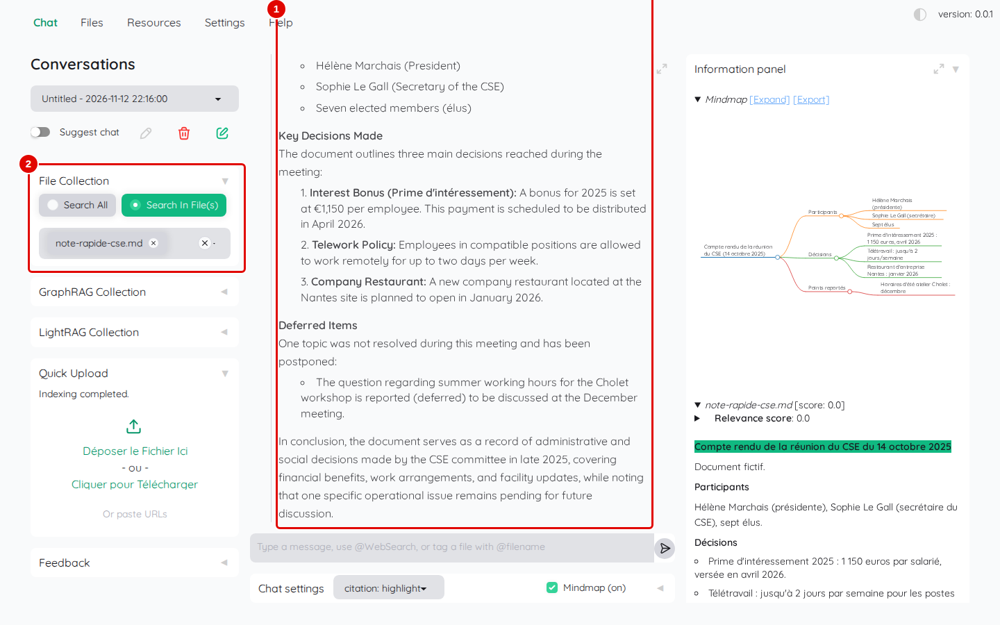
*Écran : « Chat » après l'ajout rapide.*

| N° | Élément | Rôle |
|---|---|---|
| 1 | résumé du fichier | Kotaemon pose de lui-même la question « What is the summary of this document? » (en haut de la zone, hors capture) et affiche la réponse |
| 2 | « File Collection » | la recherche est réglée sur « Search In File(s) » avec le seul fichier ajouté |

*Résultat* : le résumé et sa carte mentale s'affichent. Le résumé est en anglais quand la page vient d'être ouverte ou rechargée (à chaque ouverture ou rechargement de la page, la langue de la conversation repart sur « English » ; elle reste ensuite celle choisie pour toutes les conversations, jusqu'au prochain rechargement, chapitre 04, étape 5).

## Choisir le lecteur de fichiers

**Étape 12. Choisir Docling**
*Où* : barre des onglets › « Settings » › « Retrieval settings » › « File Collection ».

Choisir « Docling (figure+table extraction) » dans « File loader », puis cliquer sur « Save & Close ».

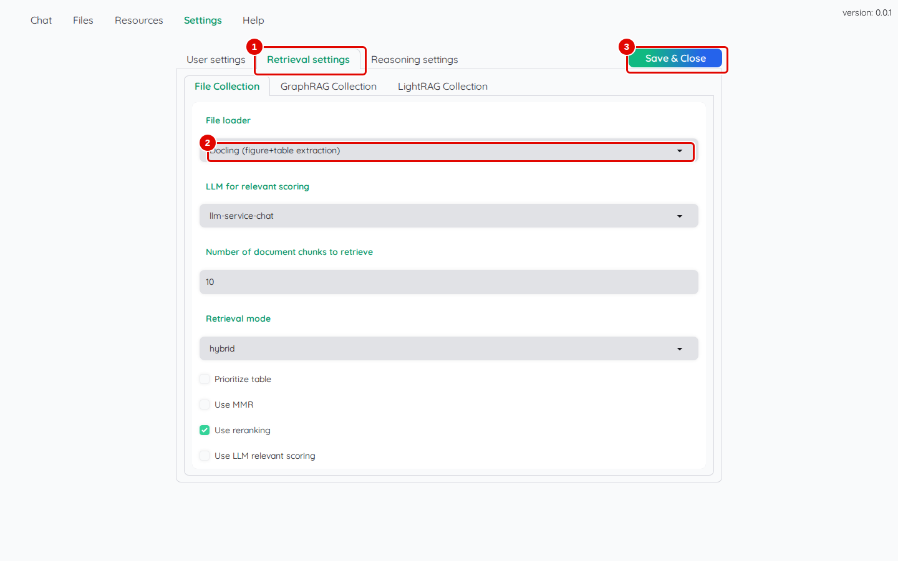
*Écran : « Settings » › « Retrieval settings », lecteur Docling choisi.*

| N° | Élément | Rôle |
|---|---|---|
| 1 | « Retrieval settings » | réglages de lecture et de recherche de la collection |
| 2 | « File loader » | lecteur des PDF : « Default (open-source) », « Docling (figure+table extraction) » ; les autres choix (Adobe, Azure : services en ligne payants ; PaddleOCR : absent de cette image) ne fonctionnent pas ici |
| 3 | « Save & Close » | enregistre le choix |

*Résultat* : le message « Setting saved » apparaît. Le choix vaut pour les PDF ajoutés **ensuite** ; les PDF déjà présents gardent leur lecture.

**Étape 13. Relire le PDF scanné avec Docling**
*Où* : « Files » › « File Collection » › « Upload Files ».

Choisir `contrat-batterix-scan.pdf`, cocher « Force reindex file » (étape 9), cliquer sur « Upload and Index », puis cliquer sur la ligne du fichier dans la liste.

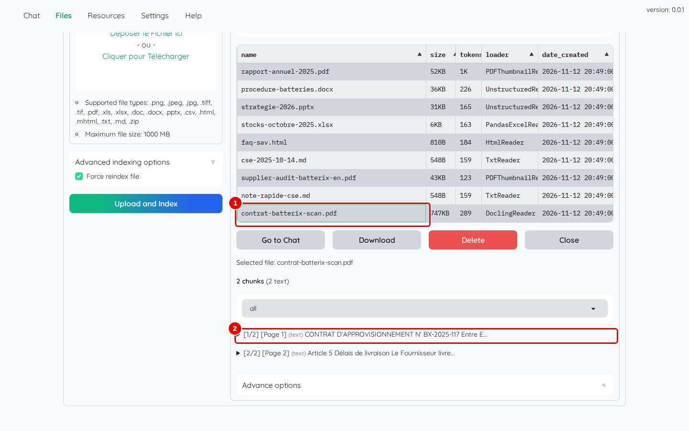
*Écran : fiche de `contrat-batterix-scan.pdf` après la relecture.*

| N° | Élément | Rôle |
|---|---|---|
| 1 | `contrat-batterix-scan.pdf` | la colonne « loader » indique désormais `DoclingReader` |
| 2 | passage lu | « [1/2] [Page 1] (text) CONTRAT D'APPROVISIONNEMENT N° BX-2025-117 … » : le texte de la page scannée est lu |

*Résultat* : la relecture prend environ 50 secondes pour ces deux pages (la première fois, Docling télécharge aussi ses modèles). Les questions sur le contrat trouvent désormais leur réponse (prix, délai, pénalités, volume). Remettre ensuite « Default (open-source) » dans « File loader », puis « Save & Close » : le lecteur intégré est plus rapide pour les PDF de texte et garde la vignette de chaque page ; revenir à Docling seulement pour un autre PDF scanné. Les choix « PaddleOCR » de la même liste désignent un autre lecteur à lecture optique, absent de cette image.

## Supprimer un fichier

**Étape 14. Supprimer un fichier**
*Où* : « Files » › « File Collection » › sous-onglet « Files » ; cliquer sur la ligne du fichier.

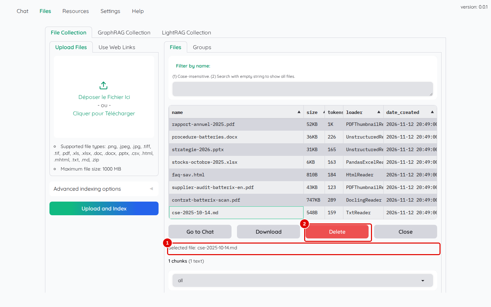
*Écran : fiche du fichier `cse-2025-10-14.md`.*

| N° | Élément | Rôle |
|---|---|---|
| 1 | « Selected file: » | fichier sélectionné : vérifier son nom avant de continuer |
| 2 | « Delete » | supprime le fichier aussitôt |

*Résultat* : le message « File cse-2025-10-14.md has been deleted » apparaît et le fichier disparaît de la liste. **Ajouter de nouveau `cse-2025-10-14.md`** (étape 1) : il sert aux chapitres suivants. Supprimer de la même façon la copie `note-rapide-cse.md` de l'étape 10, devenue inutile.

## Réparer un groupe après une relecture forcée

Une relecture forcée (étape 9 ou 13) remplace le fichier par une nouvelle version, avec un nouvel identifiant interne. Les groupes qui contenaient ce fichier gardent l'ancien identifiant : le fichier en disparaît sans aucun message.

**Étape 15. Repérer le groupe incomplet**
*Où* : « Files » › « File Collection » › « Groups » ; cliquer sur la ligne `Fournisseur Batterix`.

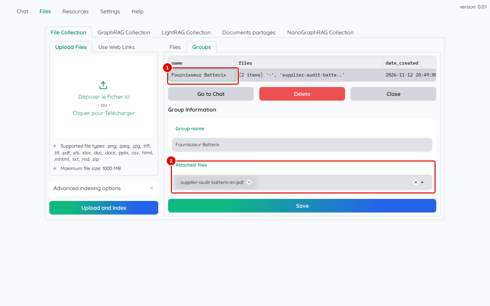
*Écran : fiche du groupe `Fournisseur Batterix` après la relecture du contrat par Docling.*

| N° | Élément | Rôle |
|---|---|---|
| 1 | `Fournisseur Batterix` | la colonne « files » affiche « [2 items] '-', 'supplier-audit-batte..' » : le premier fichier n'existe plus sous cet identifiant |
| 2 | « Attached files » | seul l'audit reste ; le contrat a disparu du groupe |

*Résultat* : le défaut est visible ; une question limitée à ce groupe ne trouverait plus le contrat.

**Étape 16. Remettre le fichier dans le groupe**
*Où* : même fiche.

Cliquer dans « Attached files », choisir `contrat-batterix-scan.pdf`, puis cliquer sur « Save ».

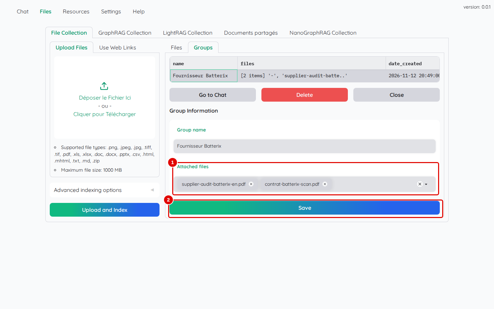
*Écran : fiche du groupe, contrat remis.*

| N° | Élément | Rôle |
|---|---|---|
| 1 | « Attached files » | le contrat et l'audit |
| 2 | « Save » | enregistre le groupe |

*Résultat* : le message « Group Fournisseur Batterix has been saved » apparaît ; le groupe contient de nouveau ses deux fichiers.

## Bon à savoir

- Formats acceptés : PDF, images (PNG, JPEG, TIFF), Word (`.doc`, `.docx`), Excel (`.xls`, `.xlsx`), PowerPoint (`.pptx`), CSV, HTML, MHTML, texte, Markdown et archives ZIP ; taille maximale 1000 Mo par fichier.
- Les collections sont privées par défaut : chaque compte ne voit que les fichiers qu'il a ajoutés (chapitre 11).
- **Lecteur extérieur** : Kotaemon accepte qu'un lecteur écrit à part remplace le sien pour une extension donnée (réglage `FILE_INDEX_PIPELINE_FILE_EXTRACTORS` de son fichier de configuration `flowsettings.py`). C'est par ce moyen qu'un serveur Docling ou PaddleOCR installé hors de Kotaemon peut lire les PDF : un petit module Python envoie le fichier au serveur et rend le texte page par page. Ce branchement n'est pas réalisé dans ce manuel ; la méthode est décrite dans l'[annexe A3](../annexes/A3-automatiser-par-la-bibliotheque.md).
- Un fichier Word ou PowerPoint qui échoue avec « HTTP Error 403: Forbidden » signale des données de découpage manquantes : relancer le script d'installation (chapitre 02), puis forcer la relecture (étape 9) ; voir le chapitre 13 (étape 4) pour LightRAG et NanoGraphRAG après une réinstallation.

## En cas de problème

| Symptôme | Cause | Que faire |
|---|---|---|
| « Have errors for 1 files » | format non lu (audio) ou données manquantes | lire « Upload info » ; voir le [chapitre 13](13-en-cas-de-probleme.md) |
| un PDF scanné ne donne aucune réponse | lecteur intégré sans lecture optique | lecteur Docling et relecture forcée (étapes 12 et 13) |
| un fichier déjà présent n'est pas relu | Kotaemon ignore les fichiers déjà indexés | cocher « Force reindex file » (étape 9) |
| un fichier a disparu | clic sur « Delete » dans sa fiche | l'ajouter de nouveau (étape 1) |
| un groupe ne trouve plus un fichier | fichier relu par « Force reindex file » | le remettre dans le groupe (étapes 15 et 16) |

---
*Version décrite : Kotaemon 0.12.0, essais du 12 novembre 2026. Détails et preuves : [rapport d'essais](../annexes/A6-rapport-d-essais.md).*
