# 06. Poser des questions et lire les sources

> Ce chapitre apprend à limiter une question à certains fichiers ou à un groupe, à choisir le style des citations, à lire les notes de pertinence et la carte mentale, à gérer les conversations (parcourir, renommer, supprimer), à donner un avis sur une réponse et à régler l'affichage.
> **Point de départ** : onglet « Chat », documents ajoutés (chapitres 04 et 05).
> **Durée** : environ 20 minutes. **Avant** : chapitre 05.

## Ce qu'il faut savoir

Chaque question est posée dans une **conversation**. Les questions d'une même conversation se suivent : Kotaemon tient compte des échanges précédents (les cinq derniers par défaut) pour comprendre une question de suite comme « Et le numéro du service après-vente ? ».

Pour chaque collection, la colonne de gauche propose deux façons de chercher :

- « Search All » : tous les fichiers de la collection ;
- « Search In File(s) » : seulement les fichiers ou les groupes choisis dans la liste qui apparaît.

Tant qu'aucun des deux n'est choisi, la collection n'est pas consultée.

Les réglages de « Chat settings » (méthode, modèle, langue, style de citation, carte mentale) valent pour toutes les conversations ouvertes dans l'onglet du navigateur, jusqu'au prochain rechargement de la page : à chaque ouverture ou rechargement de la page, la langue de la conversation repart sur « English » ; elle reste ensuite celle choisie pour toutes les conversations, jusqu'au prochain rechargement.

## Limiter la recherche à un groupe ou à des fichiers

**Étape 1. Choisir des fichiers ou un groupe**
*Où* : « Chat » › colonne de gauche › « File Collection » › « Search In File(s) ».

Cliquer sur « Search In File(s) » (pastille 1), puis dans la liste qui apparaît (pastille 2) : choisir un groupe (pastille 3) ou un ou plusieurs fichiers (pastille 4).

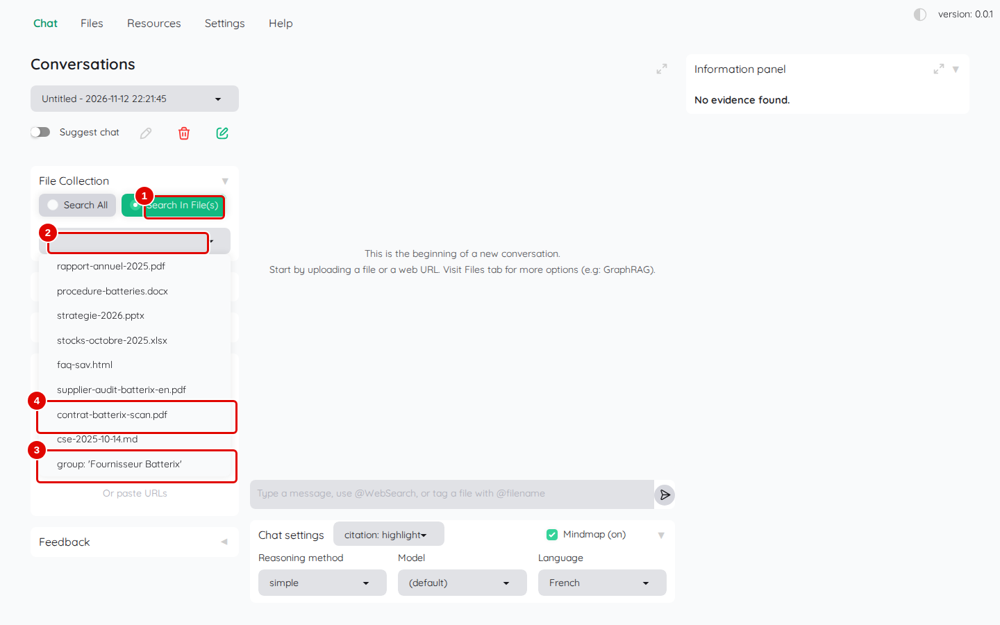
*Écran : « Chat », liste des fichiers ouverte sous « Search In File(s) ».*

| N° | Élément | Rôle |
|---|---|---|
| 1 | « Search In File(s) » | limite la recherche aux éléments choisis |
| 2 | liste des fichiers | fichiers et groupes de la collection ; un clic ajoute un élément, sa croix le retire |
| 3 | `group: 'Fournisseur Batterix'` | groupe créé au chapitre 05 : tous ses fichiers d'un coup |
| 4 | `contrat-batterix-scan.pdf` | un fichier seul |

*Résultat* : l'élément choisi apparaît dans la liste, avec une croix pour le retirer.

**Étape 2. Poser la question et lire la réponse**
*Où* : zone de saisie, puis zone de discussion.

Écrire `Quel score Batterix a-t-il obtenu à l'audit, et quel prix unitaire le contrat fixe-t-il ?`, puis Entrée.

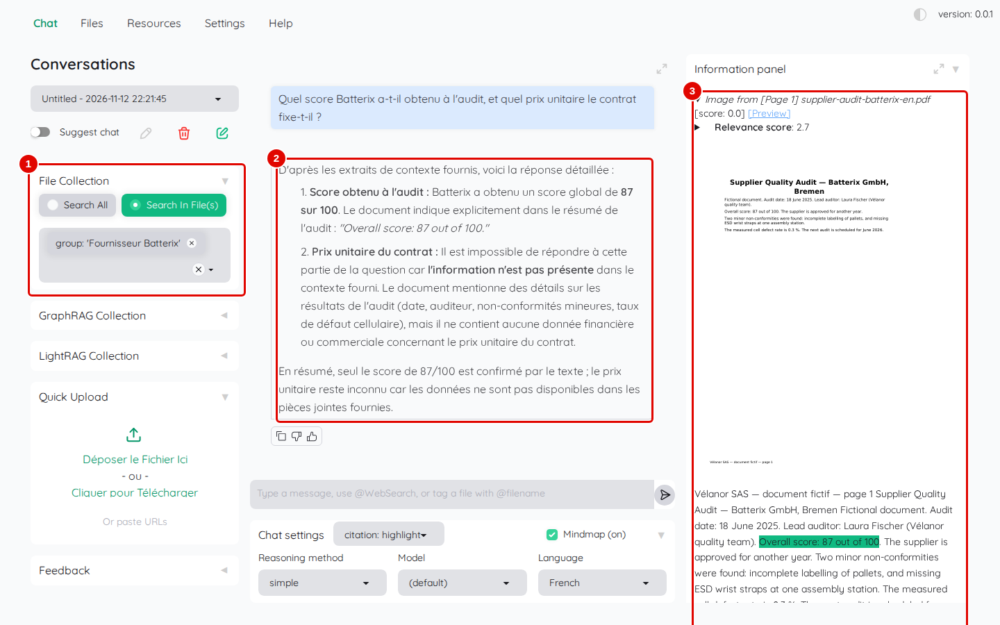
*Écran : « Chat », réponse à une question limitée au groupe.*

| N° | Élément | Rôle |
|---|---|---|
| 1 | « File Collection » | recherche limitée au groupe `Fournisseur Batterix` |
| 2 | réponse | réponse en deux parties, une par sous-question |
| 3 | « Information panel » | passages retenus, ici la page 1 de l'audit, phrase « Overall score: 87 out of 100 » surlignée |

*Résultat* : pour le lecteur qui a réparé le groupe au chapitre 05 (étapes 15 et 16), la réponse donne le score de l'audit (87 sur 100) et le prix du contrat (212 euros HT). La capture montre l'état d'avant la réparation : le groupe avait perdu le contrat, la réponse ne trouve que le score et le panneau ne montre que l'audit.

**Étape 3. Désigner un fichier dans la question**
*Où* : zone de saisie.

Le texte d'aide de la zone de saisie (« Type a message, use @WebSearch, or tag a file with @filename ») indique qu'un fichier peut être désigné en écrivant `@` suivi de son nom. Ouvrir une nouvelle conversation (crayon dans un carré vert, sous la liste des conversations, étape 9), cliquer sur « Search All », puis écrire `Quel est le prix du Vilaine Compact ? @strat` et Entrée.

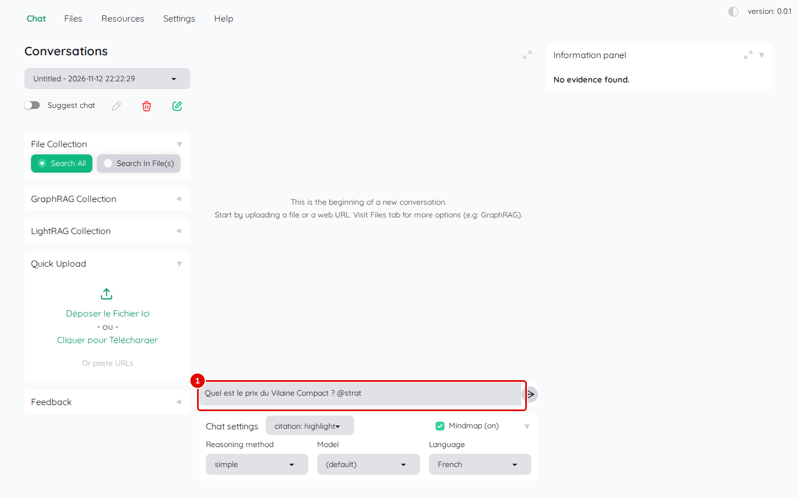
*Écran : « Chat », question avec mention `@strat`.*

| N° | Élément | Rôle |
|---|---|---|
| 1 | zone de saisie | question suivie de `@strat` |

*Résultat* : aucune liste de suggestions ne s'affiche ; la question part telle quelle, et la réponse (« 2 490 € TTC ») cite bien `strategie-2026.pptx`. Le mot `@WebSearch`, lui, envoie la question à un moteur de recherche en ligne (service Tavily, avec une clé payante) : il ne fonctionne pas dans cette installation.

## Choisir le style des citations et la carte mentale

**Étape 4. Ouvrir la liste des styles de citation**
*Où* : sous la zone de saisie, à droite de « Chat settings ».

Cliquer sur la liste qui affiche « citation: highlight ».

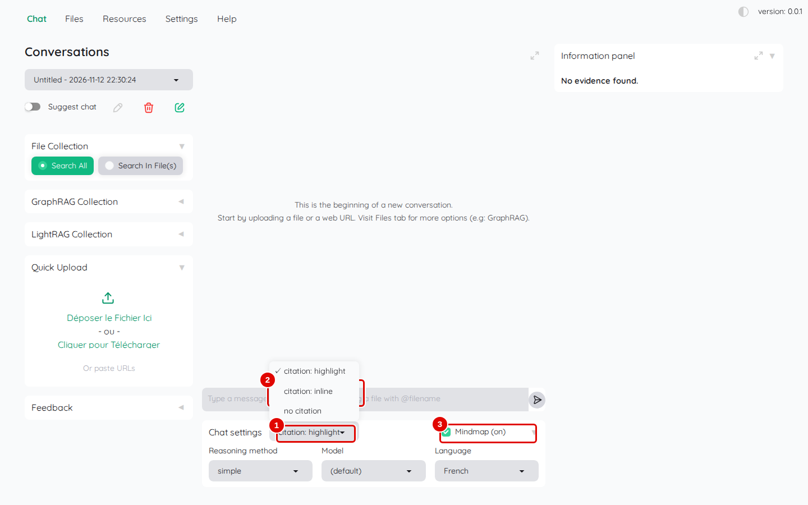
*Écran : « Chat », liste des styles de citation ouverte.*

| N° | Élément | Rôle |
|---|---|---|
| 1 | style de citation | valeur actuelle (« citation: highlight » au départ) |
| 2 | « citation: inline » | numéros de renvoi dans le texte de la réponse ; « no citation » : aucun renvoi |
| 3 | « Mindmap » | case de la carte mentale : « Mindmap (on) » ou « Mindmap (off) » |

Les trois styles :

- « citation: highlight » (par défaut) : la réponse reste propre ; les phrases des documents qui la justifient sont surlignées en vert dans le panneau des sources ;
- « citation: inline » : des numéros entre crochets, comme 【1】, renvoient dans la réponse aux passages du panneau ; peu fiable avec le modèle de ce poste (étape 5) ;
- « no citation » : aucun repère, réponse plus rapide.

*Résultat* : le style choisi s'applique aux questions suivantes.

**Étape 5. Essayer le style « citation: inline »**
*Où* : zone de discussion et « Information panel ».

Choisir « citation: inline » dans la liste de l'étape 4, décocher « Mindmap », ouvrir une nouvelle conversation avec « Search All », puis poser `Quelle est la capacité prévue de l'usine de Saint-Nazaire ?`.

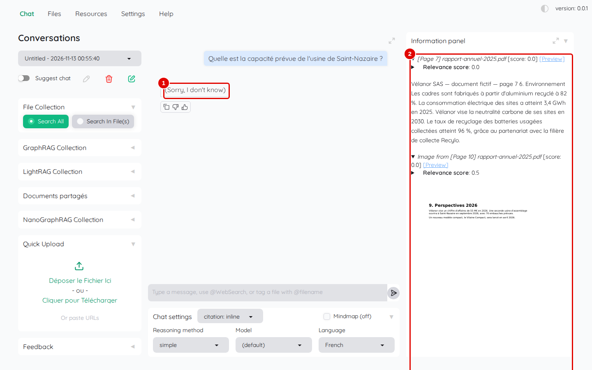
*Écran : « Chat », réponse en style « citation: inline ».*

| N° | Élément | Rôle |
|---|---|---|
| 1 | réponse | ici « (Sorry, I don't know) », alors que la réponse (25 000 vélos par an) est dans `strategie-2026.pptx` |
| 2 | « Information panel » | les passages retenus, dont la diapositive « Usine de Saint-Nazaire » |

*Résultat* : quand ce style fonctionne, la réponse contient des numéros entre crochets, comme 【1】, qui renvoient aux passages surlignés du panneau. Lors des essais, il n'a fonctionné que 2 fois sur 7 avec le modèle de ce poste ; les 5 autres fois, la réponse a été « (Sorry, I don't know) » alors que le bon passage était trouvé. **Garder « citation: highlight »**, qui a répondu juste à chaque essai.

**Étape 6. Lire le détail des notes d'un passage**
*Où* : « Information panel » › bloc d'un passage › « Relevance score ».

Dans le bloc d'un passage, cliquer sur le triangle de « Relevance score ».

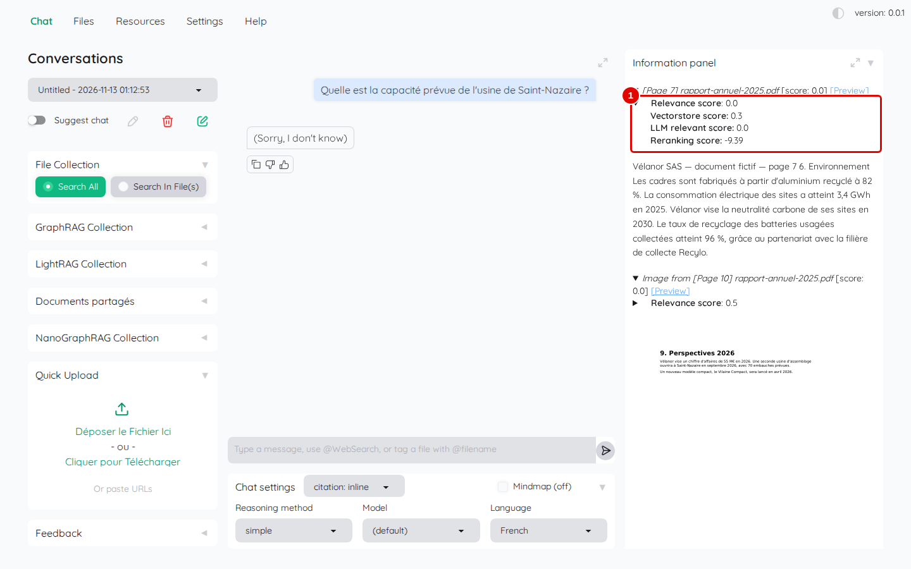
*Écran : « Information panel », notes d'un passage dépliées.*

| N° | Élément | Rôle |
|---|---|---|
| 1 | « Relevance score » et détail des notes | note de pertinence retenue pour le passage, puis son détail : « Vectorstore score » (proximité de sens, de 0 à 1), « LLM relevant score » (note du modèle de réponse, 0 si l'option est désactivée), « Reranking score » (note du modèle de tri : positive si le passage répond, négative sinon) |

*Résultat* : la note du modèle de tri est la plus parlante : un passage noté au-dessus de 0 répond en général à la question.

**Étape 7. Afficher la carte mentale**
*Où* : sous la zone de saisie : « citation: highlight » et case « Mindmap » cochée (« Mindmap (on) »).

Remettre « citation: highlight », cocher « Mindmap », nouvelle conversation avec « Search All », puis poser `Quelles sont les perspectives 2026 de Vélanor ?`.

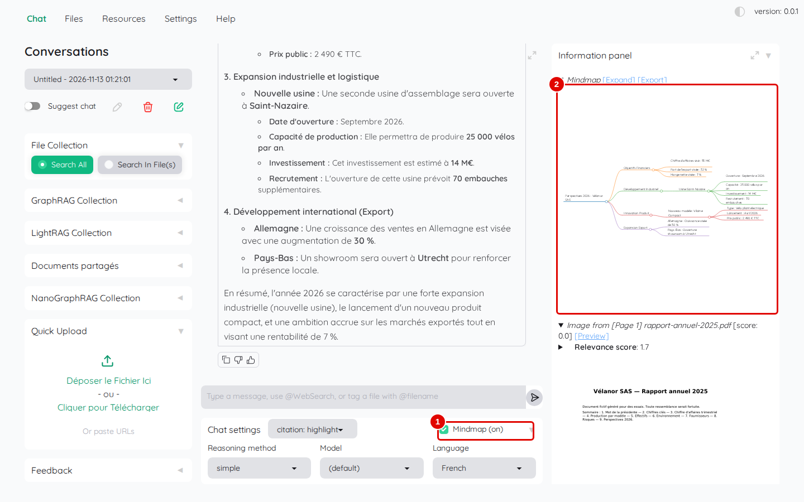
*Écran : « Information panel », carte mentale en tête du panneau.*

| N° | Élément | Rôle |
|---|---|---|
| 1 | « Mindmap (on) » | carte mentale activée |
| 2 | carte mentale | schéma de la réponse, branche par branche ; « [Expand] » l'agrandit, « [Export] » l'enregistre |

*Résultat* : la carte mentale s'affiche au-dessus des passages. Elle demande un appel de plus au modèle : la décocher rend les réponses plus rapides.

## Gérer les conversations

**Étape 8. Retrouver une conversation**
*Où* : colonne de gauche › liste des conversations (sous « Conversations »).

Les captures des étapes 8 à 13 montrent à l'arrière-plan des noms de conversations, des messages (« Conversation renamed. ») et des réponses issus d'autres essais : ne pas en tenir compte.

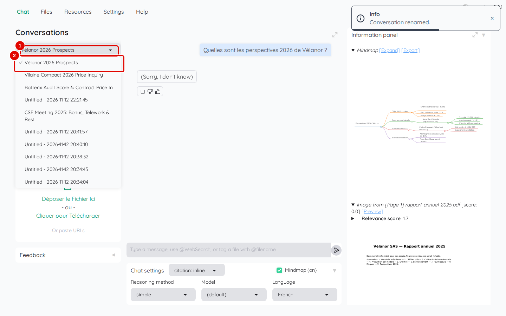
*Écran : « Chat », liste des conversations ouverte.*

| N° | Élément | Rôle |
|---|---|---|
| 1 | liste des conversations | affiche le nom de la conversation ouverte ; un clic déroule les autres, une saisie les filtre |
| 2 | une conversation | un clic la rouvre, avec ses questions et ses réponses |

*Résultat* : la conversation choisie s'affiche. Kotaemon nomme lui-même chaque conversation d'après sa première question, souvent en anglais (« Untitled » tant qu'aucune réponse n'est arrivée).

**Étape 9. Repérer les boutons d'une conversation**
*Où* : sous la liste des conversations.

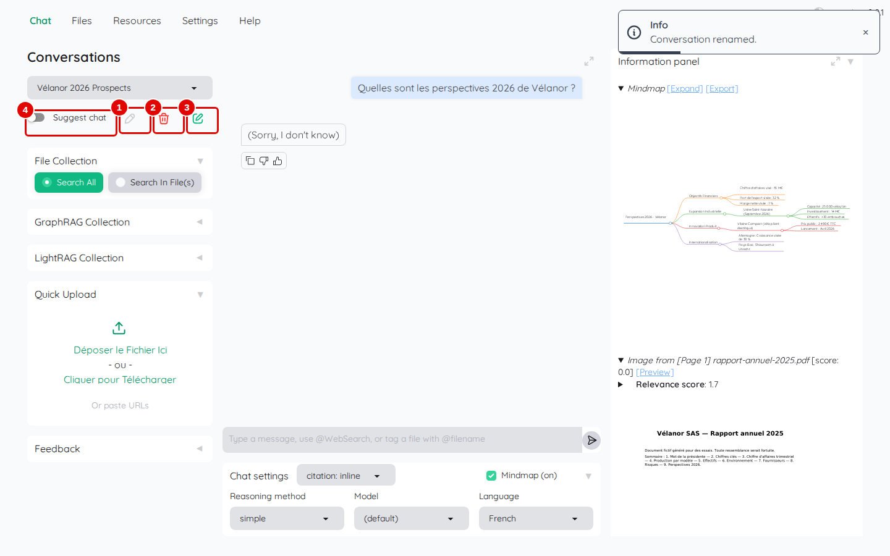
*Écran : « Chat », boutons sous la liste des conversations.*

| N° | Élément | Rôle |
|---|---|---|
| 1 | crayon | renomme la conversation ouverte |
| 2 | corbeille rouge | supprime la conversation ouverte |
| 3 | crayon dans un carré vert | ouvre une nouvelle conversation |
| 4 | « Suggest chat » | interrupteur des suggestions de questions, une fonction que Kotaemon laisse désactivée par défaut |

*Résultat* : les trois boutons agissent sur la conversation affichée dans la liste.

**Étape 10. Renommer la conversation**
*Où* : crayon (pastille 1 de l'étape 9).

Saisir le nouveau nom dans le champ qui apparaît, puis Entrée.

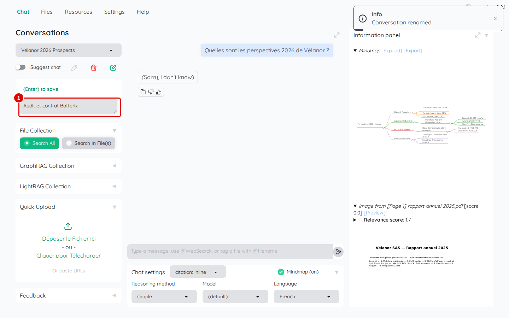
*Écran : « Chat », champ de renommage.*

| N° | Élément | Rôle |
|---|---|---|
| 1 | « Conversation name » | nouveau nom ; Entrée l'enregistre (« (Enter) to save ») |

*Résultat* : le message « Conversation renamed. » apparaît et la liste affiche le nouveau nom.

**Étape 11. Supprimer la conversation**
*Où* : corbeille rouge (pastille 2 de l'étape 9).

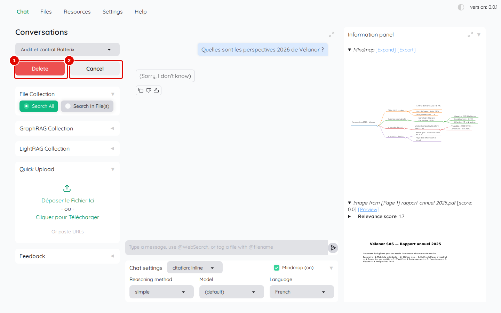
*Écran : « Chat », confirmation de suppression.*

| N° | Élément | Rôle |
|---|---|---|
| 1 | « Delete » | supprime définitivement la conversation |
| 2 | « Cancel » | annule |

*Résultat* : avec « Cancel », rien ne change (c'est le choix fait ici) ; avec « Delete », la conversation disparaît de la liste.

## Donner un avis et partager

**Étape 12. Signaler une réponse**
*Où* : colonne de gauche › « Feedback ».

Cliquer sur « Feedback » pour l'ouvrir, choisir « The answer is correct » (ou « The answer is incorrect »), cocher au besoin une case de « Other issue: », écrire une explication dans la zone de texte, puis cliquer sur « Report ».

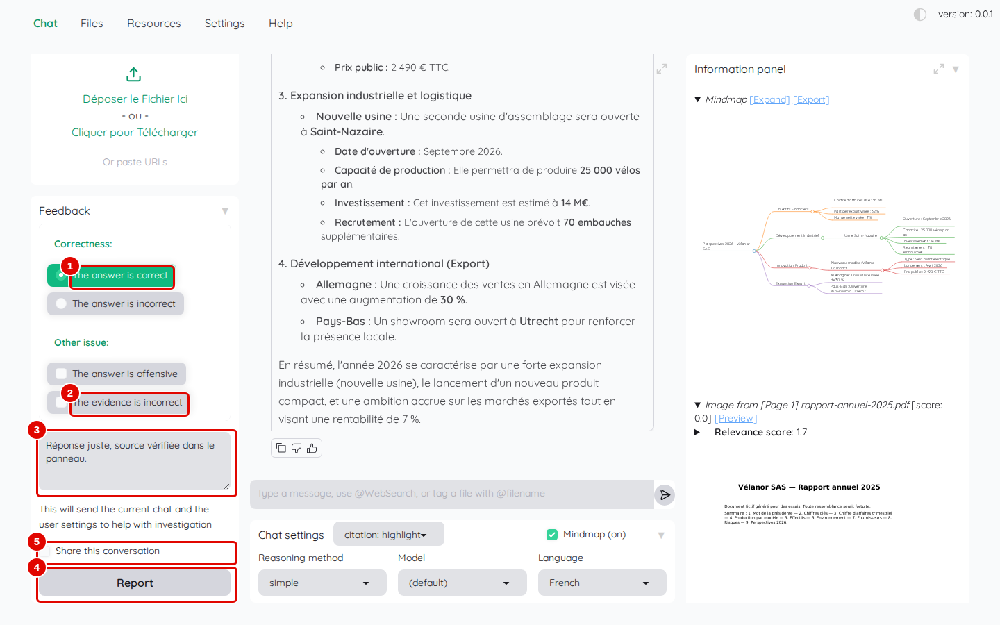
*Écran : « Chat », bloc « Feedback » ouvert.*

| N° | Élément | Rôle |
|---|---|---|
| 1 | « The answer is correct » | la réponse est juste (l'autre choix : « The answer is incorrect ») |
| 2 | « The evidence is incorrect » | les sources citées ne conviennent pas (autre case : « The answer is offensive ») |
| 3 | zone « More detail » | explication libre (ce qui est faux, la bonne réponse) |
| 4 | « Report » | enregistre l'avis dans la base de Kotaemon |
| 5 | « Share this conversation » | rend la conversation visible des autres comptes (chapitre 11) |

*Résultat* : le message « Thank you for your feedback » apparaît ; l'avis est enregistré dans la base de Kotaemon, sur le poste. Le texte affiché sous le bloc (« This will send the current chat and the user settings to help with investigation ») veut dire que la conversation et les réglages sont joints à l'avis, dans cette même base ; rien ne part vers Internet. Les pouces sous chaque réponse servent au même usage, en un clic.

## Régler l'affichage

**Étape 13. Passer en mode sombre et agrandir les zones**
*Où* : barre des onglets, à droite (mode sombre) ; coins des zones de discussion et d'information (flèches).

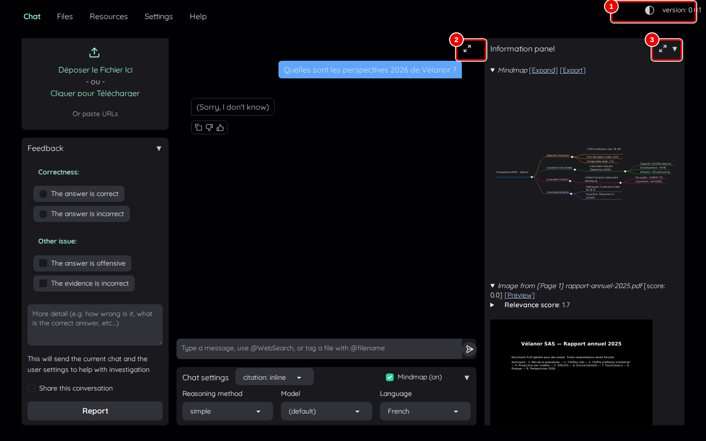
*Écran : « Chat » en mode sombre.*

| N° | Élément | Rôle |
|---|---|---|
| 1 | mode sombre | bascule entre fond clair et fond sombre |
| 2 | agrandir la discussion | donne toute la largeur à la zone de discussion |
| 3 | agrandir le panneau d'information | donne plus de place aux sources |

*Résultat* : l'écran passe en fond sombre ; un nouveau clic revient au fond clair.

## Bon à savoir

- Pour une réponse fiable, poser une question précise par message ; les questions qui mêlent plusieurs documents réussissent mieux avec la méthode « complex » (chapitre 07).
- La note de pertinence aide à juger une réponse : si tous les passages ont une note de tri négative, la réponse est probablement « je ne sais pas ».
- La langue de réponse se règle dans « Chat settings » › « Language » à chaque nouvelle visite (chapitre 04, étape 5).

## En cas de problème

| Symptôme | Cause | Que faire |
|---|---|---|
| « (Sorry, I don't know) » alors que la réponse existe | style « citation: inline » (5 échecs sur 7 essais) | revenir à « citation: highlight » |
| la réponse ignore un document attendu | recherche limitée à d'autres fichiers | vérifier « Search All » ou la liste de « Search In File(s) » |
| `@WebSearch` ne répond pas | service de recherche en ligne non configuré | ne pas utiliser ; voir le [chapitre 13](13-en-cas-de-probleme.md) |

---
*Version décrite : Kotaemon 0.12.0, essais du 12 novembre 2026. Détails et preuves : [rapport d'essais](../annexes/A6-rapport-d-essais.md).*
