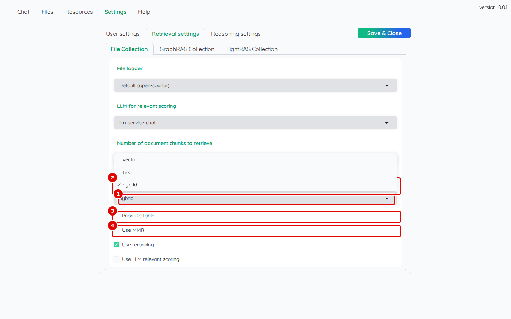
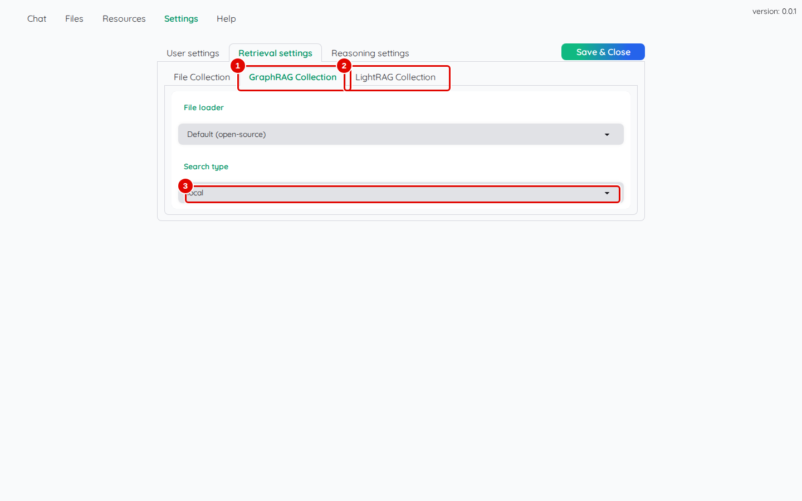
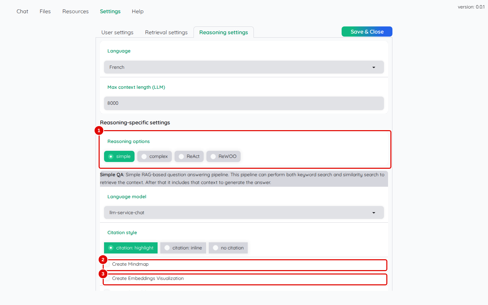
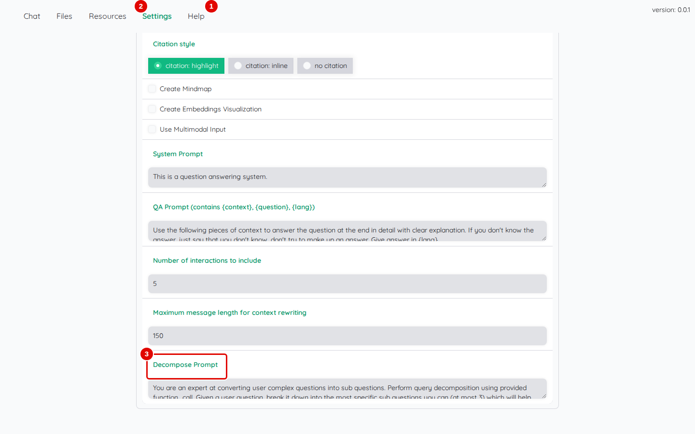
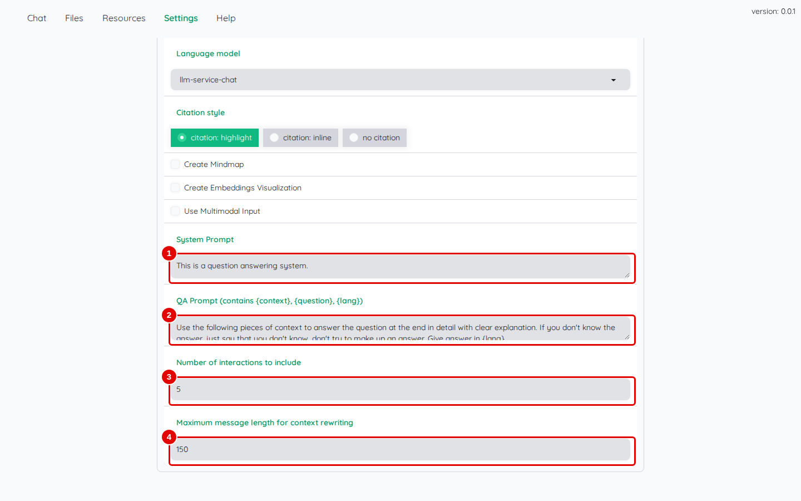
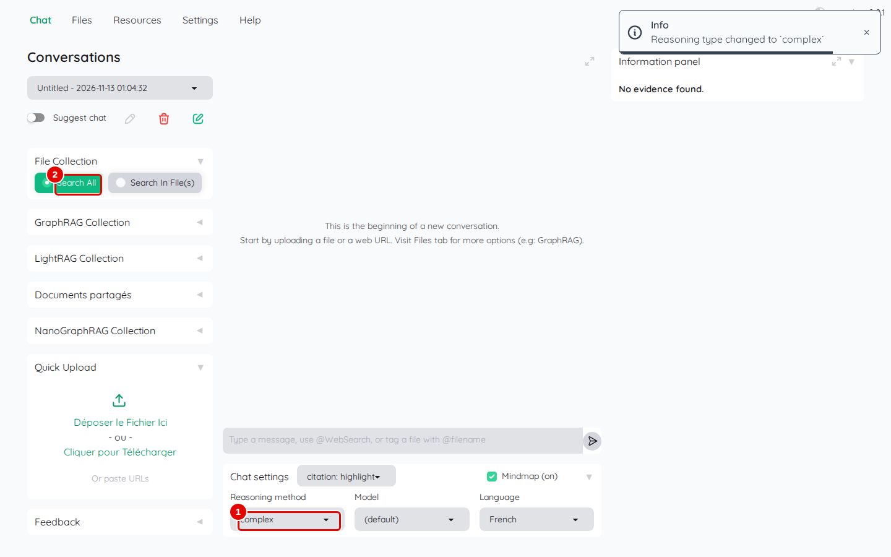
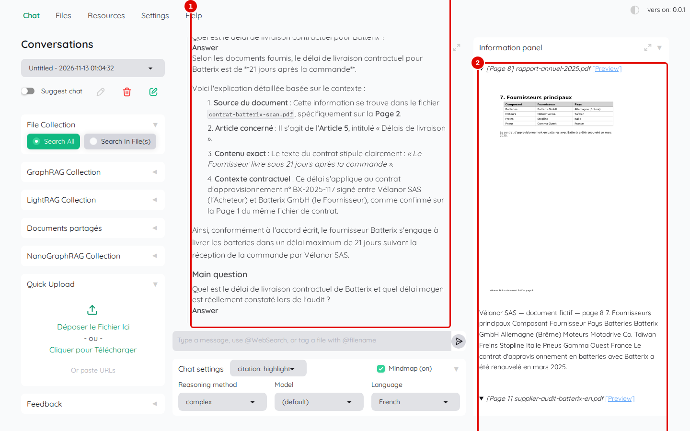
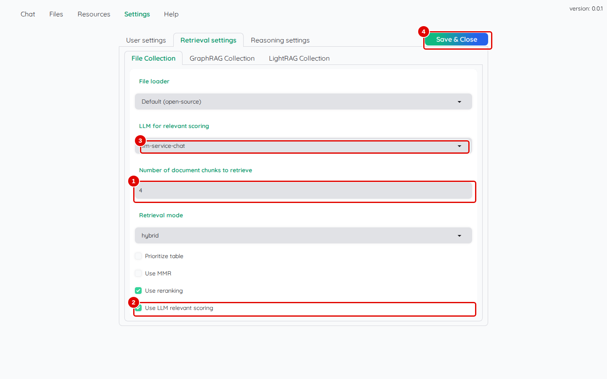
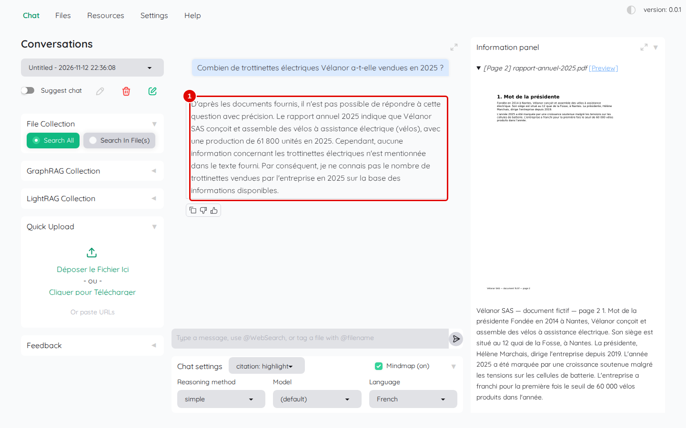

# 07. Régler la recherche et le raisonnement

> Ce chapitre apprend à régler la façon dont Kotaemon cherche les passages (mode de recherche, diversité, tableaux, tri, notation) et la façon dont il rédige (méthode de raisonnement, consignes, historique), pour tout le compte ou pour une seule conversation.
> **Point de départ** : Kotaemon ouvert, session ouverte, documents ajoutés (chapitre 05).
> **Durée** : environ 20 minutes. **Avant** : chapitre 06.

## Ce qu'il faut savoir

Les réglages se trouvent à deux endroits :

- « Settings » : réglages du compte, gardés d'une visite à l'autre ; « Retrieval settings » règle la **recherche** (un sous-onglet par collection), « Reasoning settings » règle la **rédaction** ;
- « Chat settings », sous la zone de saisie : méthode, modèle, langue, style de citation et carte mentale de la conversation, qui l'emportent sur « Settings » jusqu'au rechargement de la page.

Kotaemon propose quatre **méthodes de raisonnement** :

| Méthode | Principe | Quand l'utiliser |
|---|---|---|
| `simple` | une recherche, puis une réponse | la plupart des questions |
| `complex` | découpe la question en sous-questions, cherche chacune, puis rédige une réponse d'ensemble | questions composées (« quel délai prévu, et quel délai constaté ? ») |
| `ReAct` | agent qui alterne réflexion et recherche, pas à pas (chapitre 08) | questions qui demandent plusieurs recherches enchaînées |
| `ReWOO` | agent qui prépare d'abord un plan de recherches, puis rédige (chapitre 08) | même usage, avec un plan lisible |

Les réglages conseillés pour le service de modèles de ce poste sont ceux du chapitre 03 (recherche `hybrid`, tri par `llm-service-rerank`, notation par le modèle désactivée, 8 000 jetons de passages au plus), avec **3 à 5 passages** plutôt que 10 : sur le jeu d'essai, 3 passages donnent un peu plus de bonnes réponses, un peu plus vite (« Number of document chunks to retrieve », chapitre 03, étape 11).

## Régler la recherche

**Étape 1. Choisir le mode de recherche**
*Où* : barre des onglets › « Settings » › « Retrieval settings » › « File Collection ».

Ouvrir la liste « Retrieval mode ».

*Écran : « Retrieval settings », liste « Retrieval mode » ouverte.*

| N° | Élément | Rôle |
|---|---|---|
| 1 | « Retrieval mode » | `vector` : par le sens ; `text` : par les mots exacts ; `hybrid` : les deux, réunis |
| 2 | `hybrid` | valeur par défaut, conseillée |
| 3 | « Prioritize table » | ajoute les tableaux des documents trouvés aux passages transmis |
| 4 | « Use MMR » | choisit des passages variés, pour éviter de transmettre plusieurs fois la même information |

*Résultat* : le mode choisi s'applique après « Save & Close ». `hybrid` retrouve à la fois les passages qui contiennent les mots de la question (un numéro, un nom propre) et ceux qui en reprennent le sens.

**Étape 2. Régler les collections en graphe**
*Où* : même écran › sous-onglets « GraphRAG Collection » et « LightRAG Collection ».

*Écran : « Retrieval settings », collection « GraphRAG Collection ».*

| N° | Élément | Rôle |
|---|---|---|
| 1 | « GraphRAG Collection » | réglages de la collection en graphe de Microsoft (Microsoft GraphRAG, inutilisable ici, chapitre 09) |
| 2 | « LightRAG Collection » | réglages de la collection LightRAG (chapitre 09) |
| 3 | « Search type » | `local` : autour des entités de la question ; `global` : sur l'ensemble du graphe ; `hybrid` : les deux |

*Résultat* : chaque collection garde ses propres réglages. Rien à changer ici : la valeur de départ de « Search type », `local`, convient (chapitre 09).

Les autres réglages de « File Collection » sont décrits au chapitre 03 (étape 11) : « Number of document chunks to retrieve », « Use reranking », « Use LLM relevant scoring » et « File loader » (chapitre 05) ; « LLM for relevant scoring » est décrit plus bas (étape 8).

## Régler la rédaction

**Étape 3. Lire les options de la méthode simple**
*Où* : « Settings » › « Reasoning settings ».

*Écran : « Reasoning settings », méthode `simple`.*

| N° | Élément | Rôle |
|---|---|---|
| 1 | « Reasoning options » | méthode utilisée par défaut : `simple`, `complex`, `ReAct`, `ReWOO` |
| 2 | « Create Mindmap » | carte mentale de chaque réponse (la case « Mindmap » du chat l'emporte) |
| 3 | « Create Embeddings Visualization » | graphique qui situe la question et les passages les uns par rapport aux autres |

*Résultat* : la page montre aussi « Language model » et « Citation style » (chapitre 03 et chapitre 06), et, plus bas, la case « Use Multimodal Input », qui envoie aussi les images des figures au modèle ; prévue pour un service Azure, elle est sans effet ici.

**Étape 4. Choisir la méthode `complex`**
*Où* : même écran ; cliquer sur `complex` dans « Reasoning options ».

*Écran : « Reasoning settings », bas des options de la méthode `complex`.*

| N° | Élément | Rôle |
|---|---|---|
| 1 | « Decompose Prompt » | consigne qui demande au modèle de découper la question en sous-questions (option propre à `complex`) |

*Résultat* : les options de la méthode `complex` s'affichent, précédées de sa description « Complex QA » ; elles reprennent celles de `simple`, plus « Decompose Prompt » en bas. Pour garder `simple` par défaut, cliquer de nouveau sur `simple` avant « Save & Close » ; la méthode se choisit alors conversation par conversation (étape 6).

**Étape 5. Lire les consignes et l'historique**
*Où* : même écran, plus bas, méthode `simple`.

*Écran : « Reasoning settings », consignes de la méthode `simple`.*

| N° | Élément | Rôle |
|---|---|---|
| 1 | « System Prompt » | consigne générale donnée au modèle avant chaque question |
| 2 | « QA Prompt » | modèle de la demande : contient `{context}` (les passages), `{question}` et `{lang}` (la langue) |
| 3 | « Number of interactions to include » | nombre d'échanges précédents pris en compte (5) |
| 4 | « Maximum message length for context rewriting » | longueur au-delà de laquelle une question de suite n'est pas reformulée (150 caractères) |

*Résultat* : ces textes se modifient librement, puis « Save & Close ». Les champs `{context}`, `{question}` et `{lang}` doivent rester dans « QA Prompt ».

## Choisir la méthode pour une conversation

**Étape 6. Passer une conversation en méthode `complex`**
*Où* : « Chat » › « Chat settings » › « Reasoning method ».

Choisir `complex` dans « Reasoning method », cliquer sur « Search All », puis poser `Quel est le délai de livraison contractuel de Batterix et quel délai moyen est réellement constaté lors de l'audit ?`.

*Écran : « Chat », méthode `complex` choisie dans « Chat settings ».*

| N° | Élément | Rôle |
|---|---|---|
| 1 | « Reasoning method » : `complex` | méthode de cette conversation |
| 2 | « Search All » | recherche dans toute la collection |

*Résultat* : la question part (étape suivante).

**Étape 7. Lire une réponse décomposée**
*Où* : zone de discussion.

*Écran : « Chat », réponse de la méthode `complex`.*

| N° | Élément | Rôle |
|---|---|---|
| 1 | réponse | « Sub questions and their answers » : chaque sous-question, suivie de sa réponse, puis la réponse d'ensemble plus bas |
| 2 | « Information panel » | passages de toutes les sous-questions |

*Résultat* : la réponse est plus longue à venir (une recherche et une réponse par sous-question) mais traite chaque partie : sous-question 1, délai contractuel de 21 jours après la commande (contrat, page 2) ; pour le délai constaté, l'audit ne donne pas de valeur, ce que la réponse dit (ce délai figure en réalité dans le classeur des stocks).

## Faire noter les passages par le modèle

**Étape 8. Activer la notation avec 4 passages**
*Où* : « Settings » › « Retrieval settings » › « File Collection ».

Saisir `4` dans « Number of document chunks to retrieve », cocher « Use LLM relevant scoring », vérifier `llm-service-chat` dans « LLM for relevant scoring », puis « Save & Close ».

*Écran : « Retrieval settings », notation activée.*

| N° | Élément | Rôle |
|---|---|---|
| 1 | « Number of document chunks to retrieve » : 4 | quatre passages, soit quatre demandes de notation à la fois, ce que le service de modèles accepte |
| 2 | « Use LLM relevant scoring » | fait noter chaque passage par le modèle de réponse |
| 3 | « LLM for relevant scoring » | modèle qui note |
| 4 | « Save & Close » | enregistre |

*Résultat* : « Setting saved ». Avec 10 passages, la notation envoie dix demandes simultanées et la réponse reste bloquée (chapitre 13).

**Étape 9. Vérifier l'alerte de faible pertinence**
*Où* : « Chat », nouvelle conversation, « Search All ».

Remettre `simple` dans « Chat settings » › « Reasoning method » (l'étape 6 l'avait passée sur `complex`), puis poser une question dont la réponse n'est pas dans les documents : `Combien de trottinettes électriques Vélanor a-t-elle vendues en 2025 ?`.

*Écran : « Chat », réponse avec notation par le modèle.*

| N° | Élément | Rôle |
|---|---|---|
| 1 | réponse | la réponse dit ne pas trouver l'information dans les documents |

*Résultat* : la réponse est juste (refus), mais l'alerte prévue par Kotaemon (« WARNING! Context relevance score is low. ») n'apparaît pas : le modèle de ce poste ne renvoie pas sa note sous la forme attendue par Kotaemon, la notation échoue sans message à l'écran (une erreur « AssertionError » apparaît seulement dans le journal du conteneur) et chaque passage garde une note du modèle à 0 (« LLM relevant score: 0.0 » dans le détail des notes, chapitre 06, étape 6, quand le bloc du passage affiche la ligne « Relevance score » ; sur cette capture, le bloc visible ne l'affiche pas). Cette option n'apporte donc rien ici : revenir ensuite aux réglages conseillés (3 à 5 passages, « Use LLM relevant scoring » décoché, « Save & Close »).

## Bon à savoir

- Mesures faites sur ce poste : avec 3 passages au lieu de 10, une bonne réponse de plus sur 34 et des réponses un peu plus rapides ; le tri par `llm-service-rerank` ne change pas le nombre de bonnes réponses (annexe A1).
- Après un changement de réglage, une nouvelle conversation évite de mélanger les effets avec l'historique.
- Les consignes modifiées s'appliquent au compte seulement ; les autres comptes gardent les leurs.

## En cas de problème

| Symptôme | Cause | Que faire |
|---|---|---|
| réponse bloquée sur « Thinking ... » | notation par le modèle avec plus de 4 passages | décocher « Use LLM relevant scoring » ou passer à 4 passages |
| une question composée n'obtient qu'une moitié de réponse | méthode `simple` | méthode `complex` pour cette conversation (étape 6) |
| un réglage semble sans effet | « Chat settings » l'emporte sur « Settings » | vérifier la méthode, le modèle et la langue de la conversation |

---
*Version décrite : Kotaemon 0.12.0, essais du 12 novembre 2026. Détails et preuves : [rapport d'essais](../annexes/A6-rapport-d-essais.md).*
