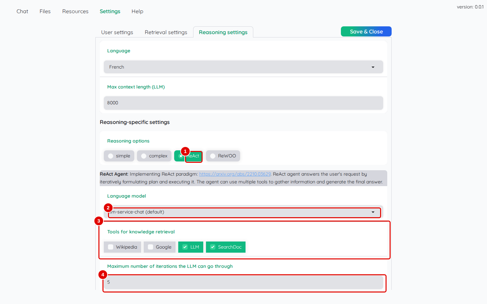
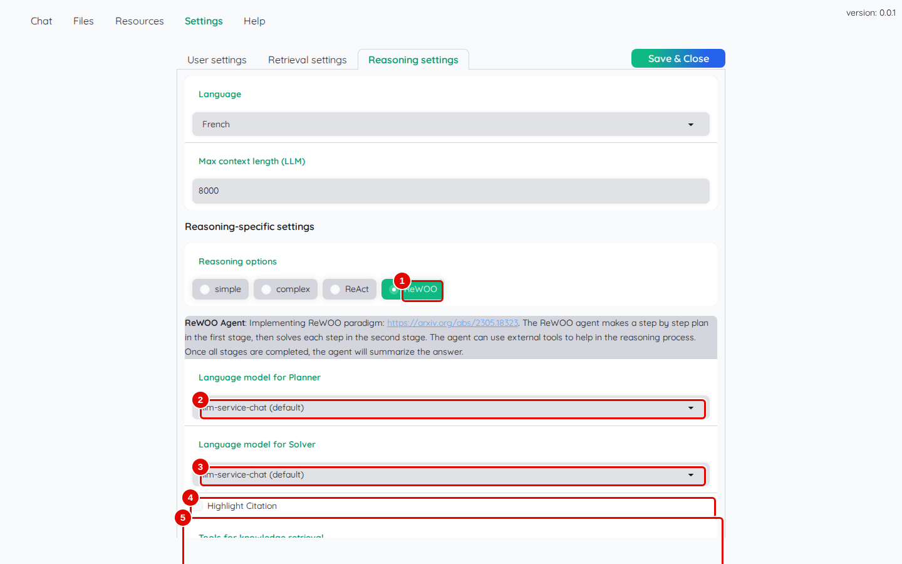
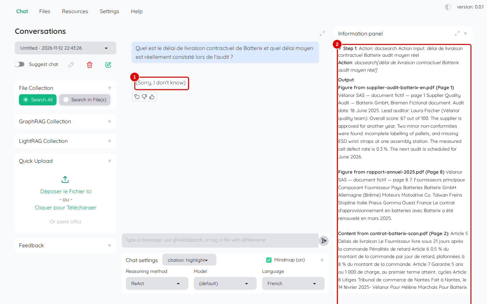
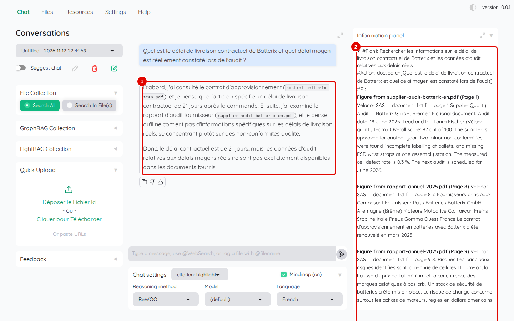
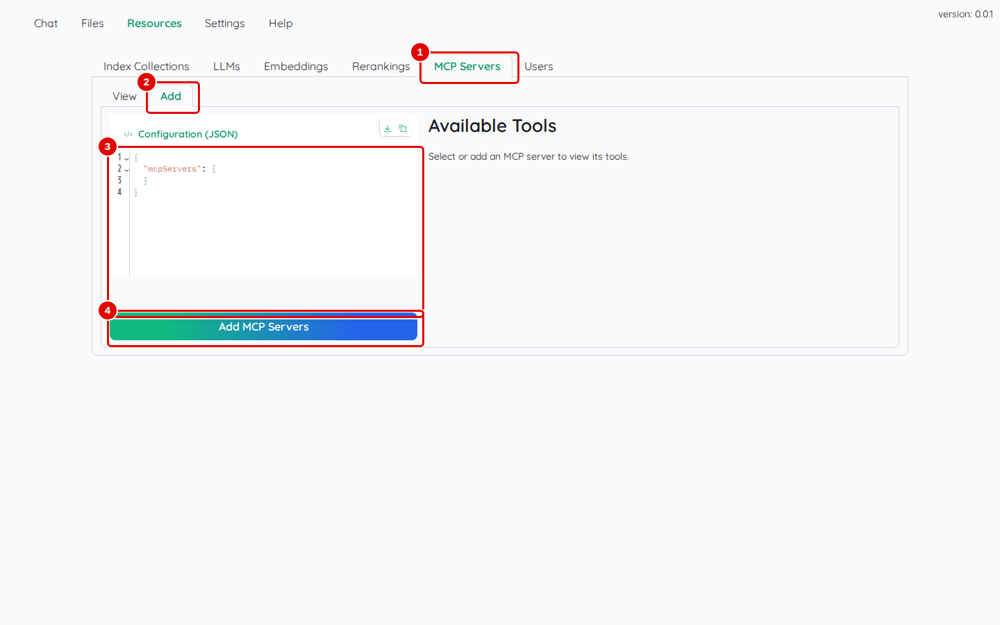

# 08. Agents ReAct et ReWOO

> Ce chapitre apprend à faire répondre un **agent**, c'est-à-dire un assistant qui décide lui-même des recherches à faire avant de répondre, à régler ses outils, à lire les étapes qu'il a suivies, et à repérer où se déclarent des outils supplémentaires (serveurs MCP).
> **Point de départ** : Kotaemon ouvert, session administrateur, documents ajoutés (chapitre 05).
> **Durée** : environ 15 minutes. **Avant** : chapitre 07.

## Ce qu'il faut savoir

Avec la méthode `simple`, Kotaemon fait une seule recherche, puis répond. Un agent, lui, enchaîne plusieurs actions avec des **outils** :

- `SearchDoc` : chercher dans les documents des collections choisies ;
- `LLM` : demander directement au modèle de réponse ;
- `Wikipedia` et `Google` : chercher sur Internet (ces deux outils font sortir la question du poste ; ils ne sont pas cochés par défaut).

Deux agents existent :

- **ReAct** alterne réflexion et action : il réfléchit, choisit un outil, lit le résultat, puis recommence, jusqu'à cinq fois au plus ;
- **ReWOO** écrit d'abord un plan (« #Plan1 », « #Plan2 »…) avec les actions à faire, les exécute toutes, puis rédige la réponse à partir des résultats.

Les agents sont en général plus lents que la méthode `simple` (souvent une minute ou plus par question ; ReAct répond plus vite quand il s'arrête après une seule recherche, comme à l'étape 3) et leur réussite dépend beaucoup du modèle de réponse.

## Régler les agents

**Étape 1. Lire les réglages de ReAct**
*Où* : barre des onglets › « Settings » › « Reasoning settings » ; cliquer sur `ReAct` dans « Reasoning options ».

*Écran : « Reasoning settings », méthode `ReAct` choisie.*

| N° | Élément | Rôle |
|---|---|---|
| 1 | `ReAct` | affiche les réglages de cet agent |
| 2 | « Language model » | modèle utilisé par l'agent (`llm-service-chat`) |
| 3 | « Tools for knowledge retrieval » | outils permis : `SearchDoc` et `LLM` cochés par défaut, `Wikipedia` et `Google` décochés |
| 4 | « Maximum number of iterations the LLM can go through » | nombre maximal de tours réflexion-action (5) |

*Résultat* : ces réglages s'enregistrent avec « Save & Close ». Cliquer ensuite de nouveau sur `simple` avant « Save & Close » (ne pas enregistrer un agent comme méthode par défaut : la suite du manuel suppose `simple`) ; l'agent se choisit conversation par conversation (étape 3).

**Étape 2. Lire les réglages de ReWOO**
*Où* : même écran ; cliquer sur `ReWOO`.

*Écran : « Reasoning settings », méthode `ReWOO` choisie.*

| N° | Élément | Rôle |
|---|---|---|
| 1 | `ReWOO` | affiche les réglages de cet agent |
| 2 | « Language model for Planner » | modèle qui écrit le plan |
| 3 | « Language model for Solver » | modèle qui rédige la réponse finale |
| 4 | « Highlight Citation » | surligne les passages cités dans le panneau des sources |

*Résultat* : plus bas, « Tools for knowledge retrieval » (outils permis, comme pour ReAct), « Planner Prompt » et « Solver Prompt » (consignes des deux étapes).

## Poser une question à un agent

**Étape 3. Interroger l'agent ReAct**
*Où* : « Chat » › nouvelle conversation › « Chat settings » › « Reasoning method » : `ReAct` ; « Language » : `French` ; « File Collection » › « Search All ».

Poser `Quel est le délai de livraison contractuel de Batterix et quel délai moyen est réellement constaté lors de l'audit ?`.

*Écran : « Chat », réponse de l'agent ReAct et ses étapes.*

| N° | Élément | Rôle |
|---|---|---|
| 1 | réponse de l'agent | réponse finale de l'agent |
| 2 | étapes et sources | chaque étape : « Step 1 », action choisie (`docsearch`), texte cherché, passages obtenus |

*Résultat* : en 26 secondes, l'agent fait une recherche (`docsearch`), obtient la page de l'audit, celle des fournisseurs du rapport annuel et même la page 2 du contrat (« 21 jours »), puis répond « (Sorry, I don't know) » alors que la réponse est sous ses yeux. Avec le modèle de ce poste, ReAct s'arrête souvent ainsi : il ne sait pas tirer la réponse des passages trouvés.

**Étape 4. Interroger l'agent ReWOO**
*Où* : nouvelle conversation, « Reasoning method » : `ReWOO`, mêmes réglages, même question.

*Écran : « Chat », réponse de l'agent ReWOO et son plan.*

| N° | Élément | Rôle |
|---|---|---|
| 1 | réponse de l'agent | réponse rédigée à partir des résultats du plan |
| 2 | étapes et sources | plan (« #Plan1 »), action (`docsearch[…]`), résultats (« #E1 ») |

*Résultat* : en un peu plus d'une minute, ReWOO trouve dans le contrat le délai contractuel de 21 jours, et constate que l'audit ne donne pas de délai réellement observé. C'est exact : ce délai moyen (24 jours) figure dans le classeur des stocks, pas dans l'audit. La réponse suit fidèlement la question posée.

## Voir où se déclarent d'autres outils

**Étape 5. Ouvrir le formulaire des serveurs MCP**
*Où* : barre des onglets › « Resources » › « MCP Servers » › « Add ».

Un **serveur MCP** est un petit programme qui offre des outils à un agent (lire un agenda, interroger une base…), selon un protocole commun appelé MCP.

*Écran : « Resources » › « MCP Servers » › « Add ».*

| N° | Élément | Rôle |
|---|---|---|
| 1 | « MCP Servers » | liste des serveurs MCP déclarés |
| 2 | « Add » | formulaire d'ajout |
| 3 | « Configuration (JSON) » | description du serveur au format JSON, un format de texte structuré entre accolades (commande à lancer ou adresse) |
| 4 | « Add MCP Servers » | enregistre le serveur |

*Résultat* : un serveur déclaré ici apparaît comme outil supplémentaire dans « Tools for knowledge retrieval » des agents. Aucun serveur MCP n'a été branché dans ce manuel.

## Bon à savoir

- Pour une question composée sur ses propres documents, la méthode `complex` (chapitre 07) donne en général une réponse plus complète que les agents, plus vite.
- Cocher `Wikipedia` ou `Google` envoie le texte de la question à ces services en ligne.
- Les étapes affichées dans le panneau d'information permettent de comprendre pourquoi un agent s'est trompé : recherche mal formulée, passage mal lu.

## En cas de problème

| Symptôme | Cause | Que faire |
|---|---|---|
| « (Sorry, I don't know) » avec ReAct | l'agent n'exploite pas les passages trouvés | essayer ReWOO ou la méthode `complex` |
| réponse très lente | agent : plusieurs appels au modèle par question | méthode `simple` ou `complex` |
| outil `Google` sans effet | outil en ligne, non configuré | laisser décoché |

---
*Version décrite : Kotaemon 0.12.0, essais du 12 novembre 2026. Détails et preuves : [rapport d'essais](../annexes/A6-rapport-d-essais.md).*
