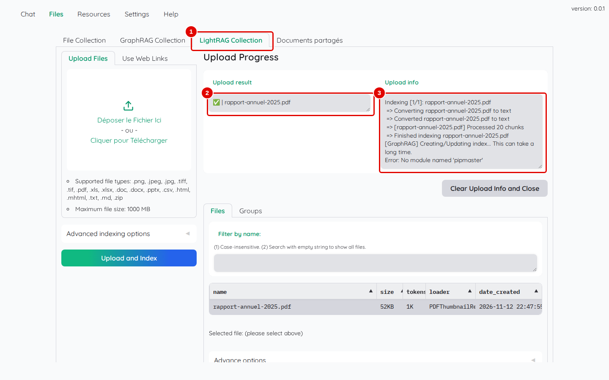
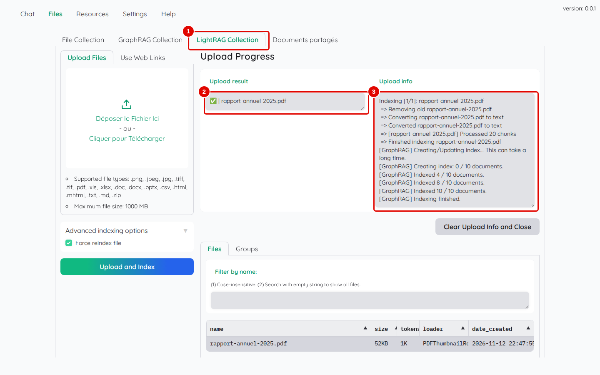
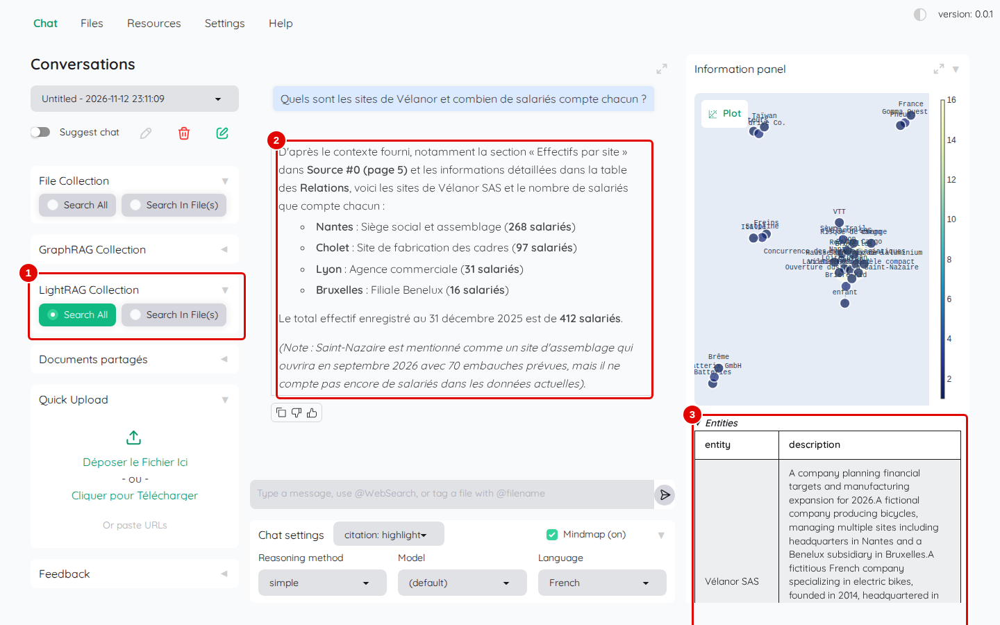
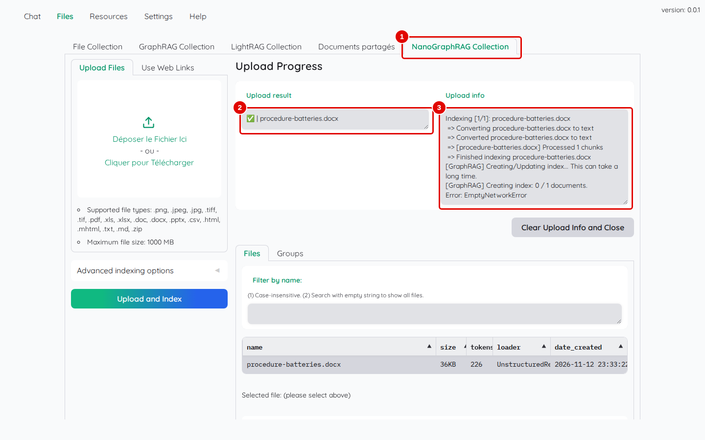
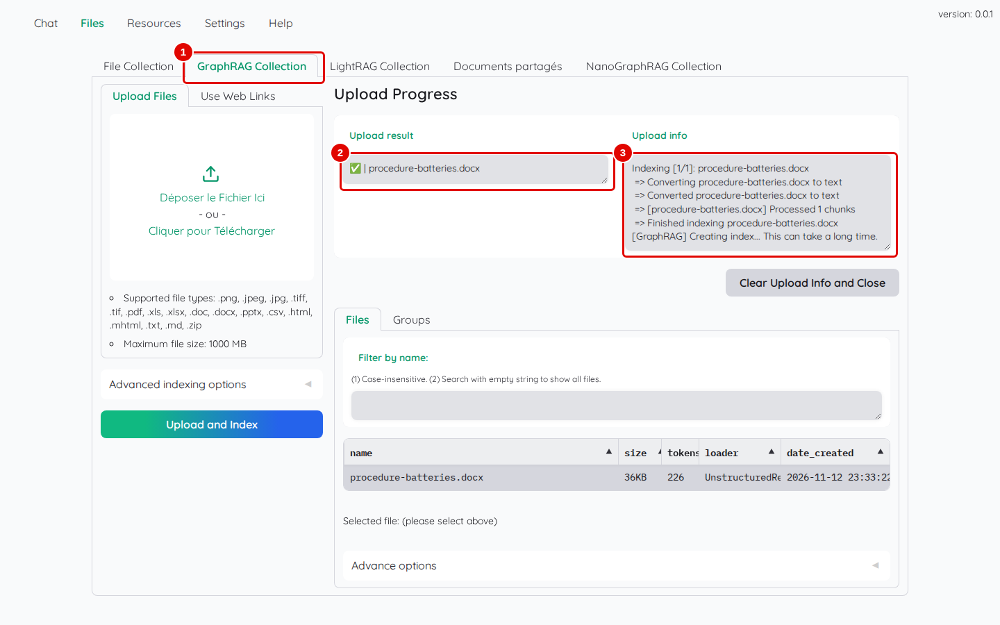

# 09. Graphes de connaissances (GraphRAG)

> Ce chapitre apprend à indexer un document dans une collection « en graphe » (LightRAG), à l'interroger, et dit ce qui se passe avec les deux autres variantes proposées par Kotaemon (NanoGraphRAG et Microsoft GraphRAG) sur ce poste.
> **Point de départ** : Kotaemon ouvert, session administrateur, modèles déclarés (chapitre 03).
> **Durée** : environ 30 minutes, dont 10 d'indexation. **Avant** : chapitre 05.

**Attention** : l'indexation en graphe sollicite fortement le modèle de réponse (plusieurs demandes par passage) : un document de dix pages occupe le service de modèles pendant une dizaine de minutes, et les autres questions attendent pendant ce temps.

## Ce qu'il faut savoir

Une collection ordinaire retrouve des **passages**. Une collection **en graphe** extrait en plus, à l'indexation, les **entités** du document (personnes, sites, produits, chiffres) et leurs **relations** (« Cholet fabrique les cadres », « Batterix fournit les batteries »), puis s'en sert pour répondre. C'est utile pour les questions qui rassemblent des informations dispersées (« quels sont les sites et leurs effectifs ? »).

Kotaemon propose trois variantes, chacune dans sa propre collection :

| Collection | Variante | Sur ce poste |
|---|---|---|
| « LightRAG Collection » | LightRAG | fonctionne, après une petite correction faite par un script (étape 1) |
| « NanoGraphRAG Collection » | NanoGraphRAG | s'installe avec un script ; l'indexation échoue avec le modèle de ce poste (étape 5) |
| « GraphRAG Collection » | Microsoft GraphRAG | ne fonctionne pas : l'indexation ne démarre pas (étape 6) |

Une collection en graphe s'utilise comme les autres : ajout par « Files », question par le chat en choisissant « Search All » dans sa section. Certaines captures de ce chapitre montrent déjà « Documents partagés » et « NanoGraphRAG Collection », créées ailleurs dans le manuel : ne pas en tenir compte.

## Préparer LightRAG

**Étape 1. Ajouter la pièce manquante de LightRAG**
*Où* : terminal Ubuntu, dossier du dépôt.

L'image de Kotaemon 0.12.0 contient LightRAG, mais il lui manque une petite bibliothèque (`pipmaster`). Sans elle, l'indexation s'arrête, comme le montre la capture ci-dessous (prise sans le script). La seule action de cette étape est de lancer le script indiqué après la capture.


*Écran : « Files » › « LightRAG Collection », indexation en échec.*

| N° | Élément | Rôle |
|---|---|---|
| 1 | « LightRAG Collection » | collection en graphe LightRAG |
| 2 | « Upload result » | coche verte : le fichier est lu… |
| 3 | « Upload info » | … mais la construction du graphe s'arrête sur « Error: No module named 'pipmaster' » |

```bash
outils/kotaemon/completer_lightrag.sh
```

*Résultat* : le script ajoute `pipmaster` dans le conteneur et affiche son emplacement. Il est à relancer chaque fois que le conteneur est recréé (réinstallation, chapitre 02, ou option NanoGraphRAG, étape 4). Un arrêt puis un redémarrage par `outils/kotaemon/arreter.sh` et `outils/kotaemon/demarrer.sh` (chapitres 02 et 10) gardent le conteneur : inutile alors de relancer le script.

## Indexer et interroger avec LightRAG

**Étape 2. Indexer un document**
*Où* : « Files » › « LightRAG Collection » › « Upload Files ».

Choisir `rapport-annuel-2025.pdf` (cocher « Force reindex file » s'il a déjà été essayé), puis « Upload and Index ».


*Écran : « LightRAG Collection », indexation terminée.*

| N° | Élément | Rôle |
|---|---|---|
| 1 | « LightRAG Collection » | collection en graphe |
| 2 | « Upload result » | coche verte : fichier indexé |
| 3 | « Upload info » | « [GraphRAG] Creating index: 0 / 10 documents », « Indexed 4 / 10 documents… » : avancement de la construction du graphe ; les « documents » sont ici les morceaux de texte que LightRAG traite l'un après l'autre (10 pour ce rapport), pas des fichiers |

*Résultat* : après environ 9 minutes pour ce rapport de 10 pages (contre 6 secondes dans « File Collection »), le message « Successfully index 1 files » apparaît.

**Étape 3. Poser une question au graphe**
*Où* : « Chat » › nouvelle conversation › « LightRAG Collection » › « Search All » ; « Language » : `French`.

Cliquer d'abord sur le titre « LightRAG Collection » dans la colonne de gauche pour déplier la section (elle est repliée, petit triangle à droite), puis sur « Search All ». Laisser « File Collection » sans choix, pour n'interroger que le graphe (si « Search All » y est déjà coché, recharger la page : à l'ouverture, aucune collection n'est choisie ; puis choisir de nouveau « French »), puis poser `Quels sont les sites de Vélanor et combien de salariés compte chacun ?`.


*Écran : « Chat », réponse de la collection LightRAG.*

| N° | Élément | Rôle |
|---|---|---|
| 1 | « LightRAG Collection » avec « Search All » | recherche dans le graphe seulement |
| 2 | réponse | les quatre sites et leurs effectifs (Nantes 268, Cholet 97, Lyon 31, Bruxelles 16), total 412 |
| 3 | entités, relations et passages | « Plot » : carte des entités ; « Entities » : tableau des entités et de leurs descriptions ; plus bas, « Relationships » et les passages d'origine |

*Résultat* : la réponse arrive en moins d'une minute et elle est juste. Le panneau montre ce que le graphe a retenu ; les descriptions des entités sont en anglais (langue de l'extraction).

## Essayer NanoGraphRAG

**Étape 4. Installer NanoGraphRAG**
*Où* : terminal Ubuntu, dossier du dépôt.

```bash
outils/kotaemon/installer_nanographrag.sh
outils/kotaemon/completer_lightrag.sh
```

Le premier script active la collection « NanoGraphRAG Collection », installe le paquet `nano-graphrag` dans le conteneur, puis corrige les deux conflits qu'il provoque : il remplace une bibliothèque de la base des vecteurs (Kotaemon ne démarre plus sans cette correction, comme le signale la documentation du projet) et il fait monter une autre bibliothèque (pydantic) vers une version qui empêche l'interface de s'afficher ; le script remet la version d'origine. Le second script remet la pièce de LightRAG, perdue quand le conteneur est recréé.

*Résultat* : le premier script redémarre Kotaemon lui-même et se termine par « Kotaemon redémarré avec NanoGraphRAG ». Recharger la page du navigateur : « NanoGraphRAG Collection » apparaît dans « Files » et dans le chat. Comme toute création de collection, celle-ci fait revenir les réglages de « Settings » aux valeurs par défaut (anglais, 32 000, notation cochée) : dans « Settings » › « Reasoning settings », remettre « Language » sur `French` et « Max context length (LLM) » sur `8000` ; dans « Settings » › « Retrieval settings », décocher « Use LLM relevant scoring » dans les sous-onglets « File Collection » et « Documents partagés » (les collections en graphe n'ont pas cette case) ; puis « Save & Close » (détail au chapitre 10, étape 4).

**Étape 5. Indexer un document avec NanoGraphRAG**
*Où* : « Files » › « NanoGraphRAG Collection » › « Upload Files ».

Choisir `procedure-batteries.docx`, puis « Upload and Index ».


*Écran : « NanoGraphRAG Collection », fin de l'indexation.*

| N° | Élément | Rôle |
|---|---|---|
| 1 | « NanoGraphRAG Collection » | collection en graphe NanoGraphRAG |
| 2 | « Upload result » | coche verte : fichier lu |
| 3 | « Upload info » | « Error: EmptyNetworkError » : le graphe est vide |

*Résultat* : après trois minutes, l'indexation se termine sur une erreur : NanoGraphRAG n'a trouvé que 6 entités et aucune relation dans cette procédure d'une page, et ne sait pas construire de graphe sans relation. NanoGraphRAG n'est donc pas utilisable ici ; LightRAG l'est.

## Essayer Microsoft GraphRAG

**Étape 6. Indexer un document avec Microsoft GraphRAG**
*Où* : « Files » › « GraphRAG Collection » › « Upload Files ».

Choisir `procedure-batteries.docx`, puis « Upload and Index ».


*Écran : « GraphRAG Collection », indexation interrompue.*

| N° | Élément | Rôle |
|---|---|---|
| 1 | « GraphRAG Collection » | collection en graphe de Microsoft |
| 2 | « Upload result » | coche verte : fichier lu |
| 3 | « Upload info » | « [GraphRAG] Creating index... This can take a long time. », puis plus rien |

*Résultat* : l'interface affiche « Successfully index 1 files », mais le graphe n'est jamais construit : Kotaemon lance la construction avec un programme Python qui ne contient pas Microsoft GraphRAG (le journal du conteneur indique « No module named 'graphrag' »). De plus, cette variante ne sait parler qu'au service d'OpenAI ou à Ollama. Elle n'est pas utilisable avec cette installation.

## Bon à savoir

- Le réglage « Search type » (« Settings » › « Retrieval settings » › « LightRAG Collection », chapitre 07, étape 2) choisit `local`, `global` ou `hybrid` ; la valeur de départ, `local`, a suffi pour les essais de ce chapitre.
- Un graphe coûte cher à construire : environ une minute par page avec le modèle de ce poste, sur une carte graphique. Le réserver à quelques documents riches en relations.
- La question s'adresse au graphe seulement si les autres collections restent sans choix ; cocher « Search All » dans plusieurs collections mélange passages et graphe.
- Une conversation qui interroge une collection en graphe sans graphe construit reste sur « Thinking ... » (chapitre 13).

## En cas de problème

| Symptôme | Cause | Que faire |
|---|---|---|
| « Error: No module named 'pipmaster' » | pièce manquante de LightRAG | `outils/kotaemon/completer_lightrag.sh`, puis « Force reindex file » |
| la page ne s'affiche plus après l'installation de NanoGraphRAG | conflit de bibliothèques | relancer `outils/kotaemon/installer_nanographrag.sh` (il contient les corrections) |
| « Error: EmptyNetworkError » | aucune relation trouvée par NanoGraphRAG | utiliser LightRAG |
| GraphRAG : rien ne se passe après « Creating index » | Microsoft GraphRAG absent du programme lancé | utiliser LightRAG |

---
*Version décrite : Kotaemon 0.12.0, essais du 12 et 13 novembre 2026. Détails et preuves : [rapport d'essais](../annexes/A6-rapport-d-essais.md).*
