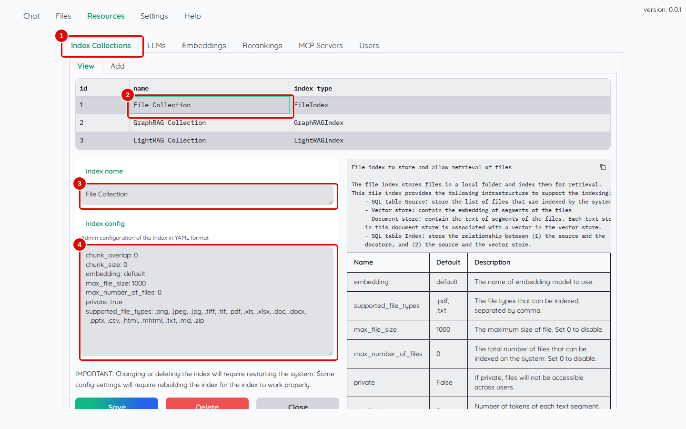
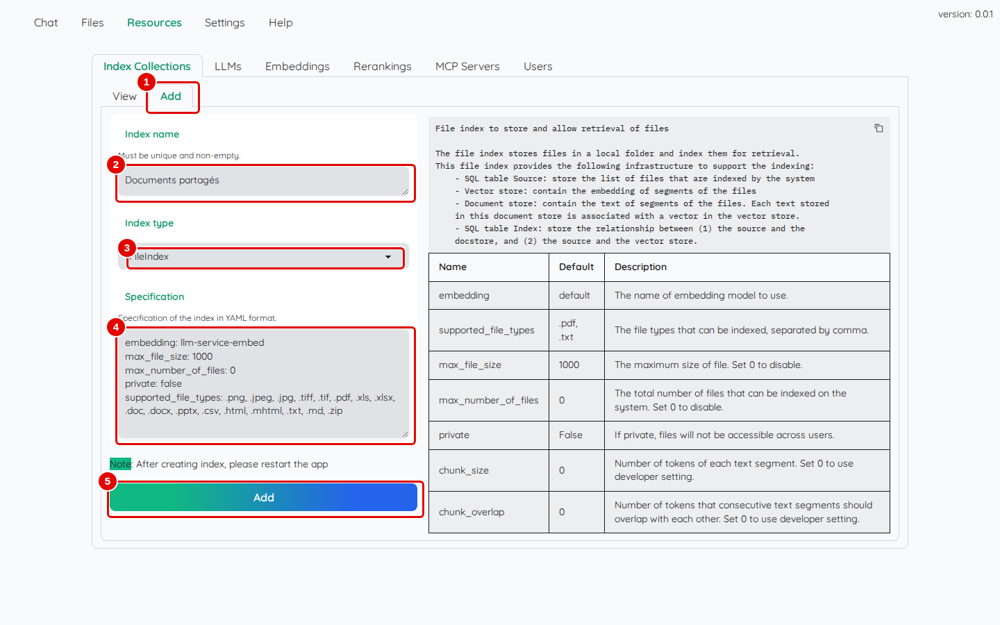
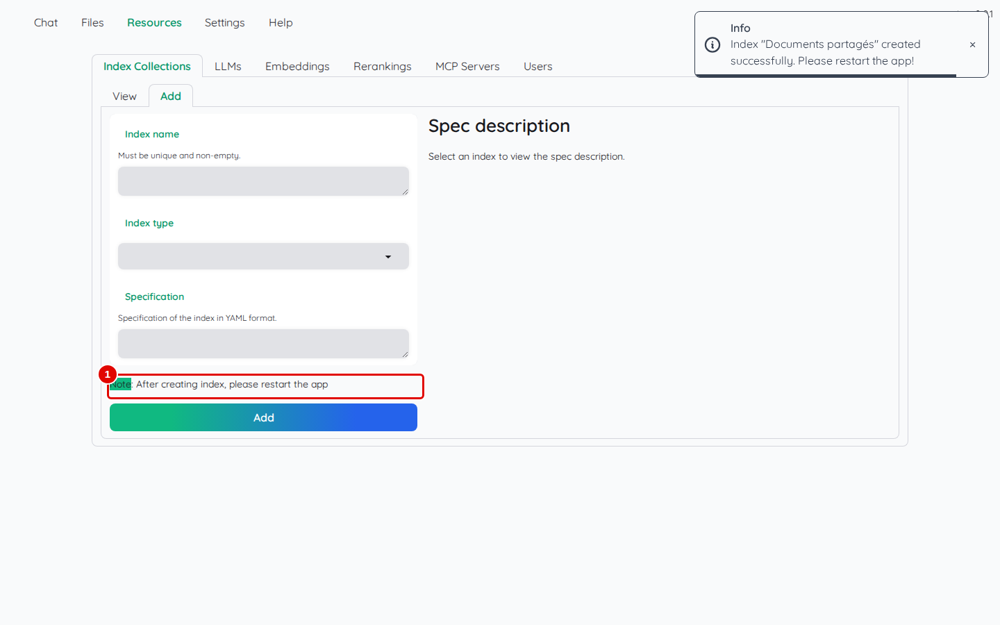
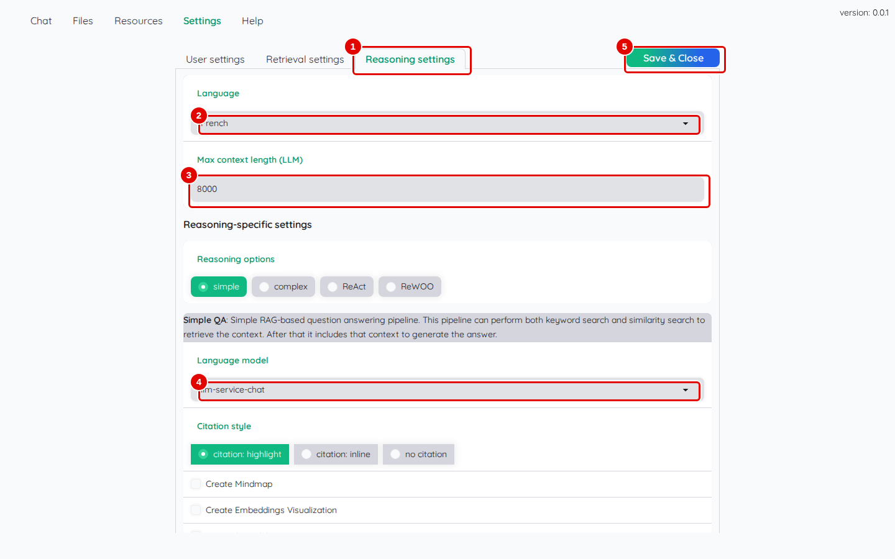
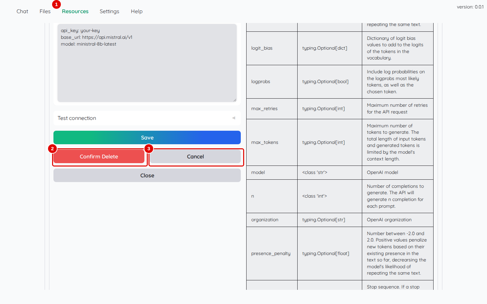
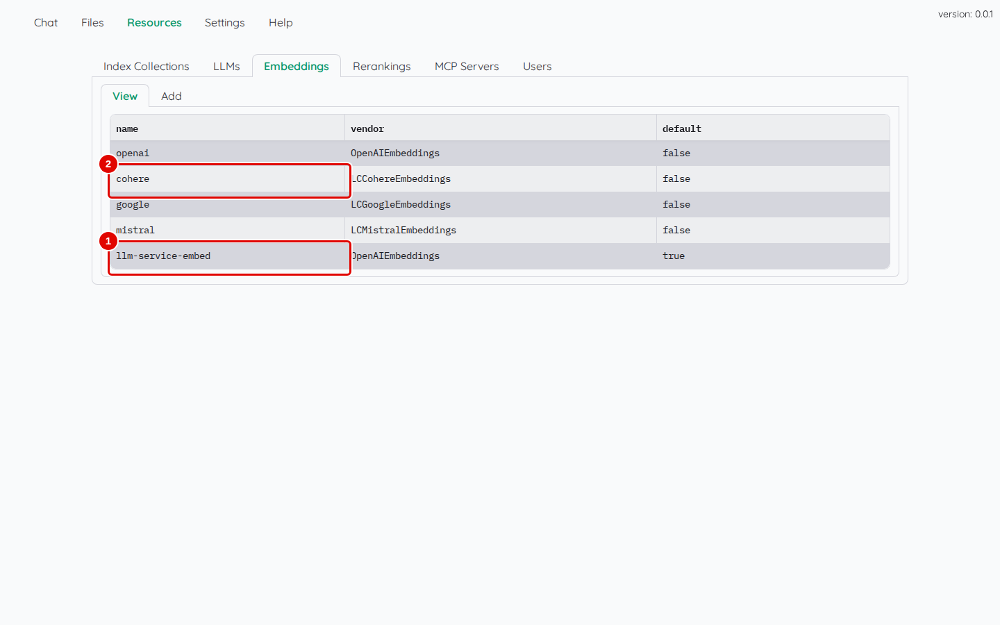
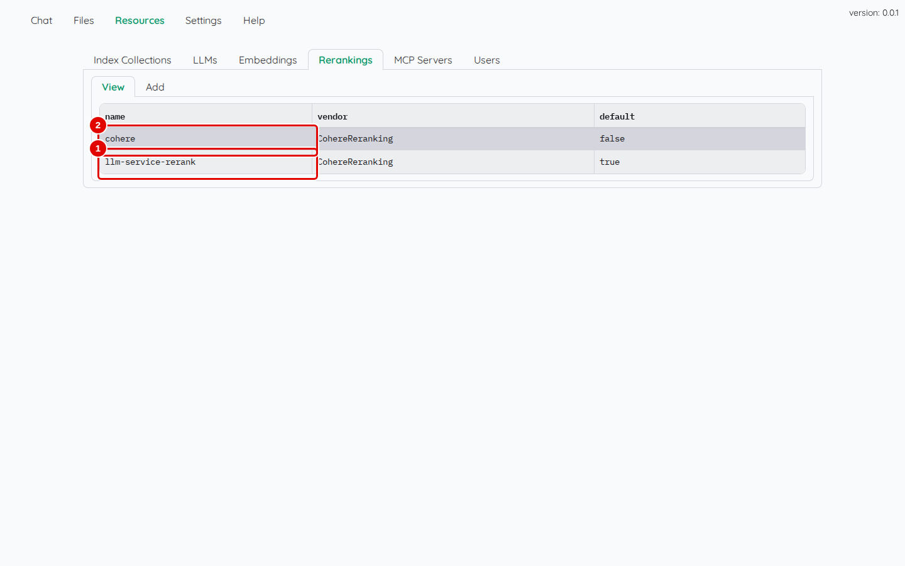

# 10. Collections et modèles

> Ce chapitre apprend à consulter et créer des collections de documents, à supprimer un modèle inutile et à relire la liste des modèles d'embedding et de tri, dans l'onglet réservé à l'administrateur.
> **Point de départ** : Kotaemon ouvert, session administrateur (chapitre 03).
> **Durée** : environ 15 minutes. **Avant** : chapitre 03.

**Attention** : créer ou supprimer une collection demande de **redémarrer Kotaemon** ; supprimer une collection efface ses documents.

## Ce qu'il faut savoir

L'onglet « Resources » n'apparaît que pour un compte administrateur. Il regroupe :

- « Index Collections » : les collections de documents ;
- « LLMs », « Embeddings », « Rerankings » : les modèles de réponse, d'embedding et de tri (chapitre 03) ;
- « MCP Servers » : les outils supplémentaires des agents (chapitre 08) ;
- « Users » : les comptes (chapitre 11).

Une **collection** se décrit par une spécification YAML. Les réglages utiles :

| Réglage | Sens |
|---|---|
| `private` | `true` : chaque compte ne voit que ses propres fichiers ; `false` : collection partagée, tous les comptes voient tous les fichiers |
| `embedding` | modèle d'embedding de la collection (`default` : celui par défaut) |
| `chunk_size`, `chunk_overlap` | taille des passages et recouvrement, en jetons (`0` : valeurs de Kotaemon, 1 024 et 256) |
| `supported_file_types` | extensions acceptées |
| `max_file_size`, `max_number_of_files` | taille maximale d'un fichier (en Mo) et nombre maximal de fichiers (`0` : sans limite) |

## Consulter une collection

**Étape 1. Ouvrir la fiche d'une collection**
*Où* : barre des onglets › « Resources » › « Index Collections » › « View » ; cliquer sur `File Collection`.


*Écran : « Index Collections », collection `File Collection` sélectionnée.*

| N° | Élément | Rôle |
|---|---|---|
| 1 | « Index Collections » | liste des collections : numéro, nom, type (`FileIndex`, `GraphRAGIndex`, `LightRAGIndex`) |
| 2 | `File Collection` | un clic ouvre la fiche |
| 3 | « Index name » | nom affiché dans « Files » et dans le chat |
| 4 | « Index config » | spécification YAML de la collection (`private: true`, `embedding: default`…) |

*Résultat* : la fiche montre aussi « Save », « Delete » et « Close ». Une modification de la spécification ne vaut qu'après redémarrage.

## Créer une collection partagée

**Étape 2. Remplir le formulaire**
*Où* : « Resources » › « Index Collections » › « Add ».

Saisir `Documents partagés` dans « Index name », choisir `FileIndex` dans « Index type », puis remplacer « Specification » par :

```yaml
embedding: llm-service-embed
max_file_size: 1000
max_number_of_files: 0
private: false
supported_file_types: .png, .jpeg, .jpg, .tiff, .tif, .pdf, .xls, .xlsx, .doc, .docx, .pptx, .csv, .html, .mhtml, .txt, .md, .zip
```

Cliquer enfin sur le bouton « Add » (pastille 5).


*Écran : « Index Collections » › « Add », spécification saisie.*

| N° | Élément | Rôle |
|---|---|---|
| 1 | sous-onglet « Add » | formulaire de création |
| 2 | « Index name » | nom de la collection |
| 3 | « Index type » | `FileIndex` : collection ordinaire ; `GraphRAGIndex`, `LightRAGIndex`, `NanoGraphRAGIndex` : collections en graphe (chapitre 09) |
| 4 | « Specification » | réglages ; la proposition par défaut n'accepte que `.pdf` et `.txt`, d'où la liste complète saisie ici |
| 5 | bouton « Add » | crée la collection |

*Résultat* : le message « Index "Documents partagés" created successfully. Please restart the app! » apparaît (étape suivante).

**Étape 3. Redémarrer Kotaemon**
*Où* : terminal Ubuntu, dossier du dépôt.


*Écran : message de fin de création.*

| N° | Élément | Rôle |
|---|---|---|
| 1 | message de redémarrage | la collection n'existe qu'après redémarrage |

```bash
outils/kotaemon/arreter.sh
outils/kotaemon/demarrer.sh
```

*Résultat* : après `Kotaemon prêt`, recharger la page du navigateur : « Documents partagés » apparaît comme sous-onglet de « Files » et comme section dans la colonne de gauche du chat. Elle sert au chapitre 11.

**Étape 4. Enregistrer de nouveau les réglages**
*Où* : « Settings » › « Reasoning settings », puis « Settings » › « Retrieval settings ».

Après la création d'une collection, Kotaemon ne sait plus relire les réglages enregistrés de chaque compte (il manque ceux de la nouvelle collection) : l'interface revient en silence aux valeurs par défaut (« Language » `English`, « Max context length (LLM) » `32000`, « Use LLM relevant scoring » coché). Refaire les étapes 10 et 11 du chapitre 03 (langue `French`, `8000`, notation décochée), puis « Save & Close » : les réglages sont de nouveau enregistrés au complet, nouvelle collection comprise.


*Écran : « Settings » › « Reasoning settings » (même écran qu'au chapitre 03).*

| N° | Élément | Rôle |
|---|---|---|
| 1 | « Reasoning settings » | réglages de la rédaction |
| 2 | « Language » | à remettre sur `French` |
| 3 | « Max context length (LLM) » | à remettre sur `8000` |
| 4 | « Language model » | `llm-service-chat` |
| 5 | « Save & Close » | enregistre l'ensemble des réglages |

*Résultat* : « Setting saved » ; à la visite suivante, les réglages sont relus correctement. Chaque compte doit faire cette étape.

## Supprimer un modèle inutile

**Étape 5. Supprimer un modèle en ligne**
*Où* : « Resources » › « LLMs » › « View » ; cliquer sur la ligne d'un modèle en ligne préinstallé, par exemple `mistral`, puis sur « Delete » (en bas de la fiche).


*Écran : fiche du modèle `mistral`, confirmation demandée.*

| N° | Élément | Rôle |
|---|---|---|
| 1 | nom du modèle (`mistral`) | modèle en ligne préinstallé, inutilisable sans clé |
| 2 | « Confirm Delete » | confirme la suppression |
| 3 | « Cancel » | annule |

*Résultat* : après « Confirm Delete », la ligne `mistral` disparaît de la liste. La même démarche vaut pour « openai », « claude », « google », « groq » et « cohere » (`groq` a été supprimé de la même façon pendant les essais). Ne jamais supprimer le modèle marqué `true` dans la colonne « default ».

## Relire les modèles d'embedding et de tri

**Étape 6. Lire la liste des modèles d'embedding**
*Où* : « Resources » › « Embeddings » › « View ».


*Écran : « Embeddings », liste des modèles.*

| N° | Élément | Rôle |
|---|---|---|
| 1 | `llm-service-embed` | modèle du service de modèles, `true` dans la colonne « default » |
| 2 | `cohere` | modèle en ligne préinstallé, sans clé |

*Résultat* : un seul modèle est marqué par défaut ; c'est lui qui représente les passages de toutes les collections réglées sur `embedding: default`.

**Étape 7. Lire la liste des modèles de tri**
*Où* : « Resources » › « Rerankings » › « View ».


*Écran : « Rerankings », liste des modèles.*

| N° | Élément | Rôle |
|---|---|---|
| 1 | `llm-service-rerank` | modèle de tri du service de modèles, par défaut |
| 2 | `cohere` | modèle de tri en ligne préinstallé, sans clé |

*Résultat* : le tri des passages (« Use reranking », chapitre 07) utilise le modèle marqué par défaut.

## Bon à savoir

- Changer le modèle d'embedding d'une collection qui contient déjà des fichiers rend ses passages introuvables : il faut alors réindexer tous les fichiers (chapitre 05, « Force reindex file »).
- Le formulaire « Add » des collections propose aussi des types en graphe ; le chapitre 09 les présente.

## En cas de problème

| Symptôme | Cause | Que faire |
|---|---|---|
| la nouvelle collection n'apparaît pas | Kotaemon pas redémarré | étape 3, puis recharger la page |
| après une création de collection, réponses en anglais et réglages revenus aux valeurs par défaut | réglages enregistrés incomplets | étape 4 |
| un type de fichier est refusé dans la collection | `supported_file_types` incomplet | corriger la spécification (« Index config », « Save »), redémarrer |
| plus aucune réponse après une suppression de modèle | modèle par défaut supprimé | déclarer de nouveau le modèle (chapitre 03) et cocher « Set default » |

---
*Version décrite : Kotaemon 0.12.0, essais du 12 novembre 2026. Détails et preuves : [rapport d'essais](../annexes/A6-rapport-d-essais.md).*
