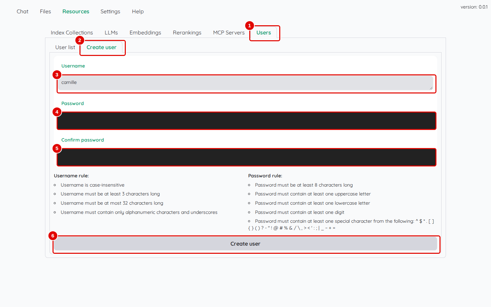
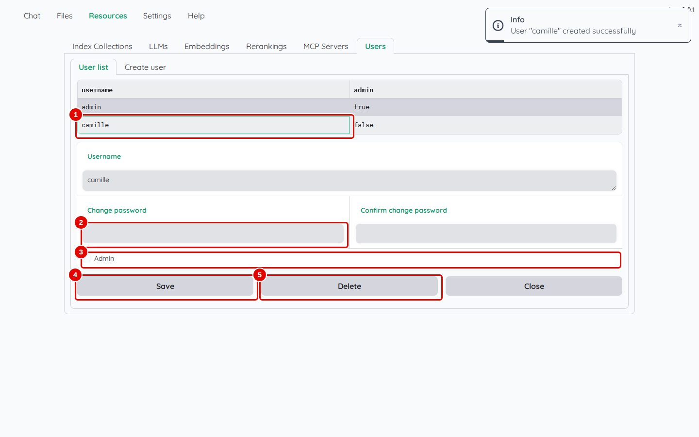
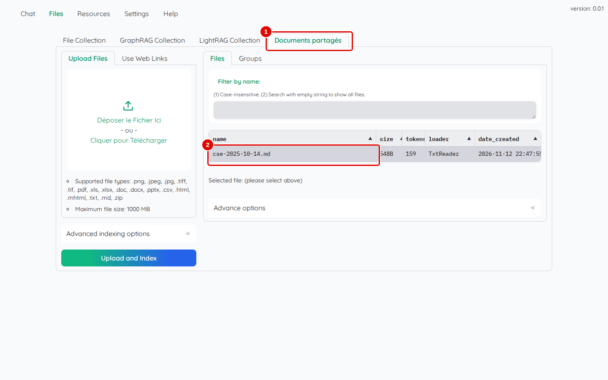
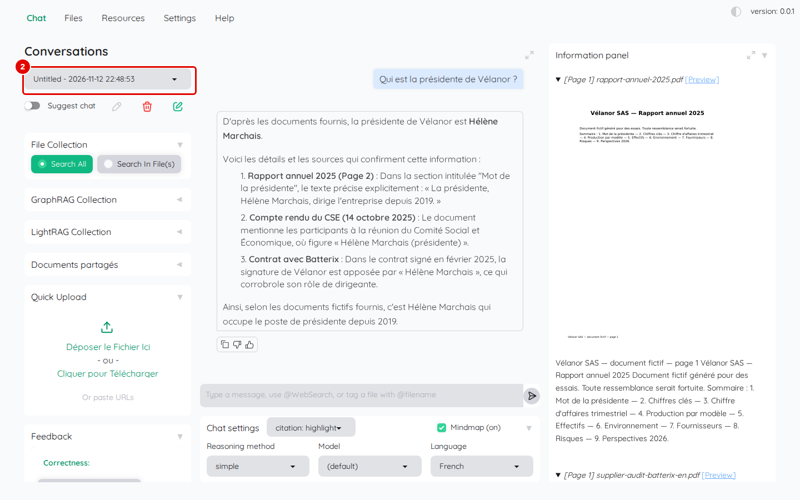
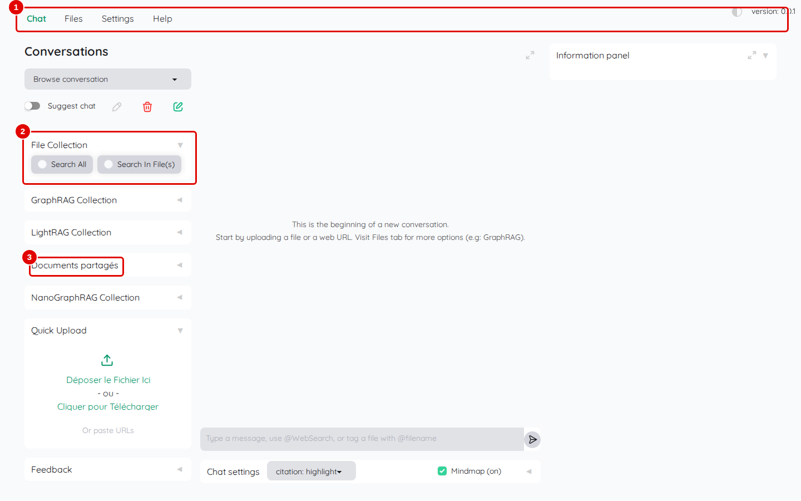
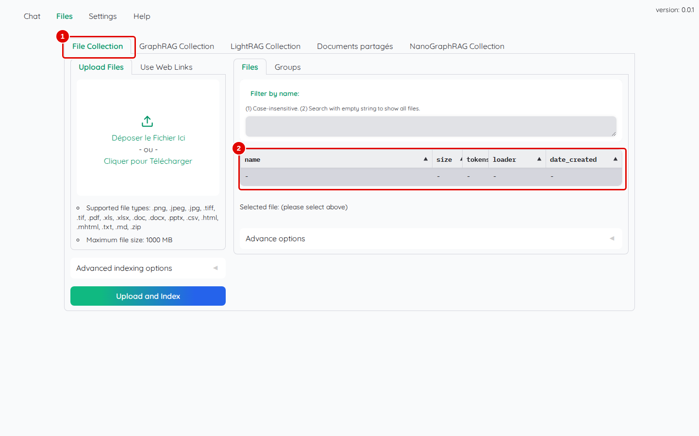
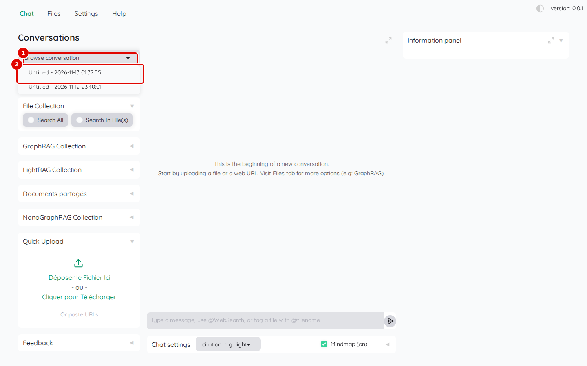
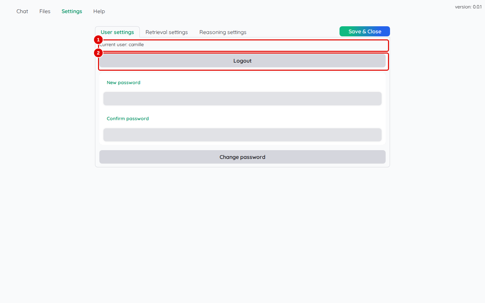

# 11. Comptes et partage

> Ce chapitre apprend à créer un compte pour une autre personne, à le modifier, à partager des documents grâce à une collection partagée, à partager une conversation, puis à voir ce que l'autre personne obtient en se connectant.
> **Point de départ** : Kotaemon ouvert, session administrateur, collection « Documents partagés » créée (chapitre 10).
> **Durée** : environ 15 minutes. **Avant** : chapitre 10.

## Ce qu'il faut savoir

Kotaemon gère des **comptes** : chacun a son nom, son mot de passe, ses réglages et ses conversations. Un compte est soit **administrateur** (il voit l'onglet « Resources »), soit **utilisateur** (sans « Resources »). Personne ne peut créer son compte seul : c'est l'administrateur qui le crée.

Ce que chacun voit :

| Élément | Visible par |
|---|---|
| fichiers d'une collection privée (« File Collection » par défaut) | seulement le compte qui les a ajoutés |
| fichiers d'une collection partagée (`private: false`, chapitre 10) | tous les comptes |
| conversation | son auteur ; tous les comptes si « Share this conversation » est coché |
| modèles, collections, comptes (« Resources ») | administrateurs seulement |

## Créer un compte

**Étape 1. Remplir le formulaire**
*Où* : barre des onglets › « Resources » › « Users » › « Create user ».

Saisir `camille` dans « Username », puis le mot de passe dans « Password » et « Confirm password », et cliquer sur « Create user » (pastille 6).

*Écran : « Users » › « Create user » (mots de passe masqués).*

| N° | Élément | Rôle |
|---|---|---|
| 1 | « Users » | gestion des comptes |
| 2 | sous-onglet « Create user » | formulaire de création |
| 3 | « Username » | identifiant : 3 à 32 caractères, lettres, chiffres ou `_` |
| 4 | « Password » | mot de passe : au moins 8 caractères, dont une majuscule, une minuscule, un chiffre et un caractère spécial |
| 5 | « Confirm password » | même mot de passe |
| 6 | bouton « Create user » | crée le compte |

*Résultat* : le message « User "camille" created successfully » apparaît. Le nouveau compte est un compte utilisateur, sans droits d'administration.

**Étape 2. Modifier un compte**
*Où* : « Users » › « User list » ; cliquer sur la ligne `camille`.

*Écran : « User list », compte `camille` sélectionné (mots de passe masqués).*

| N° | Élément | Rôle |
|---|---|---|
| 1 | `camille` | ligne du compte : nom (« username ») et droit d'administration (« admin ») |
| 2 | « Change password » | nouveau mot de passe, à saisir aussi dans « Confirm change password » ; c'est ainsi qu'un administrateur remplace un mot de passe oublié |
| 3 | « Admin » | case à cocher pour donner les droits d'administration |
| 4 | « Save » | enregistre les modifications |
| 5 | « Delete » | supprime le compte (une confirmation est demandée) |

*Résultat* : « Close » referme la fiche sans rien changer.

## Partager des documents et une conversation

**Étape 3. Ajouter un document dans la collection partagée**
*Où* : « Files » › « Documents partagés » › « Upload Files ».

Ajouter `cse-2025-10-14.md` comme au chapitre 05 (étape 1).

*Écran : « Files », collection « Documents partagés ».*

| N° | Élément | Rôle |
|---|---|---|
| 1 | « Documents partagés » | collection partagée créée au chapitre 10 |
| 2 | `cse-2025-10-14.md` | document visible de tous les comptes |

*Résultat* : le compte rendu du CSE est consultable par tous les comptes.

**Étape 4. Partager une conversation**
*Où* : « Chat » › colonne de gauche › « Feedback » › « Share this conversation ».

Ouvrir une nouvelle conversation, cliquer sur « Search All » dans « File Collection », poser une question (par exemple `Qui est la présidente de Vélanor ?`), ouvrir « Feedback », puis cocher « Share this conversation ».

*Écran : « Chat », bloc « Feedback » ouvert, conversation partagée.*

| N° | Élément | Rôle |
|---|---|---|
| 1 | « Share this conversation » | rend la conversation visible de tous les comptes |
| 2 | liste des conversations | conversation partagée, toujours modifiable par son auteur seulement |

*Résultat* : le message « Conversation: … is public. » apparaît.

## Ce que voit l'autre compte

**Étape 5. Se connecter avec le nouveau compte**
*Où* : un autre navigateur (ou une fenêtre de navigation privée), `http://127.0.0.1:7860`, onglet « Welcome ».

Se connecter avec `camille` et son mot de passe (chapitre 03, étape 1).

*Écran : « Chat » du compte `camille`.*

| N° | Élément | Rôle |
|---|---|---|
| 1 | barre des onglets | « Chat », « Files », « Settings », « Help » : pas de « Resources » pour un utilisateur |
| 2 | « File Collection » | collection privée : vide pour ce compte |
| 3 | « Documents partagés » | section de la collection partagée (repliée ; un clic sur le titre la déplie) : le document ajouté par l'administrateur y est consultable |

*Résultat* : le compte `camille` ne voit ni les modèles ni les comptes, et ne voit pas les fichiers privés de l'administrateur.

**Étape 6. Vérifier la collection privée**
*Où* : « Files » › « File Collection ».

*Écran : « Files » du compte `camille`.*

| N° | Élément | Rôle |
|---|---|---|
| 1 | « File Collection » | collection privée |
| 2 | liste des fichiers | vide : les fichiers de l'administrateur n'y sont pas |

*Résultat* : chaque compte ajoute ses propres fichiers dans « File Collection » sans les mélanger à ceux des autres.

**Étape 7. Ouvrir la conversation partagée**
*Où* : « Chat » › liste des conversations.

*Écran : « Chat » du compte `camille`, liste des conversations ouverte.*

| N° | Élément | Rôle |
|---|---|---|
| 1 | liste des conversations | conversations du compte et conversations partagées |
| 2 | conversation partagée | conversation de l'administrateur, lisible par `camille` |

*Résultat* : un clic sur la conversation l'affiche avec ses questions, ses réponses et ses sources.

**Étape 8. Se déconnecter**
*Où* : « Settings » › « User settings ».

*Écran : « Settings » du compte `camille`.*

| N° | Élément | Rôle |
|---|---|---|
| 1 | « Current user: camille » | compte connecté |
| 2 | « Logout » | ferme la session |

*Résultat* : l'onglet « Welcome » revient ; sur un poste partagé, se déconnecter évite que la session reste ouverte (Kotaemon la garde sinon dans le navigateur).

## Bon à savoir

- Un administrateur peut donner les droits d'administration à un autre compte (case « Admin », étape 2).
- Les réglages (« Settings ») sont propres à chaque compte : le nouveau compte repart des valeurs par défaut, sauf les modèles, communs à tous ; lui faire régler « Language » (`French`), « Max context length (LLM) » (`8000`) et « Use LLM relevant scoring » (décoché) comme au chapitre 03.
- Une collection partagée convient aux documents de référence (procédures, comptes rendus) ; les documents personnels restent dans « File Collection ».

## En cas de problème

| Symptôme | Cause | Que faire |
|---|---|---|
| la création de compte est refusée | mot de passe trop simple ou identifiant invalide | respecter les règles de l'étape 1 |
| l'autre compte ne voit pas un document | document dans une collection privée | l'ajouter à « Documents partagés » |
| l'autre compte ne voit pas une conversation | case « Share this conversation » non cochée | la cocher (étape 4) |

---
*Version décrite : Kotaemon 0.12.0, essais du 12 novembre 2026. Détails et preuves : [rapport d'essais](../annexes/A6-rapport-d-essais.md).*
