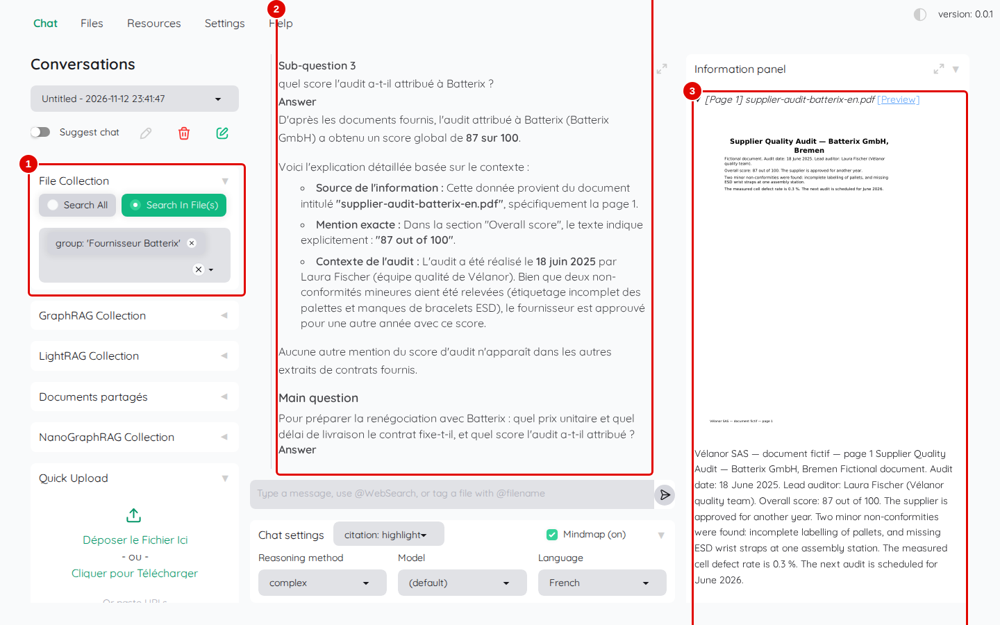
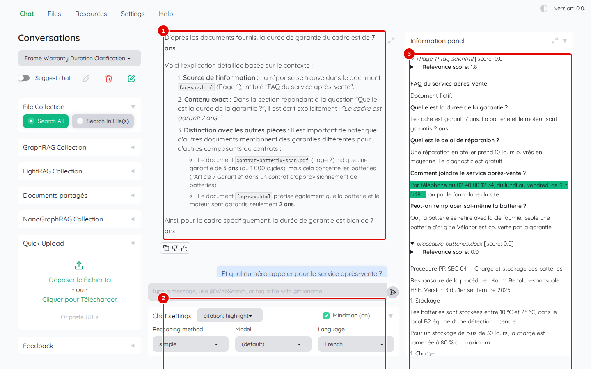
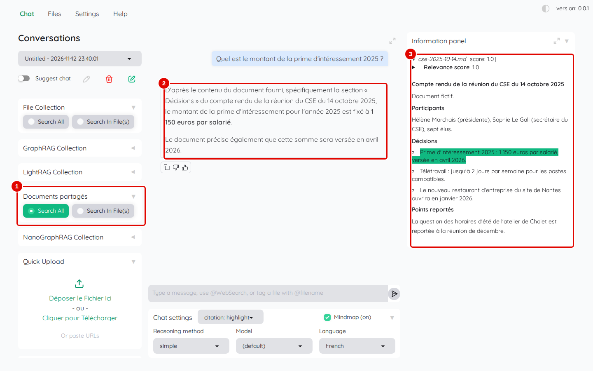

# 12. Cas pratiques

> Ce chapitre déroule trois usages complets, de la mise en place à la réponse vérifiée : préparer la renégociation d'un fournisseur, répondre à un client, mettre une note interne à disposition de l'équipe.
> **Point de départ** : Kotaemon ouvert, session administrateur, documents du corpus ajoutés (chapitre 05), groupe « Fournisseur Batterix » créé (chapitre 05), collection « Documents partagés » et compte `camille` créés (chapitres 10 et 11).
> **Durée** : environ 20 minutes. **Avant** : chapitres 05 à 11.

## Ce qu'il faut savoir

Chaque cas reprend des gestes déjà vus ; il les enchaîne pour un but précis et montre comment vérifier la réponse à sa source. Avant chaque cas : nouvelle conversation (crayon dans un carré vert, chapitre 06) ; vérifier que « Chat settings » › « Language » affiche `French` (le rechoisir après un rechargement de la page).

## Cas 1. Préparer la renégociation d'un fournisseur

But : réunir en une question le prix et le délai prévus au contrat de Batterix et la note obtenue à l'audit, avec leurs sources.

**Étape 1. Limiter la recherche au groupe et choisir la décomposition**
*Où* : « Chat » › « File Collection » › « Search In File(s) » ; « Chat settings » › « Reasoning method ».

Choisir `group: 'Fournisseur Batterix'` dans la liste des fichiers (chapitre 06, étape 1), choisir `complex` dans « Reasoning method » (chapitre 07, étape 6), puis poser : `Pour préparer la renégociation avec Batterix : quel prix unitaire et quel délai de livraison le contrat fixe-t-il, et quel score l'audit a-t-il attribué ?`.

*Écran : « Chat », réponse décomposée limitée au groupe « Fournisseur Batterix ».*

| N° | Élément | Rôle |
|---|---|---|
| 1 | groupe « Fournisseur Batterix » | recherche limitée au contrat et à l'audit |
| 2 | réponse | « Sub questions and their answers » : prix 212 euros HT (sous-question 1), délai 21 jours après la commande (sous-question 2) ; le score de l'audit (87 sur 100) suit plus bas |
| 3 | sources : contrat et audit | passages retenus ; en tête l'audit, puis, plus bas dans le panneau, les pages 1 et 2 du contrat, phrases surlignées |

*Résultat* : en un peu plus d'une minute, chaque partie de la question a sa réponse et sa source. Vérifier : le passage « Prix unitaire 212 euros HT, révisable une fois par an » est surligné dans `contrat-batterix-scan.pdf`, page 1.

Ce cas suppose que le contrat scanné a été lu par Docling et qu'il figure bien dans le groupe : après une relecture forcée, le groupe perd le fichier et doit être réparé (chapitre 05, étapes 15 et 16).

## Cas 2. Répondre à un client

But : retrouver dans la foire aux questions du service après-vente la durée de garantie, puis le numéro à appeler, dans une même conversation.

**Étape 2. Poser une question, puis une question de suite**
*Où* : « Chat » › « File Collection » › « Search All » ; « Reasoning method » : `simple`.

Poser `Quelle est la durée de garantie du cadre ?`, attendre une trentaine de secondes après que la réponse a cessé de s'allonger (Kotaemon termine encore la carte mentale), puis poser `Et quel numéro appeler pour le service après-vente ?`.

*Écran : « Chat », deux questions dans la même conversation.*

| N° | Élément | Rôle |
|---|---|---|
| 1 | question de suite | « Et quel numéro… » : Kotaemon comprend qu'il s'agit du même service grâce à la question précédente (la première réponse, « 7 ans », est au-dessus, hors capture) |
| 2 | réponse à la question de suite | « 02 40 00 12 34 », du lundi au vendredi de 9 h à 18 h |
| 3 | source : `faq-sav.html` | passage de la foire aux questions surligné |

*Résultat* : la seconde réponse donne « 02 40 00 12 34 ». Une question de suite envoyée trop tôt, pendant que Kotaemon termine la carte mentale et le nom de la conversation, reste sans réponse affichée : il suffit d'attendre une trentaine de secondes après la fin de la réponse avant de continuer.

## Cas 3. Mettre une note interne à disposition de l'équipe

But : permettre à une collègue, Camille, de consulter le compte rendu du CSE sans voir les autres documents.

**Étape 3. Interroger la collection partagée depuis le compte de Camille**
*Où* : un autre navigateur ou une fenêtre privée, `http://127.0.0.1:7860`, session `camille` ; « Chat » › « Documents partagés » › « Search All ».

Si ce n'est pas déjà fait, régler d'abord les « Settings » du compte `camille` comme au chapitre 03, étapes 10 et 11 (langue `French`, `8000`, « Use LLM relevant scoring » décoché), puis « Save & Close ». Le compte rendu a été ajouté par l'administrateur dans « Documents partagés » (chapitre 11, étape 3). Dans la colonne de gauche, cliquer sur le titre « Documents partagés » pour déplier la section, puis sur « Search All ». Vérifier `French` dans « Language », puis poser `Quel est le montant de la prime d'intéressement 2025 ?`.

*Écran : « Chat » du compte `camille`, collection « Documents partagés ».*

| N° | Élément | Rôle |
|---|---|---|
| 1 | « Documents partagés » avec « Search All » | collection partagée, seule consultée |
| 2 | réponse | « 1 150 euros par salarié », versée en avril 2026 |
| 3 | source : `cse-2025-10-14.md` | section « Décisions » du compte rendu |

*Résultat* : Camille obtient la réponse et sa source, sans accès aux fichiers privés de l'administrateur.

## Bon à savoir

- Pour un usage régulier, garder une conversation par sujet et la renommer (chapitre 06) : l'historique sert aux questions de suite.
- Vérifier systématiquement le passage surligné avant de reprendre un chiffre : c'est la force de Kotaemon.

## En cas de problème

| Symptôme | Cause | Que faire |
|---|---|---|
| le contrat n'est pas trouvé avec le groupe | le groupe a perdu le fichier après une relecture forcée | réparer le groupe (chapitre 05) |
| la question de suite ne reçoit pas de réponse | envoyée avant la fin de la réponse précédente | attendre une trentaine de secondes, puis reposer la question |
| Camille ne trouve pas le document | document dans « File Collection » (privée) | l'ajouter à « Documents partagés » |

---
*Version décrite : Kotaemon 0.12.0, essais du 12 et 13 novembre 2026. Détails et preuves : [rapport d'essais](../annexes/A6-rapport-d-essais.md).*
