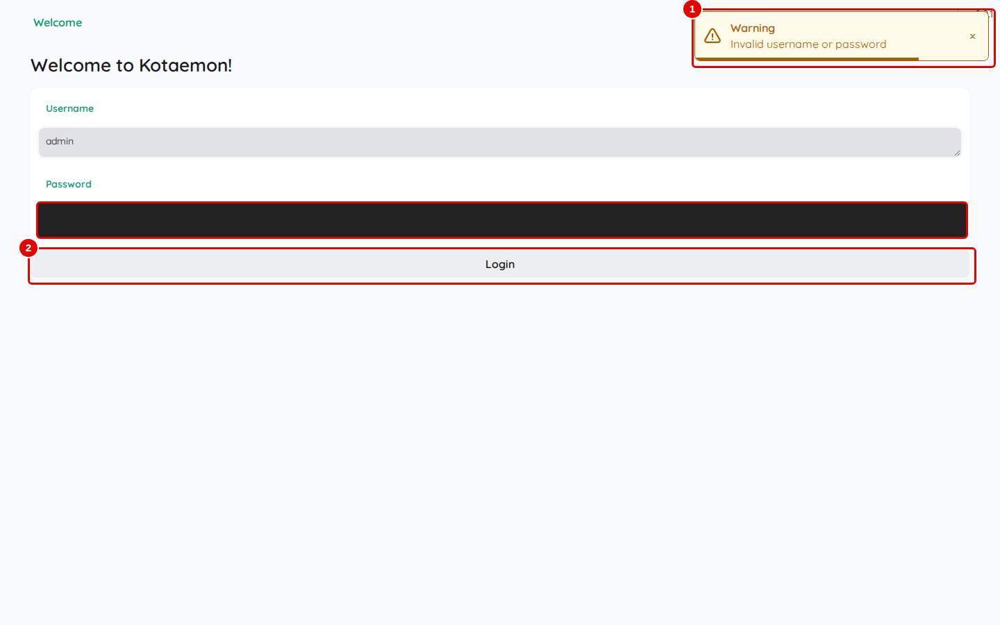
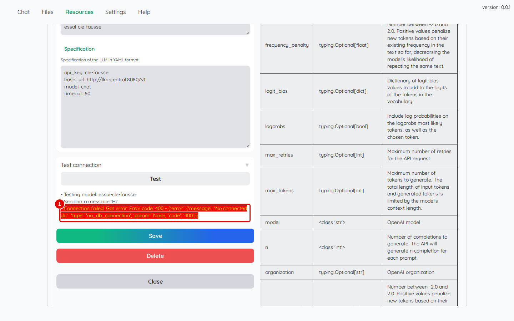
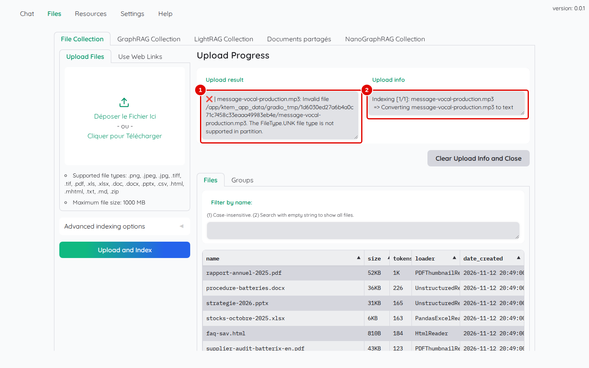
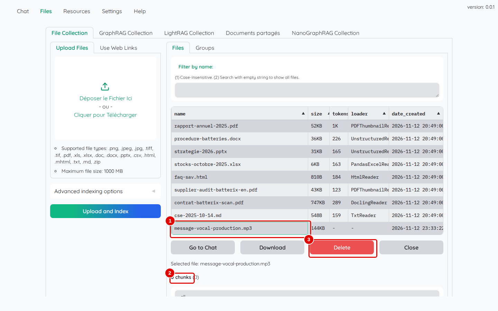
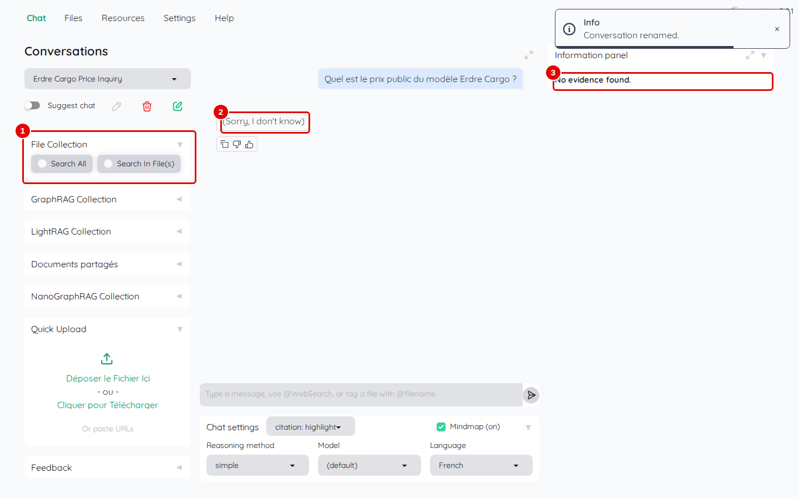
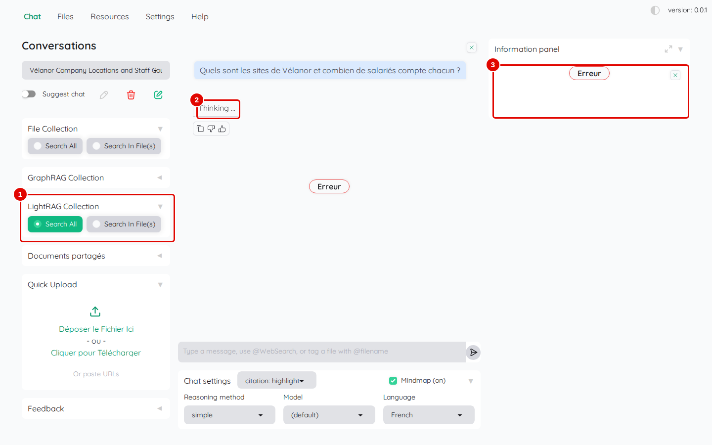
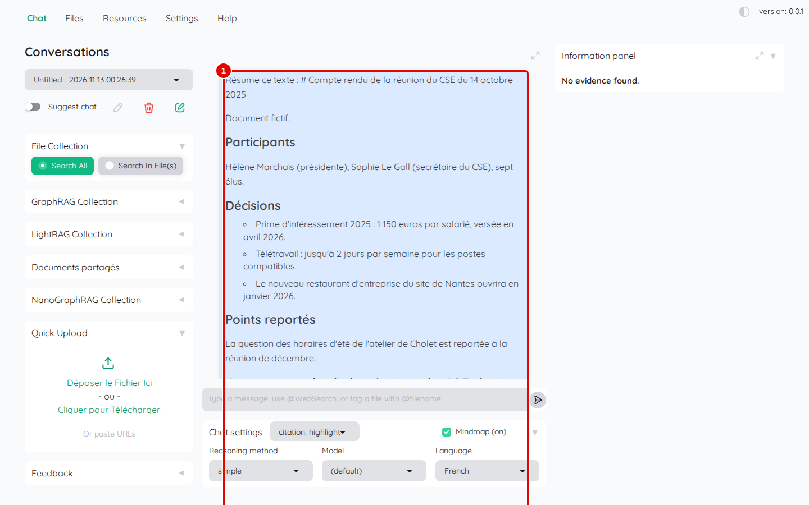
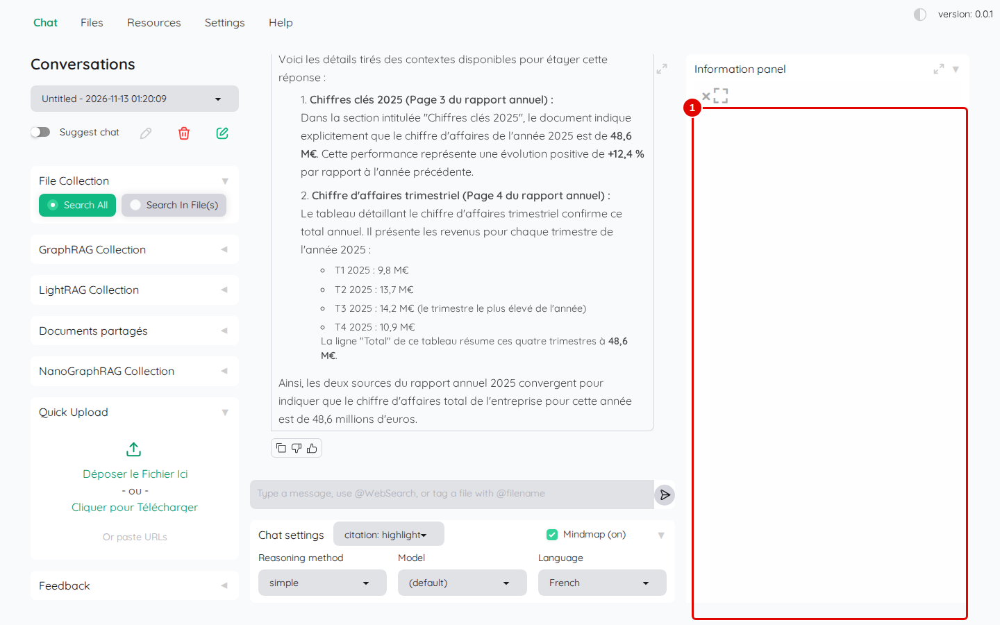

# 13. En cas de problème

> Ce chapitre rassemble les problèmes rencontrés pendant la rédaction de ce manuel, chacun avec l'écran observé, sa cause et son remède.
> **Point de départ** : Kotaemon ouvert ; terminal Ubuntu ouvert dans le dossier du dépôt pour les remèdes en ligne de commande.
> **Durée** : à la demande. **Avant** : chapitres 02 à 04.

## Ce qu'il faut savoir

Kotaemon affiche peu d'erreurs à l'écran : souvent, la réponse reste sur « Thinking ... » ou rien ne se passe. Le **journal du conteneur** donne alors la cause :

```bash
docker logs --tail 100 rag-kotaemon
```

Les lignes qui commencent par `Traceback` ou qui contiennent `Error` décrivent l'erreur. La santé du service de modèles se vérifie avec `outils/communs/llm_central_sante.sh --essai` (chapitre 02, étape 5).

## Connexion refusée

**Étape 1. Reconnaître un mot de passe refusé**
*Où* : onglet « Welcome ».


*Écran : « Welcome », après un mauvais mot de passe.*

| N° | Élément | Rôle |
|---|---|---|
| 1 | message d'erreur | « Invalid username or password » |
| 2 | « Login » | nouvel essai |

*Résultat* : vérifier le mot de passe choisi au chapitre 03 (le mot de passe `admin` ne vaut plus). Un mot de passe oublié se remplace par un autre administrateur (chapitre 11, étape 2) ; s'il n'y en a pas d'autre, il n'existe pas de procédure dans l'interface.

## Modèle injoignable ou clé refusée

**Étape 2. Lire l'échec d'un test de connexion**
*Où* : « Resources » › « LLMs » › « View » › fiche du modèle › « Test connection » › « Test ».


*Écran : fiche d'un modèle déclaré avec une clé fausse, après le test.*

| N° | Élément | Rôle |
|---|---|---|
| 1 | « Connection failed » | « Error code: 400 … 'No connected db.' » : le service de modèles ne reconnaît pas la clé |

*Résultat* : avec une clé fausse, le service de modèles répond ce message, peu explicite ; avec une adresse fausse ou un service arrêté, le message parle de connexion (« RetryError », « Connection error »). Corriger `api_key` (ou `cohere_api_key` pour le tri) et `base_url` dans « Specification », cliquer sur « Save », refaire le test (chapitre 03, étape 7).

## Fichier refusé

**Étape 3. Reconnaître un format non lu**
*Où* : « Files » › « File Collection » › « Upload Files », après « Upload and Index ».


*Écran : « Upload Progress » après l'ajout d'un fichier MP3.*

| N° | Élément | Rôle |
|---|---|---|
| 1 | « Upload result » | croix rouge : « The FileType.UNK file type is not supported in partition. » |
| 2 | « Upload info » | étape où la lecture a échoué (« Converting … to text ») |

*Résultat* : Kotaemon ne lit pas l'audio ni la vidéo. Transcrire l'enregistrement ailleurs et ajouter le texte obtenu (fichier `.txt` ou `.md`).

**Étape 4. Retirer le fichier en échec**
*Où* : « Files » › « File Collection » › sous-onglet « Files » ; cliquer sur la ligne du fichier.


*Écran : fiche du fichier MP3 en échec.*

| N° | Élément | Rôle |
|---|---|---|
| 1 | `message-vocal-production.mp3` | le fichier reste inscrit malgré l'échec |
| 2 | « 0 chunks » | aucun passage : le fichier ne sert à rien |
| 3 | « Delete » | le retire (sans confirmation) |

*Résultat* : le fichier disparaît de la liste. Sans ce retrait, un nouvel essai d'ajout répond « File … already indexed. Please rerun with reindex=True to force reindexing. ». Même chose pour un DOCX ou un PPTX en échec avec « HTTP Error 403: Forbidden » : relancer `outils/kotaemon/installer.sh` (il fournit les données manquantes), puis relire le fichier avec « Force reindex file » (chapitre 05, étape 9).

## Réponse sans document

**Étape 5. Reconnaître une question posée sans collection**
*Où* : « Chat », nouvelle conversation, aucun choix dans « File Collection ».


*Écran : « Chat », question posée sans « Search All » ni « Search In File(s) ».*

| N° | Élément | Rôle |
|---|---|---|
| 1 | « File Collection » sans choix | aucune collection consultée |
| 2 | réponse | « (Sorry, I don't know) » |
| 3 | « Information panel » | « No evidence found. » |

*Résultat* : choisir « Search All » (chapitre 04, étape 6) et reposer la question.

## Réponse bloquée sur « Thinking ... »

**Étape 6. Reconnaître une réponse qui n'arrive pas**
*Où* : « Chat ».


*Écran : « Chat », réponse restée sur « Thinking ... » pendant dix minutes.*

| N° | Élément | Rôle |
|---|---|---|
| 1 | « LightRAG Collection (Search All) » | collection interrogée |
| 2 | réponse | « Thinking ... » sans fin |
| 3 | « Information panel » | « Erreur » ou vide |

*Résultat* : trois causes ont été rencontrées :

- la notation par le modèle (« Use LLM relevant scoring ») avec 10 passages : dix demandes simultanées, le service de modèles en refuse une partie (« Too many requests », erreur 429 dans le journal) ; décocher l'option (chapitre 03, étape 11) ;
- une collection en graphe dont le graphe n'a pas été construit (cas de la capture : pièce `pipmaster` manquante) ; voir le chapitre 09 ;
- une question de suite envoyée avant la fin de la réponse précédente : attendre que la conversation ait reçu son nom (chapitre 12, cas 2).

Dans tous les cas, recharger la page, ouvrir une nouvelle conversation et reposer la question.

## Question trop longue

**Étape 7. Reconnaître une question qui dépasse la limite**
*Où* : « Chat », question collée de plusieurs dizaines de pages.


*Écran : « Chat », question de plus de 80 000 caractères.*

| N° | Élément | Rôle |
|---|---|---|
| 1 | question | texte collé dans la zone de saisie, aucune réponse en dessous |

*Résultat* : aucune réponse n'arrive et le panneau affiche « No evidence found. » ; le journal montre une erreur de la recherche par mots (« LanceError(IO): sql parser error »). Le modèle accepte au plus 16 384 jetons par question, réponse comprise : un long texte s'ajoute comme document (chapitre 05), puis s'interroge par des questions courtes.

## Visionneuse PDF vide

**Étape 8. Reconnaître la visionneuse vide**
*Où* : « Information panel » › « [Preview] ».


*Écran : visionneuse PDF ouverte, sans contenu.*

| N° | Élément | Rôle |
|---|---|---|
| 1 | visionneuse | cadre vide |
| 2 | croix | referme la visionneuse |

*Résultat* : la visionneuse charge son composant d'affichage depuis un site public (`cdn.skypack.dev`) qui, depuis peu, renvoie une erreur au lieu du composant : le défaut touche toute installation de Kotaemon 0.12.0, pas seulement ce poste. Vérifier la source avec la vignette de la page et le texte surligné du panneau d'information (chapitre 04, étape 8).

## Autres problèmes rencontrés

| Symptôme | Cause | Que faire |
|---|---|---|
| la réponse est en anglais | langue de la conversation sur « English » | « Chat settings » › « Language » › `French` (chapitre 04) |
| réglages revenus aux valeurs par défaut après la création d'une collection | réglages enregistrés incomplets | refaire les réglages et « Save & Close » (chapitre 10, étape 4) |
| un groupe ne trouve plus un fichier | fichier relu avec « Force reindex file » | remettre le fichier dans le groupe (chapitre 05, étapes 15 et 16) |
| « (Sorry, I don't know) » alors que la réponse existe | réponse vide du modèle, plus fréquente en « citation: inline » | reposer la question ; « citation: highlight » |
| l'alerte de faible pertinence n'apparaît jamais | la notation par le modèle échoue sans message | ne pas compter sur cette alerte ; lire les notes de tri (chapitre 06, étape 6) |
| PDF scanné sans réponse | lecteur intégré sans lecture optique | lecteur Docling (chapitre 05, étapes 12 et 13) |
| la page ne s'affiche plus après l'installation de NanoGraphRAG | conflit de bibliothèques | relancer `outils/kotaemon/installer_nanographrag.sh` (chapitre 09) |
| `ollama: not found` dans le journal au démarrage | Ollama absent de l'image « full » | sans conséquence |

---
*Version décrite : Kotaemon 0.12.0, essais du 12 et 13 novembre 2026. Détails et preuves : [rapport d'essais](../annexes/A6-rapport-d-essais.md).*
